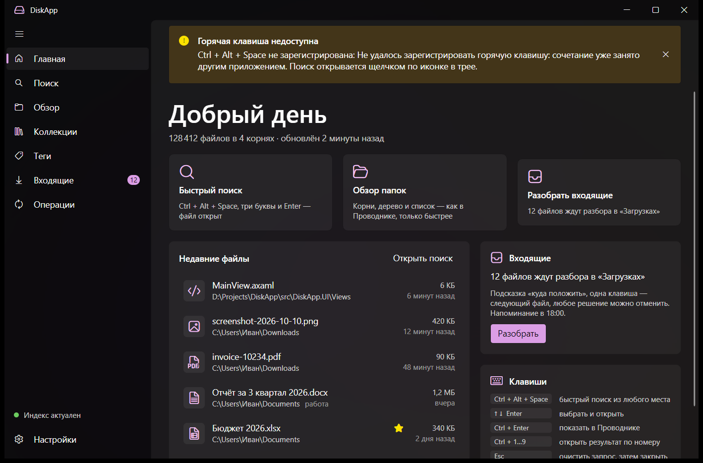
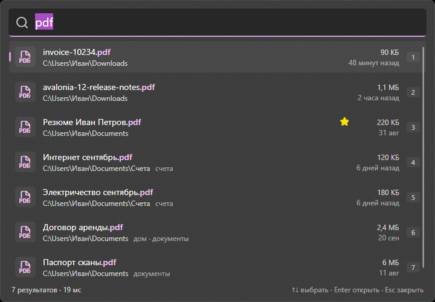
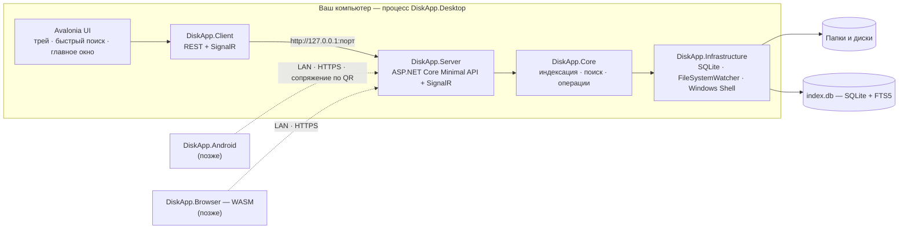
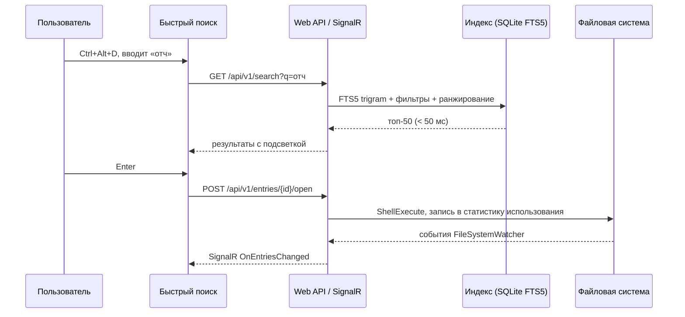

# DiskApp

[](https://github.com/IichiKohuro/DiskApp/actions/workflows/ci.yml)


[](LICENSE)

> Файлы под рукой. Приложение живёт в системном трее и по горячей клавише находит, открывает, добавляет и сохраняет файлы в ваших рабочих папках и дисках — без блужданий по Проводнику.

**Статус:** этапы 0–5 завершены, этапы 6–10 сделаны в коде и ждут ручного прогона чеклистов, сделан первый срез разбора (страница «Разбор»). 2026-10-11 план пересмотрен по [видению пользователя](docs/VISION.md); сделаны щелчки по значку в трее, хоткеи окон и окно Drag&Drop с броском в накопитель (этап 18), карточка рабочей папки (17.2), авто-теги папок (этап 19) и очередь новых файлов в накопителях (17.1), дальше — шаблоны имён и авторазбор (17.5). Последняя сборка — v0.6.2 alpha, подробности в разделе [Статус](#статус). Документ описывает целевое состояние продукта; что уже работает, отмечено отдельно.
Пошаговый план разработки — в [PLAN.md](PLAN.md). Репозиторий — [github.com/IichiKohuro/DiskApp](https://github.com/IichiKohuro/DiskApp).

---

## Содержание

- [Статус](#статус)
- [Идея](#идея)
- [Принципы](#принципы)
- [Возможности](#возможности)
- [Интерфейс](#интерфейс)
- [Горячие клавиши](#горячие-клавиши)
- [Синтаксис поиска](#синтаксис-поиска)
- [Архитектура](#архитектура)
- [Технологический стек](#технологический-стек)
- [Платформы](#платформы)
- [Структура репозитория](#структура-репозитория)
- [Быстрый старт для разработчика](#быстрый-старт-для-разработчика)
- [Данные и настройки](#данные-и-настройки)
- [Разработка](#разработка)
- [Дорожная карта](#дорожная-карта)
- [Лицензия](#лицензия)

---

## Статус

**Этапы 0–5 завершены (2026-10-11).** Готовы окружение, каркас решения (7 проектов в `src/`, 7 в `tests/`), CI, технические спайки с решениями в ADR, прототип интерфейса на макетных данных, модель домена, SQLite-хранилище, настройки, полноценная индексация (сканер, сверка, наблюдатель за изменениями, оркестратор) поиск по индексу с фильтрами, ранжированием и нечёткими совпадениями и локальный сервер внутри процесса (REST API, события SignalR, файловые операции) и клиентская библиотека к нему. Этап 6 (оболочка: трей с паузой и состоянием индексации, горячая клавиша из настроек, автозапуск, запоминание окна) сделан и ждёт ручного прогона чеклиста. На этапе 7 быстрый поиск перешёл на настоящий индекс и получил действия над файлами, иконки Windows и миниатюры, чипы фильтров, подсказки и перетаскивание; он тоже ждёт ручного прогона. Этап 8 дал главное окно на настоящих данных: «Обзор» с деревом и плиткой, «Операции» с отменой, окно «Добавить», «Коллекции» и «Теги», экспериментальный Quick Switch. Этап 9 — настройки с разделами и применением без перезапуска, русский и английский интерфейс, мастер первого запуска с подсказками, доступность (Экранный диктор, высокая контрастность, масштаб 150 %) и диагностика (окно ошибки с архивом, `--safe-mode`, журнал в настройках). Этап 10 — производительность (все бюджеты, кроме размера БД), надёжность (резервная копия настроек, перепроверка корней после сна, таймаут сетевых корней, поиск имён в форме NFD) и повторная проверка безопасности локального режима. Разделы ниже описывают целевое состояние продукта; что уже есть — в таблице.

| Что | Состояние |
|---|---|
| Главное окно в стиле Windows 11 (`FAAppWindow`, Mica, `NavigationView`) | ✅ на настоящих данных: главная, поиск, «Обзор», «Операции», «Коллекции», «Теги», настройки с разделами; мастер первого запуска, подсказки, «Что нового» |
| Окно быстрого поиска: Acrylic, скруглённые углы, подсветка совпадений, клавиатура, `Ctrl+1…9` | ✅ на настоящем индексе: секции пустого запроса, ход индексации, действия над файлом с клавиатуры и из контекстного меню (Проводник, «Открыть с помощью», свойства, копирование, закрепление, переименование, корзина); иконки Windows и миниатюры, чипы фильтров, подсказки и история, справка по `?`, перетаскивание |
| Трей с меню, глобальная горячая клавиша с запасными сочетаниями, один экземпляр, аргументы запуска, журнал | ✅ работает; пауза индексации и состояние в трее, сочетание из настроек, автозапуск (этап 6) |
| Домен (корни, записи, виды файлов, пути, запросы), интерфейсы инфраструктуры, шина событий | ✅ `DiskApp.Core` |
| SQLite: схема с FTS5, миграции, один писатель, восстановление, репозитории; настройки в JSON; папки данных | ✅ `DiskApp.Infrastructure`; база открывается при старте десктопа |
| Индексация: параллельный сканер, mark-and-sweep, сверка по разнице, наблюдатель со склейкой событий, очередь задач по дискам, пауза, недоступные корни | ✅ `DiskApp.Core` + `DiskApp.Infrastructure`; в приложении запустится вместе с сервером на этапе 4 |
| Поиск: парсер запроса с фильтрами на RU и EN, FTS5 trigram и префиксы, фильтр по папкам, ранжирование с пресетами, нечёткие совпадения, подсветка, кэш уточнения, подсказки и история | ✅ `DiskApp.Core` + `DiskApp.Infrastructure`; в приложении — через API на этапе 4 |
| Сервер внутри десктопа: REST API корней, поиска, записей, избранного, тегов, коллекций, настроек и операций; хаб SignalR с пакетами событий; OpenAPI и Scalar при разработке; защита локального режима | ✅ `DiskApp.Server`, `DiskApp.Contracts`; запускается вместе с десктопом |
| Файловые операции: копирование, перемещение, переименование, удаление в корзину, создание; конфликты, отмена, возврат результата | ✅ `DiskApp.Core`; корзина Windows подключена (этап 7.3), на сетевых и съёмных дисках удаление отклоняется |
| Клиент: типизированный REST-клиент с повторами только для GET и прогрессом загрузки, клиент хаба с переподключением и буфером событий | ✅ `DiskApp.Client`; зарегистрирован в десктопе |
| Окна на настоящих данных вместо макета | ✅ все окна (этапы 7–8) |
| Обзор, файловые операции, «Добавить», Quick Switch для диалогов «Сохранить как», коллекции и теги | ✅ этап 8 (Quick Switch — экспериментальный, выключен по умолчанию) |
| Настройки, RU и EN, онбординг, доступность, диагностика и безопасный режим | ✅ этап 9 |
| Производительность, надёжность и безопасность локального режима | ✅ этап 10: бюджеты (кроме размера БД), резервная копия настроек, перепроверка корней после сна и возврата в сеанс, таймаут сетевых корней, поиск имён в форме NFD, повторная проверка безопасности; 48-часовой soak и ручной чеклист — за пользователем |
| Разбор: папки-накопители («Загрузки», Skype) → рабочие папки с подпапкой, тегами и новым именем, поиск по всем папкам | 🔄 этап 17: страница «Разбор» (срез 17.0), карточка рабочей папки (17.2), очередь новых файлов — время ожидания загрузки, «отложить» и «оставить здесь», подпапки, автообновление (17.1); шаблоны имён с авторазбором и подсказки — дальше |
| Трей: щелчок — окно Drag&Drop («бросить в накопитель»), двойной щелчок — главное окно, свои хоткеи | ✅ этап 18.1–18.2: щелчки, хоткеи `Ctrl+Alt+O` и `Ctrl+Alt+B`, бросок в основную папку-накопитель с отменой; область «Разложить по рабочей папке» — после 1.0 |
| Авто-теги рабочих папок (наследуются всеми файлами внутри, текущими и новыми) | 🔄 этап 19: авто-теги в карточке рабочей папки и в «Обзоре», `tag:` с авто-тегами, унаследованные чипы, «Получат авто-теги» на «Разборе»; запросы только из `tag:` на 1 млн записей — 64–124 мс при бюджете 50 мс, ускорение — 19.5 |
| История файлов: что и когда случилось с файлом, в том числе в Проводнике, с возвратом на место | ⬜ этап 20 |
| Уведомления и напоминания: умное напоминание о разборе, свои напоминания | ⬜ этап 21 |
| Установщик и обновления | ⬜ этап 11 |

Замер бюджетов на текущем коде (2026-10-11, этап 10.2, `scripts/measure.ps1`: Intel Core Ultra 7 155H, 32 ГБ, NVMe SSD, Windows 11, сборка self-contained с ReadyToRun, корень на 20 тыс. файлов):

| Метрика | Бюджет | Замер |
|---|---|---|
| Старт до трея: первый запуск / тёплый | < 2 с / < 1 с | ✅ 792 мс / 662 мс |
| Показ окна поиска: первый / следующие | < 100 мс | ✅ 53 мс / 14 мс |
| Поиск p95 на 1 млн записей: сервис / через API | < 50 / < 60 мс | ✅ 47,8 / 54,5 мс |
| Память в простое (Диспетчер задач) | < 150 МБ | ✅ 69 МБ в трее, 93 МБ после главного окна — программный рендеринг по умолчанию ([ADR-0009](docs/ADR/0009-software-rendering-by-default.md)) |
| CPU в простое | ≈ 0 % | ✅ 0,04 % |
| Индексация | ≥ 2 000 файлов/с | ✅ 5 400 в приложении, 25 000 в сканере |
| Размер БД на 1 млн записей | ≤ 450 МБ (пересмотрен, [ADR-0010](docs/ADR/0010-vision-priorities-and-budgets.md)) | ✅ 408 МБ |

Подробности, история замеров и профили — [ARCHITECTURE](docs/ARCHITECTURE.md), раздел 16.

Замеры этапов 0–4 (2026-10-10…11, ноутбук разработчика: Windows 11, 22 CPU, SSD, .NET 10.0.12, Release):

| Метрика | Бюджет | Замер | Где подробнее |
|---|---|---|---|
| Старт до иконки в трее, тёплый | < 1 с | 917 мс | [ADR-0003](docs/ADR/0003-tray-hotkey-single-instance.md) |
| Показ окна поиска по хоткею | < 100 мс | 82 мс первый раз, 1 мс далее | [ADR-0002](docs/ADR/0002-windows11-shell-in-avalonia.md) |
| Второй экземпляр: передать аргументы и выйти | — | ≈ 50 мс | [ADR-0003](docs/ADR/0003-tray-hotkey-single-instance.md) |
| Старт Kestrel + SignalR внутри процесса | — | 138 мс, +17 МБ | [ADR-0004](docs/ADR/0004-kestrel-in-process.md) |
| Вызов по loopback: HTTP / SignalR, медиана | — | 0,12 / 0,16 мс | [ADR-0004](docs/ADR/0004-kestrel-in-process.md) |
| Поиск p95 на 1 млн записей, полный `SearchService` (20 видов запросов) | < 50 мс | 1,9–44,5 мс | [ARCHITECTURE](docs/ARCHITECTURE.md), раздел 16 |
| Поиск p95 через API по loopback, 1 млн записей | < 60 мс | 4,1–45,6 мс | [ARCHITECTURE](docs/ARCHITECTURE.md), раздел 16 |
| 100 одновременных поисков через API | p95 < 60 мс | ⚠️ 460 мс — оптимизация на этапе 10 | [ARCHITECTURE](docs/ARCHITECTURE.md), раздел 16 |
| Старт с сервером внутри процесса: трей / сервер готов | < 1 с / — | 878 мс / 1 039 мс (Debug) | [ARCHITECTURE](docs/ARCHITECTURE.md), раздел 3 |
| Размер БД на 1 млн записей, реальная схема | ≤ 250 МБ | ⚠️ 389 МБ при прежнем бюджете; бюджет пересмотрен до 450 МБ (ADR-0010) | [ADR-0007](docs/ADR/0007-integer-dates-and-db-size.md) |
| Заполнение индекса, 1 млн записей | — | 7,7 с (129 тыс. строк/с) | [ADR-0005](docs/ADR/0005-fts5-trigram-index-layout.md) |
| Репозиторий: вставка 100 тыс. записей пакетами | ≤ 5 с | 4,07 с | [ARCHITECTURE](docs/ARCHITECTURE.md), раздел 16 |
| Репозиторий: переименование поддерева на 50 тыс. записей | ≤ 200 мс | 184 мс | [ARCHITECTURE](docs/ARCHITECTURE.md), раздел 16 |
| Индексация 100 тыс. файлов с нуля | ≤ 60 с | 4,5 с, пик памяти +79 МБ | [ARCHITECTURE](docs/ARCHITECTURE.md), раздел 16 |
| Отражение изменения файла в индексе | ≤ 1 с | меньше 1 с | [ARCHITECTURE](docs/ARCHITECTURE.md), раздел 16 |

Тестов 901 (`dotnet test`), CI проверяет каждый коммит в `main`. Текущая позиция и журнал плана — в [PLAN.md](PLAN.md); полная таблица замеров — в [docs/ARCHITECTURE.md](docs/ARCHITECTURE.md), раздел 16.

## Идея

Проводник хорош для редких задач и плох для ежедневных. Нужная папка каждый раз в трёх кликах, встроенный поиск Windows медленный и непредсказуемый, а «сохранить в ту самую папку» превращается в прогулку по дереву каталогов.

DiskApp подходит к задаче иначе:

1. Вы указываете **корни** — папки или целые диски, с которыми реально работаете.
2. Приложение строит **локальный индекс** (SQLite + FTS5) и поддерживает его в актуальном состоянии, следя за изменениями файловой системы.
3. По **горячей клавише** всплывает окно быстрого поиска: три буквы, `Enter` — файл открыт.
4. Из того же окна файл можно показать в Проводнике, скопировать, переместить, переименовать, отправить в корзину, добавить в избранное или перетащить в другое приложение.
5. Файлы и содержимое буфера обмена можно **добавить** в нужную папку перетаскиванием, через меню «Отправить» или контекстное меню Проводника.
6. При **сохранении** из любой программы DiskApp подсказывает нужную папку и умеет направить стандартный диалог «Сохранить как» прямо в неё.
7. Файлы отовсюду — Skype, почта, браузер — сбрасываются в **папки-накопители** вроде «Загрузок». DiskApp держит их под присмотром и в удобный момент помогает **разобрать**: каждый файл одной клавишей переносится в свою **рабочую папку** (в подпапку, с тегами и новым именем), подсказки показывают куда, любое решение отменяется.

Ядро приложения — локальный сервис (Web API + SignalR). Десктопный интерфейс общается с ним так же, как позже будут общаться Android- и веб-клиенты: один API, одна логика, разные экраны.

## Принципы

- **Клавиатура прежде всего.** Любой сценарий выполняется без мыши; мышь не хуже, но не обязательна.
- **Сначала удобство, потом красота, потом оптимизация.** Порядок приоритетов из [видения](docs/VISION.md): нужная функция не ждёт оптимизации.
- **Не перегружать.** На виду то, чем пользуются каждый день; редкое — за кнопкой «Ещё» или в свёрнутой панели.
- **Автоматизировать всё, что можно.** Авто-теги, авторазбор по шаблонам, напоминания в удобный момент.
- **Скорость измеряется.** Бюджеты производительности зафиксированы и проверяются (см. ниже) — как сигнал регресса, а не запрет функции.
- **Всё локально.** Индекс, настройки и статистика хранятся на вашем компьютере. Телеметрии нет. Сеть выключена, пока вы сами её не включите.
- **Родной вид Windows 11.** Mica/Acrylic, скруглённые углы, системный акцентный цвет, светлая и тёмная темы, Segoe UI Variable и Fluent-иконки.
- **Один API для всех клиентов.** Десктоп, Android и Web — тонкие клиенты над одним сервером.
- **Ничего не ломать.** Удаление — только в корзину, переименование и перемещение отменяются, конфликты решает пользователь.

### Бюджеты производительности (цели v1.0)

| Метрика | Цель |
|---|---|
| Появление окна быстрого поиска по хоткею | < 100 мс |
| Поиск (p95) по индексу в 1 000 000 записей | < 50 мс |
| Старт до появления иконки в трее | < 1 с (холодный старт < 2 с) |
| Память в простое | < 150 МБ |
| Нагрузка на CPU в простое | ≈ 0 % |
| Скорость первичной индексации (SSD) | ≥ 2 000 файлов/с |
| Отражение изменения файла в индексе | ≤ 1 с |

## Возможности

### Версия 1.0 (MVP)

**Трей и запуск**
- Старт свёрнутым в трей, автозапуск с Windows, запоминание состояния.
- Значок в трее: щелчок — окно Drag&Drop, двойной щелчок — главное окно, правый щелчок — меню (открыть, быстрый поиск, окно Drag&Drop, пауза индексации, настройки, выход). У главного окна и окна Drag&Drop свои глобальные хоткеи. Иконка отражает состояние (простой / индексация / пауза / ошибка) и число неразобранных файлов.
- Окно Drag&Drop: брошенные файлы падают в основную папку-накопитель (как в Проводнике: на том же диске переносятся, с другого копируются; `Shift` и `Ctrl` меняют действие), с отменой. Вторая область — перенос сразу в рабочую папку с подпапкой, именем и тегами (после 1.0).
- Один экземпляр приложения; повторный запуск передаёт команду уже работающему (`--search`, `--add`, `diskapp://`).
- Глобальная горячая клавиша (по умолчанию `Ctrl+Alt+D`), настраиваемая, с проверкой конфликтов и запасными сочетаниями.

**Корни и индекс**
- Любое число корней: папки и целые диски, включая съёмные и сетевые (с оговорками).
- Правила исключений: glob-шаблоны, скрытые и системные объекты, глубина, стандартные исключения (`$RECYCLE.BIN`, `node_modules`, `.git`, …).
- Первичное сканирование с прогрессом, слежение через `FileSystemWatcher`, периодическая сверка, пауза и возобновление, пересборка индекса.
- Корректная работа с junction/символическими ссылками, длинными путями, файлами OneDrive «по запросу» (без их скачивания), отключаемыми дисками.

**Быстрый поиск**
- Поиск по мере ввода с подсветкой совпадений, нечёткое совпадение, фильтры (`ext:`, `type:`, `in:`, `size:`, `modified:`, `tag:`, …).
- Ранжирование: точность совпадения + частота и давность использования (frecency) + избранное + свежесть изменений.
- Пустой запрос показывает недавние и избранные файлы; история запросов.
- Действия из результатов: открыть, открыть с помощью, показать в Проводнике, свойства, копировать путь/файл, переименовать, в корзину, запустить от администратора.
- Перетаскивание результатов в другие приложения и файлов из других приложений в DiskApp.

**Главное окно**
- Главная: недавние, закреплённые, недавно изменённые, состояние корней.
- Обзор: дерево + список/плитка с виртуализацией, сортировка, группировка, панель сведений, адресная строка.
- Файловые операции: копировать, переместить, переименовать, создать, в корзину — с очередью, прогрессом, отменой, разбором конфликтов и `Ctrl+Z`.
- Избранное, теги, коллекции (ручные и сохранённые запросы).

**Добавить и сохранить**
- Зона для перетаскивания с выбором целевой папки (недавние цели, избранное, поиск по папкам).
- Пункт «Добавить в DiskApp» в меню «Отправить» и контекстном меню Проводника.
- Буфер обмена в файл: текст → `.txt`/`.md`, изображение → `.png` в выбранную папку с шаблоном имени.
- Quick Switch для диалогов «Открыть / Сохранить как» (экспериментально): выбрали папку в DiskApp — системный диалог перешёл в неё.

**Разбор входящих**
- Папки-накопители («Загрузки», «Мои полученные файлы» Skype, любые другие, список настраивается, одна — основная). Новые файлы ждут разбора, как только загрузка завершена; временные файлы игнорируются.
- Рабочие папки (TCI2, 417, Soft — какие нужны): номера 1–9, авто-теги, шаблоны имён. Разбор на странице «Разбор»: выбрали файлы → рабочая папка → подпапка (в том числе новая), новое имя или шаблон, теги → «Перенести», с отменой.
- **Авто-теги:** теги рабочей папки (и любой её подпапки) наследуют все файлы внутри — и текущие, и новые; файл, вынесенный из папки, тег теряет. Поиск `tag:` находит и такие файлы.
- **Авторазбор:** файлы, имя которых совпадает с шаблоном рабочей папки (`417_*`), раскладываются сами или предлагаются первыми; шаблон создаётся из решения одним действием, есть сухой прогон и отмена.
- Подсказки рядом с выбором папки: шаблон, история ваших решений по расширению и словам имени, недавние; объяснение рядом с каждой подсказкой.
- При разборе ничего не удаляется само; всё, что сделал авторазбор, видно в истории файлов.

**История файлов**
- Что, когда и откуда случилось с файлом: создан, переименован, перемещён, удалён в корзину, получил теги, разобран — через DiskApp или в Проводнике.
- Потерянный файл находится по прежнему имени («перемещён в …», «в корзине с 12.10») и возвращается на место одним действием.

**Уведомления и напоминания**
- Один модуль для всего приложения: значок в трее, тихая карточка у области уведомлений без звука, полоса в главном окне. Общие лимиты, часы тишины, «Не беспокоить» Windows.
- Умное напоминание о разборе накопителей: приходит, когда вы вернулись к компьютеру и не заняты; «Отложить» — «напомни, когда освобожусь».
- Свои напоминания: «напомни про этот файл в пятницу».

**Настройки и качество**
- Корни и исключения, поиск, горячие клавиши, внешний вид (тема, фон Mica/Acrylic, акцент), поведение, интеграции, данные, диагностика.
- Русский и английский интерфейс, онбординг при первом запуске, доступность (клавиатура, экранные дикторы, высокий контраст).
- Установщик с автообновлением и портативная версия.

**Резервное копирование**
- Настраиваемые копии базы индекса и настроек: вручную, по расписанию, при выходе и автоматически перед миграциями и пересборкой индекса. Снимок делается через SQLite Backup API, не останавливая работу.
- Несколько назначений (локальная папка, папка облачной синхронизации, сетевой путь), правила хранения, шифрование по желанию, проверка целостности и восстановление в один клик, экспорт метаданных в JSON для переноса на другую машину.

### После 1.0

- **v1.x:** панель предпросмотра (изображения, текст и код, Markdown, PDF, миниатюры Office), поиск по содержимому, поиск дубликатов и анализ занятого места, умные коллекции, быстрая индексация целых NTFS-дисков через USN Journal, расширяемые действия, задания резервного копирования файлов (зеркало, версии, снимки) с инкрементальными запусками на основе индекса, проверка Linux/macOS.
- **v2.x:** безопасный удалённый доступ по локальной сети (HTTPS, сопряжение по QR, права на устройство), Android-клиент (поиск и скачивание файлов с ПК, загрузка фото во «Входящие»), веб-клиент на Avalonia Browser, который раздаёт сам сервер.

## Интерфейс

Прототип интерфейса на макетных данных (Windows 11, тёмная тема, системный акцент):





Что задумано целиком — словами:

- **Окно быстрого поиска.** Безрамочное, поверх всех окон, в верхней трети экрана, фон Acrylic, скруглённые углы. Поле ввода крупным шрифтом, под ним список результатов с иконками, путями и бейджами, внизу строка состояния (количество, время, состояние индекса). Закрывается по `Esc` или при потере фокуса.
- **Окно Drag&Drop.** Небольшое окно у значка в трее, поверх всех окон, не прячется, пока вы берёте файлы в Проводнике. Область «Бросить в накопитель» с подписью действия («Переместить в „Загрузки“»), итог с отменой; позже — вторая область «Разложить по рабочей папке».
- **Страница «Разбор».** Слева накопители и их файлы, справа рабочие папки на клавишах 1–9, подпапки, имя, теги и «Перенести»; рекомендуемая папка подсвечена и подписана причиной.
- **Главное окно.** `NavigationView` слева (на виду — Главная, Поиск, Разбор, Обзор, История; Коллекции и Теги — в «Ещё»; Настройки), собственный заголовок окна поверх Mica, панель команд, строка навигации (breadcrumb), панель сведений справа, `InfoBar` с состоянием индекса.
- **Настройки.** Страницы в стиле «Параметров» Windows 11 (`SettingsExpander`), применяются сразу, без перезапуска.

## Горячие клавиши

Значения по умолчанию, все настраиваются.

| Клавиши | Действие |
|---|---|
| `Ctrl+Alt+D` | Показать/скрыть быстрый поиск (глобально); если занято — `Ctrl+Alt+F`, затем `Ctrl+Alt+Space`, действующее сочетание показано в настройках |
| `Ctrl+Alt+O` | Показать/скрыть главное окно (глобально); если занято — `Ctrl+Alt+W`, затем `Ctrl+Alt+M`. Открывает его и двойной щелчок по значку в трее |
| `Ctrl+Alt+B` | Показать/скрыть окно Drag&Drop (глобально); если занято — `Ctrl+Alt+J`, затем `Ctrl+Alt+X`. Открывает его и щелчок по значку в трее |
| `↑` `↓` `PgUp` `PgDn` | Навигация по результатам |
| `Enter` | Открыть |
| `Ctrl+Enter` | Показать в Проводнике |
| `Shift+Enter` | Открыть с помощью… |
| `Alt+Enter` | Свойства |
| `Ctrl+C` / `Ctrl+Shift+C` | Копировать путь / копировать файл |
| `F2` | Переименовать |
| `Del` | В корзину (с подтверждением) |
| `Ctrl+P` | Панель предпросмотра |
| `Ctrl+Shift+V` | Сохранить буфер обмена как файл |
| `Tab` / `Shift+F10` | Меню действий |
| `Ctrl+1…9` | Открыть результат по номеру |
| `Esc` | Очистить запрос, затем закрыть окно |

На странице «Разбор»:

| Клавиши | Действие |
|---|---|
| `1…9` | Выбрать рабочую папку с этим номером (номера закреплены за папками) |
| `Enter` в списке файлов, `Ctrl+Enter` | Перенести выбранные файлы |
| `Enter` в поиске папок | Выбрать первую найденную папку |
| `Ctrl+Shift+N` | Новая подпапка в выбранной папке (`Enter` — создать, `Esc` — отменить) |
| `Enter` в поле тегов | Добавить тег |
| `F5` | Перечитать накопители |

## Синтаксис поиска

| Запрос | Что найдёт |
|---|---|
| `отчет` | Подстрока в имени (регистр не важен), затем нечёткие совпадения |
| `"годовой отчет"` | Точная фраза |
| `отчет ext:xlsx` | Только файлы `.xlsx` |
| `type:image` | Изображения (`image`, `video`, `audio`, `doc`, `sheet`, `slides`, `pdf`, `archive`, `code`, `exe`, `link`, `folder`; есть русские синонимы: `type:картинки`) |
| `in:Projects` | Внутри любой папки с именем `Projects` или по полному пути (`in:D:\Work`) |
| `root:Документы` | Внутри корня с такой меткой или путём |
| `size:>10mb` | Крупнее 10 МБ (`kb`, `mb`, `gb`, `tb` и `кб`…`тб`; диапазон `size:1mb..5mb`; `size:empty`) |
| `modified:week` | Изменено за неделю (`today`, `yesterday`, `week`, `month`, `year`, `неделя`, `3d`, `2026-03`, `>2026-01-01`, `2026-01..2026-03`); `created:` — так же по дате создания |
| `is:dir` | Только папки (`is:file`, `is:hidden`, `is:cloud`) |
| `fav:` | Только избранное (`is:fav`) |
| `tag:работа` | Помечено тегом — своим или авто-тегом папки выше |
| `-ext:tmp` | Отрицание любого фильтра |
| `/^inv.*\.pdf$/` | Регулярное выражение по имени |

## Архитектура

### Общая схема



### Зачем Web API внутри десктопного приложения

- **Один путь кода для всех клиентов.** Десктоп использует тот же `DiskApp.Client`, что и будущие Android и Web. API проверяется ежедневным использованием, а не отдельными тестами.
- **Сервер отделяем от интерфейса.** Тот же `DiskApp.Server` можно запустить без окна — как службу Windows или headless-процесс.
- **Реальное время бесплатно.** SignalR доставляет прогресс индексации, изменения файлов и ход операций всем подключённым клиентам.
- **Дёшево.** Kestrel слушает только `127.0.0.1` на динамическом порту. По замеру спайка S3 ([ADR-0004](docs/ADR/0004-kestrel-in-process.md)): старт 138 мс и +17 МБ памяти, вызов по loopback 0,1–0,2 мс; сервер стартует параллельно с инициализацией UI и не задерживает появление трея.

### Слои и зависимости

| Проект | Ответственность | Зависит от |
|---|---|---|
| `DiskApp.Core` | Домен: корни, записи, теги, коллекции; разбор запросов, ранжирование, логика сканирования и файловых операций; интерфейсы инфраструктуры | — |
| `DiskApp.Infrastructure` | SQLite (Microsoft.Data.Sqlite + Dapper, миграции, FTS5), файловая система, `FileSystemWatcher`, Windows Shell (открытие, корзина, иконки, миниатюры) | Core |
| `DiskApp.Contracts` | DTO, маршруты API, типизированные интерфейсы SignalR-хаба, JSON source generation | — |
| `DiskApp.Server` | Minimal API, SignalR-хаб, hosted services индексации и операций, OpenAPI, авторизация для удалённого доступа | Core, Infrastructure, Contracts |
| `DiskApp.Client` | Типизированный REST-клиент и обёртка SignalR с переподключением; интерфейс `IDiskAppApi` | Contracts |
| `DiskApp.UI` | Общий Avalonia-интерфейс: ViewModels (CommunityToolkit.Mvvm), Views, стили, локализация | Client |
| `DiskApp.Desktop` | Точка входа: трей, глобальные хоткеи, один экземпляр, автозапуск, запуск сервера внутри процесса | UI, Server |

Интерфейс не ссылается на `Core` напрямую — только через `Client`. Это гарантирует, что любой экран можно показать на Android или в браузере без переделки.

### Поток «нашёл и открыл»



### Индекс

- SQLite в режиме WAL, один писатель (очередь через `System.Threading.Channels`), много читателей.
- Таблицы: `roots`, `entries` (имя, расширение, путь, размер, даты, атрибуты, вид), `entries_fts` (FTS5 с токенизатором `trigram` только по имени файла — поиск подстрок без учёта регистра, включая кириллицу), `usage` (частота и давность открытия), `favorites`, `tags`, `entry_tags`, `collections`, `collection_items`, `meta`.
- Запрос от трёх символов идёт через trigram `MATCH`, один–два символа — префиксом по колонке `name_folded` (имя в нижнем регистре), ранжирование своё, без `bm25`. Так решил спайк S4 ([ADR-0005](docs/ADR/0005-fts5-trigram-index-layout.md)): индекс только по имени на 1 млн записей занимает 161 МБ и заполняется со скоростью 129 тыс. строк/с, вдвое меньше и быстрее, чем с путями; `LIKE` не сворачивает регистр кириллицы, а полный скан на два символа стоит сотни миллисекунд.
- Первичное сканирование: параллельный обход, пакетные вставки по 5–10 тыс. строк в транзакции, маркировка `scan_id` для обнаружения удалённых файлов.
- Инкрементально: события `FileSystemWatcher` склеиваются (debounce), переименование папки обновляет префикс пути одним запросом, переполнение буфера приводит к пересканированию поддерева.

## Технологический стек

| Область | Технология | Назначение |
|---|---|---|
| Платформа | .NET 10 (LTS), C# 14 | Единая среда для сервера, десктопа и будущих клиентов |
| UI | Avalonia UI 12.x, FluentAvaloniaUI 3.x, CommunityToolkit.Mvvm, FluentIcons | Кроссплатформенный интерфейс в стиле WinUI 3 / Windows 11, MVVM |
| Сервер | ASP.NET Core Minimal API, SignalR, встроенный OpenAPI + Scalar | Локальный сервис, реальное время, документация API |
| Данные | SQLite (Microsoft.Data.Sqlite + Dapper), FTS5 `trigram`, SQL-миграции | Индекс, статистика, теги, настройки |
| Файловая система | System.IO, `FileSystemWatcher`, System.IO.Abstractions | Сканирование, слежение, тестируемость |
| Windows | P/Invoke: `RegisterHotKey`, `DwmSetWindowAttribute`, `SHGetFileInfo`, `IShellItemImageFactory`, `IFileOperation` | Хоткеи, скруглённые углы, иконки, миниатюры, корзина |
| Логирование | Serilog (файлы с ротацией) | Диагностика без телеметрии |
| Тесты | xunit.v3 на Microsoft.Testing.Platform, Shouldly, NSubstitute, Avalonia.Headless, BenchmarkDotNet | Модульные, интеграционные, UI, производительность |
| Сборка и поставка | GitHub Actions, `scripts/publish.ps1` (`dotnet publish`: self-contained, single-file, ReadyToRun), позже Velopack | CI, сборка для запуска, установщик, дельта-обновления |

## Платформы

| Платформа | Версия | Роль |
|---|---|---|
| Windows 10/11, x64 и arm64 | v1.0 | Полнофункциональный клиент и локальный сервер |
| Linux, macOS | v1.x (проверка) | Десктоп с теми же функциями; вместо Mica — сплошной фон |
| Android | v2.x | Удалённый клиент к ПК по локальной сети: поиск, скачивание, загрузка во «Входящие» |
| Web (Avalonia Browser, WebAssembly) | v2.x | Удалённый клиент, который раздаёт сам сервер DiskApp |

## Структура репозитория

Структура после этапа 5; папки будущих этапов помечены.

```
DiskApp/
├─ README.md, PLAN.md, CHANGELOG.md, CONTRIBUTING.md, LICENSE, CLAUDE.md
├─ DiskApp.slnx
├─ global.json, Directory.Build.props, Directory.Packages.props, .editorconfig
├─ src/
│  ├─ DiskApp.Core/            домен, пути, интерфейсы, индексация, поиск, файловые операции, шина событий, настройки
│  ├─ DiskApp.Infrastructure/  SQLite (схема, репозитории, исполнение поиска), файловая система, пути, настройки
│  ├─ DiskApp.Contracts/       DTO, маршруты и JSON-контекст API и хаба SignalR
│  ├─ DiskApp.Server/          сервер внутри процесса: Minimal API, хаб SignalR, запуск базы и индексатора
│  ├─ DiskApp.Client/          типизированный REST-клиент и клиент хаба SignalR
│  ├─ DiskApp.UI/              общий Avalonia UI: ViewModels, Views, стили, макет ISearchService
│  ├─ DiskApp.Desktop/         точка входа, оболочка (трей, хоткей, один экземпляр), окна, Win32, иконка
│  ├─ DiskApp.Android/         (v2.x)
│  └─ DiskApp.Browser/         (v2.x)
├─ tests/
│  ├─ DiskApp.Core.Tests/       домен, пути, события, архитектурные правила слоёв
│  ├─ DiskApp.Desktop.Tests/    один экземпляр, протокол канала
│  ├─ DiskApp.Infrastructure.Tests/  SQLite, репозитории, сканер, наблюдатель, индексатор, поиск и golden-тесты, настройки
│  ├─ DiskApp.Server.Tests/     хост, API по loopback, хаб, безопасность, снимки JSON-контрактов, клиент
│  ├─ DiskApp.UI.Tests/         ViewModel, форматирование, headless-представления
│  ├─ DiskApp.Testing/          общие фикстуры тестов
│  └─ DiskApp.Benchmarks/       BenchmarkDotNet, проверка бюджетов сканирования (scan-budget), поиска (search-budget) и поиска через API (api-budget)
├─ docs/                       VISION.md, ARCHITECTURE.md, ADR/, QA_CHECKLIST.md, FEEDBACK.md, images/; USER_GUIDE.md (этап 9)
├─ spikes/                     спайки этапа 0.6 с результатами замеров
├─ scripts/                    publish.ps1 (сборка exe), protect-main.ps1 (защита ветки)
├─ releases/                   локальные сборки publish.ps1 (не в git)
└─ .github/workflows/          ci.yml; release.yml (этап 11)
```

## Быстрый старт для разработчика

### Требования

- Windows 10 (1809+) или Windows 11 — для Mica и скруглённых углов нужна Windows 11.
- .NET SDK 10.
- Git.
- IDE на выбор: Visual Studio 2026 Community, JetBrains Rider или VS Code с расширениями C# Dev Kit и Avalonia.

### Установка инструментов (чистая машина)

```bash
winget install --id Microsoft.DotNet.SDK.10 -e
```

```bash
winget install --id Git.Git -e
```

Один из вариантов IDE:

```bash
winget install --id Microsoft.VisualStudio.Community -e
```

```bash
winget install --id JetBrains.Rider -e
```

```bash
winget install --id Microsoft.VisualStudioCode -e
```

Шаблоны проектов Avalonia (после установки SDK, в новом окне терминала):

```bash
dotnet new install Avalonia.Templates
```

### Сборка и запуск

```bash
git clone https://github.com/IichiKohuro/DiskApp.git
```

```bash
dotnet build
```

```bash
dotnet run --project src/DiskApp.Desktop
```

```bash
dotnet test
```

Самодостаточный exe без установленного .NET (self-contained, ReadyToRun) собирает скрипт; результат — `releases\diskapp_v{версия}_{стадия}[_singlefile].exe`, например `releases\diskapp_v0.1.0_alpha_singlefile.exe`. Стадия (`alpha`, `beta`, `rc`, `release`) задаётся параметром `-Stage` и попадает в версию сборки; `-SingleFile:$false` даёт обычную папку с библиотеками рядом и без суффикса в имени:

```powershell
.\scripts\publish.ps1 -Stage alpha
```

Полезные параметры запуска: `--minimized` (сразу в трей), `--show`, `--settings`, `--search "запрос"`, `--portable`, `--exit` (штатно завершить запущенный экземпляр); позже — `--add <путь>…` и `--safe-mode`.

## Данные и настройки

```
%LocalAppData%\DiskApp\
├─ index.db         индекс и метаданные (SQLite, WAL)
├─ settings.json    настройки
├─ backups\         резервные копии данных приложения (назначение по умолчанию)
├─ cache\           иконки и миниатюры
└─ logs\            журналы Serilog с ротацией по дням
```

Портативный режим: файл `portable` рядом с исполняемым файлом переводит хранение в `.\data\`.

## Разработка

- Соглашения — ветки, коммиты, стиль кода, шаблон теста, фикстуры: [CONTRIBUTING.md](CONTRIBUTING.md).
- Ветка `main` всегда собирается и проходит тесты. Работа ведётся в ветках `feat/…`, `fix/…`, коммиты в формате Conventional Commits.
- Один подэтап плана = одна законченная единица работы: код, тесты, документация, отметка в [PLAN.md](PLAN.md).
- Архитектурные решения фиксируются в `docs/ADR/`. Пользовательская документация — `docs/USER_GUIDE.md`.
- `Nullable` и `TreatWarningsAsErrors` включены, анализаторы на уровне `latest-recommended`, `dotnet format` проверяется в CI.
- Бюджеты производительности проверяются бенчмарками; регресс — это дефект.

## Дорожная карта

| Версия | Этапы плана | Содержание |
|---|---|---|
| v0.1 ✅ 2026-10-10 | 0 | Окружение, каркас решения, CI, технические спайки; плюс прототип интерфейса этапов 6–7 на макетных данных |
| v0.2 ✅ 2026-10-11 | 1–2 | Домен, SQLite, сканирование и слежение за файловой системой |
| v0.3 🔄 | 3–7 | Поиск (✅ этап 3), Web API + SignalR (✅ этап 4), клиент (✅ этап 5), клиент, трей и окно быстрого поиска — первая сборка для ежедневного использования |
| v0.4 | 8 | Главное окно, обзор, файловые операции, «добавить» и «сохранить» |
| v0.5 | 9 | Настройки, локализация, онбординг, доступность |
| v0.6 (сборки 0.6.0, 0.6.1) | 10, 17.0 | Производительность и надёжность; страница «Разбор»: накопители → рабочие папки с подпапкой, тегами и именем |
| v0.7 | 18.1–18.2, 17.2, 19 | Щелчки по трею и хоткеи окон, окно Drag&Drop, карточка рабочей папки, авто-теги |
| v0.8 | 17.1, 17.5, 17.4 | Очередь новых файлов, шаблоны имён и авторазбор, подсказки |
| v0.9 | 20–22 | История файлов, уведомления и напоминания, разгрузка интерфейса |
| v1.0 | 10.6, 16.1, 11 | Стабилизация, резервное копирование данных приложения, установщик, автообновление |
| v1.1 | 18.3 | Окно Drag&Drop: перенос сразу в рабочую папку |
| v1.x | 12, 16.2 | Предпросмотр, поиск по содержимому, дубликаты, USN, расширения, резервное копирование файлов |
| v2.x | 13–15 | Удалённый доступ, Android, Web |

Порядок работ строится по [видению пользователя](docs/VISION.md). Подробности, критерии готовности и текущая позиция — в [PLAN.md](PLAN.md).

## Лицензия

[MIT](LICENSE).
