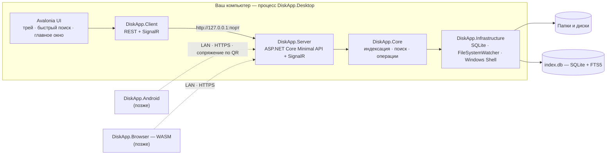
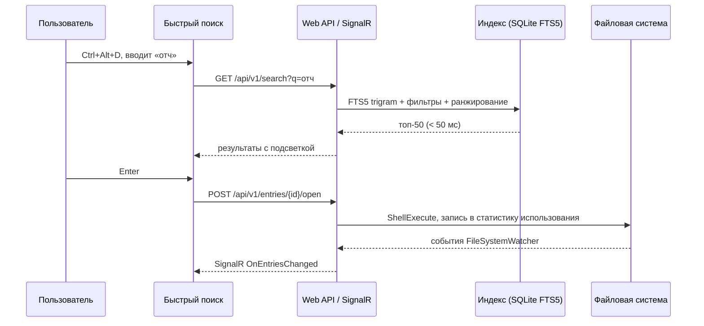

# DiskApp

[](https://github.com/IichiKohuro/DiskApp/actions/workflows/ci.yml)


[](LICENSE)

> Файлы под рукой. Приложение живёт в системном трее и по горячей клавише находит, открывает, добавляет и сохраняет файлы в ваших рабочих папках и дисках — без блужданий по Проводнику.

**Статус:** этап 0 завершён, идёт этап 1 (домен и хранилище) — подробности в разделе [Статус](#статус). Документ описывает целевое состояние продукта; что уже работает, отмечено отдельно.
Пошаговый план разработки — в [PLAN.md](PLAN.md). Репозиторий — [github.com/IichiKohuro/DiskApp](https://github.com/IichiKohuro/DiskApp).

---

## Содержание

- [Статус](#статус)
- [Идея](#идея)
- [Принципы](#принципы)
- [Возможности](#возможности)
- [Интерфейс](#интерфейс)
- [Горячие клавиши](#горячие-клавиши)
- [Синтаксис поиска](#синтаксис-поиска)
- [Архитектура](#архитектура)
- [Технологический стек](#технологический-стек)
- [Платформы](#платформы)
- [Структура репозитория](#структура-репозитория)
- [Быстрый старт для разработчика](#быстрый-старт-для-разработчика)
- [Данные и настройки](#данные-и-настройки)
- [Разработка](#разработка)
- [Дорожная карта](#дорожная-карта)
- [Лицензия](#лицензия)

---

## Статус

**Этапы 0–2 завершены (v0.1.0-alpha, 2026-10-11).** Готовы окружение, каркас решения (7 проектов в `src/`, 7 в `tests/`), CI, технические спайки с решениями в ADR, прототип интерфейса на макетных данных, модель домена, SQLite-хранилище, настройки и полноценная индексация: сканер, сверка, наблюдатель за изменениями и оркестратор. Поиска по индексу и API ещё нет: следующий этап 3 — поиск. Разделы ниже описывают целевое состояние продукта; что уже есть — в таблице.

| Что | Состояние |
|---|---|
| Главное окно в стиле Windows 11 (`FAAppWindow`, Mica, `NavigationView`), страницы «Главная», «Поиск», «Настройки» | ✅ прототип на макетных данных |
| Окно быстрого поиска: Acrylic, скруглённые углы, подсветка совпадений, клавиатура, `Ctrl+1…9` | ✅ прототип на макетных данных |
| Трей с меню, глобальная горячая клавиша с запасными сочетаниями, один экземпляр, аргументы запуска, журнал | ✅ работает |
| Домен (корни, записи, виды файлов, пути, запросы), интерфейсы инфраструктуры, шина событий | ✅ `DiskApp.Core` |
| SQLite: схема с FTS5, миграции, один писатель, восстановление, репозитории; настройки в JSON; папки данных | ✅ `DiskApp.Infrastructure`, не подключено к интерфейсу |
| Индексация: параллельный сканер, mark-and-sweep, сверка по разнице, наблюдатель со склейкой событий, очередь задач по дискам, пауза, недоступные корни | ✅ `DiskApp.Core` + `DiskApp.Infrastructure`; в приложении запустится вместе с сервером на этапе 4 |
| Поиск по индексу, Web API + SignalR, клиент вместо макета | ⬜ этапы 3–5 |
| Обзор, файловые операции, «добавить» и «сохранить», разбор входящих, настройки, установщик | ⬜ этапы 8–11, 17 |

Замеры этапов 0–2 (2026-10-10…11, ноутбук разработчика: Windows 11, 22 CPU, SSD, .NET 10.0.12, Release):

| Метрика | Бюджет | Замер | Где подробнее |
|---|---|---|---|
| Старт до иконки в трее, тёплый | < 1 с | 917 мс | [ADR-0003](docs/ADR/0003-tray-hotkey-single-instance.md) |
| Показ окна поиска по хоткею | < 100 мс | 82 мс первый раз, 1 мс далее | [ADR-0002](docs/ADR/0002-windows11-shell-in-avalonia.md) |
| Второй экземпляр: передать аргументы и выйти | — | ≈ 50 мс | [ADR-0003](docs/ADR/0003-tray-hotkey-single-instance.md) |
| Старт Kestrel + SignalR внутри процесса | — | 138 мс, +17 МБ | [ADR-0004](docs/ADR/0004-kestrel-in-process.md) |
| Вызов по loopback: HTTP / SignalR, медиана | — | 0,12 / 0,16 мс | [ADR-0004](docs/ADR/0004-kestrel-in-process.md) |
| Поиск от 3 символов на 1 млн записей, trigram `MATCH` | < 50 мс | 0,6–5 мс (подсчёт), 12–34 мс первые 50 с `rank` | [ADR-0005](docs/ADR/0005-fts5-trigram-index-layout.md) |
| Размер БД на 1 млн записей, FTS по имени | ≤ 250 МБ | 161 МБ | [ADR-0005](docs/ADR/0005-fts5-trigram-index-layout.md) |
| Заполнение индекса, 1 млн записей | — | 7,7 с (129 тыс. строк/с) | [ADR-0005](docs/ADR/0005-fts5-trigram-index-layout.md) |
| Репозиторий: вставка 100 тыс. записей пакетами | ≤ 5 с | 4,07 с | [ARCHITECTURE](docs/ARCHITECTURE.md), раздел 16 |
| Репозиторий: переименование поддерева на 50 тыс. записей | ≤ 200 мс | 184 мс | [ARCHITECTURE](docs/ARCHITECTURE.md), раздел 16 |
| Индексация 100 тыс. файлов с нуля | ≤ 60 с | 4,5 с, пик памяти +79 МБ | [ARCHITECTURE](docs/ARCHITECTURE.md), раздел 16 |
| Отражение изменения файла в индексе | ≤ 1 с | меньше 1 с | [ARCHITECTURE](docs/ARCHITECTURE.md), раздел 16 |

Тестов 504 (`dotnet test`), CI проверяет каждый коммит в `main`. Текущая позиция и журнал плана — в [PLAN.md](PLAN.md); полная таблица замеров — в [docs/ARCHITECTURE.md](docs/ARCHITECTURE.md), раздел 16.

## Идея

Проводник хорош для редких задач и плох для ежедневных. Нужная папка каждый раз в трёх кликах, встроенный поиск Windows медленный и непредсказуемый, а «сохранить в ту самую папку» превращается в прогулку по дереву каталогов.

DiskApp подходит к задаче иначе:

1. Вы указываете **корни** — папки или целые диски, с которыми реально работаете.
2. Приложение строит **локальный индекс** (SQLite + FTS5) и поддерживает его в актуальном состоянии, следя за изменениями файловой системы.
3. По **горячей клавише** всплывает окно быстрого поиска: три буквы, `Enter` — файл открыт.
4. Из того же окна файл можно показать в Проводнике, скопировать, переместить, переименовать, отправить в корзину, добавить в избранное или перетащить в другое приложение.
5. Файлы и содержимое буфера обмена можно **добавить** в нужную папку перетаскиванием, через меню «Отправить» или контекстное меню Проводника.
6. При **сохранении** из любой программы DiskApp подсказывает нужную папку и умеет направить стандартный диалог «Сохранить как» прямо в неё.
7. Файлы отовсюду — Skype, почта, браузер — сбрасываются на **общий склад** вроде «Загрузок». DiskApp держит его под присмотром и в удобный момент помогает **разобрать**: каждый файл одной клавишей пересылается на свой **профильный склад** («Документы», «Картинки», «Установщики», …), подсказки показывают куда, любое решение отменяется.

Ядро приложения — локальный сервис (Web API + SignalR). Десктопный интерфейс общается с ним так же, как позже будут общаться Android- и веб-клиенты: один API, одна логика, разные экраны.

## Принципы

- **Клавиатура прежде всего.** Любой сценарий выполняется без мыши; мышь не хуже, но не обязательна.
- **Скорость измеряется.** Бюджеты производительности зафиксированы и проверяются (см. ниже).
- **Всё локально.** Индекс, настройки и статистика хранятся на вашем компьютере. Телеметрии нет. Сеть выключена, пока вы сами её не включите.
- **Родной вид Windows 11.** Mica/Acrylic, скруглённые углы, системный акцентный цвет, светлая и тёмная темы, Segoe UI Variable и Fluent-иконки.
- **Один API для всех клиентов.** Десктоп, Android и Web — тонкие клиенты над одним сервером.
- **Ничего не ломать.** Удаление — только в корзину, переименование и перемещение отменяются, конфликты решает пользователь.

### Бюджеты производительности (цели v1.0)

| Метрика | Цель |
|---|---|
| Появление окна быстрого поиска по хоткею | < 100 мс |
| Поиск (p95) по индексу в 1 000 000 записей | < 50 мс |
| Старт до появления иконки в трее | < 1 с (холодный старт < 2 с) |
| Память в простое | < 150 МБ |
| Нагрузка на CPU в простое | ≈ 0 % |
| Скорость первичной индексации (SSD) | ≥ 2 000 файлов/с |
| Отражение изменения файла в индексе | ≤ 1 с |

## Возможности

### Версия 1.0 (MVP)

**Трей и запуск**
- Старт свёрнутым в трей, автозапуск с Windows, запоминание состояния.
- Меню трея: открыть, быстрый поиск, пауза индексации, настройки, выход. Иконка отражает состояние (простой / индексация / пауза / ошибка).
- Один экземпляр приложения; повторный запуск передаёт команду уже работающему (`--search`, `--add`, `diskapp://`).
- Глобальная горячая клавиша (по умолчанию `Ctrl+Alt+D`), настраиваемая, с проверкой конфликтов и запасными сочетаниями.

**Корни и индекс**
- Любое число корней: папки и целые диски, включая съёмные и сетевые (с оговорками).
- Правила исключений: glob-шаблоны, скрытые и системные объекты, глубина, стандартные исключения (`$RECYCLE.BIN`, `node_modules`, `.git`, …).
- Первичное сканирование с прогрессом, слежение через `FileSystemWatcher`, периодическая сверка, пауза и возобновление, пересборка индекса.
- Корректная работа с junction/символическими ссылками, длинными путями, файлами OneDrive «по запросу» (без их скачивания), отключаемыми дисками.

**Быстрый поиск**
- Поиск по мере ввода с подсветкой совпадений, нечёткое совпадение, фильтры (`ext:`, `type:`, `in:`, `size:`, `modified:`, `tag:`, …).
- Ранжирование: точность совпадения + частота и давность использования (frecency) + избранное + свежесть изменений.
- Пустой запрос показывает недавние и избранные файлы; история запросов.
- Действия из результатов: открыть, открыть с помощью, показать в Проводнике, свойства, копировать путь/файл, переименовать, в корзину, запустить от администратора.
- Перетаскивание результатов в другие приложения и файлов из других приложений в DiskApp.

**Главное окно**
- Главная: недавние, закреплённые, недавно изменённые, состояние корней.
- Обзор: дерево + список/плитка с виртуализацией, сортировка, группировка, панель сведений, адресная строка.
- Файловые операции: копировать, переместить, переименовать, создать, в корзину — с очередью, прогрессом, отменой, разбором конфликтов и `Ctrl+Z`.
- Избранное, теги, коллекции (ручные и сохранённые запросы), папка «Входящие».

**Добавить и сохранить**
- Зона для перетаскивания с выбором целевой папки (недавние цели, избранное, поиск по папкам).
- Пункт «Добавить в DiskApp» в меню «Отправить» и контекстном меню Проводника.
- Буфер обмена в файл: текст → `.txt`/`.md`, изображение → `.png` в выбранную папку с шаблоном имени.
- Quick Switch для диалогов «Открыть / Сохранить как» (экспериментально): выбрали папку в DiskApp — системный диалог перешёл в неё.

**Разбор входящих**
- Общий склад: папки-накопители («Загрузки», «Рабочий стол», любые другие, список настраивается). Новые файлы попадают в очередь разбора, как только загрузка завершена; временные файлы игнорируются.
- Профильные склады: именованные папки-назначения со своим профилем (виды файлов, расширения, ключевые слова, источники) и закреплёнными номерами 1–9. Набор по умолчанию предлагается при первом запуске; склад может быть складом следующего уровня со своей сортировкой.
- Сессия разбора в отдельном быстром окне: файл, превью, склады кнопками с номерами, рекомендуемый подсвечен и подписан объяснением, одна клавиша на решение, пакетная обработка похожих файлов, любая другая папка через поиск, итог с отменой.
- Подсказки: профиль склада, правила, история ваших решений по расширению, имени и источнику загрузки; объяснение рядом с каждой подсказкой.
- Правила автосортировки создаются из решения одной клавишей («всегда так делать для PDF из Загрузок»), работают тихо и пишут в журнал.
- Умный момент для напоминания: приложение смотрит, заняты ли вы (идёт звонок, полноэкранное приложение, интенсивная работа, «не беспокоить» Windows), и предлагает разбор, когда вы свободны: после возвращения к компьютеру, при переходе к лёгким задачам, в привычные часы. «Отложить» означает «напомни, когда освобожусь»: повторы не чаще заданного интервала и не больше нескольких в день, с нарастающей паузой, пока склад не разобран. Никаких модальных окон и звука.
- Журнал всех решений с отменой: файл никогда не теряется, при разборе ничего не удаляется само.

**Настройки и качество**
- Корни и исключения, поиск, горячие клавиши, внешний вид (тема, фон Mica/Acrylic, акцент), поведение, интеграции, данные, диагностика.
- Русский и английский интерфейс, онбординг при первом запуске, доступность (клавиатура, экранные дикторы, высокий контраст).
- Установщик с автообновлением и портативная версия.

**Резервное копирование**
- Настраиваемые копии базы индекса и настроек: вручную, по расписанию, при выходе и автоматически перед миграциями и пересборкой индекса. Снимок делается через SQLite Backup API, не останавливая работу.
- Несколько назначений (локальная папка, папка облачной синхронизации, сетевой путь), правила хранения, шифрование по желанию, проверка целостности и восстановление в один клик, экспорт метаданных в JSON для переноса на другую машину.

### После 1.0

- **v1.x:** панель предпросмотра (изображения, текст и код, Markdown, PDF, миниатюры Office), поиск по содержимому, поиск дубликатов и анализ занятого места, умные коллекции и правила авто-сортировки «Входящих», быстрая индексация целых NTFS-дисков через USN Journal, расширяемые действия, задания резервного копирования файлов (зеркало, версии, снимки) с инкрементальными запусками на основе индекса, проверка Linux/macOS.
- **v2.x:** безопасный удалённый доступ по локальной сети (HTTPS, сопряжение по QR, права на устройство), Android-клиент (поиск и скачивание файлов с ПК, загрузка фото во «Входящие»), веб-клиент на Avalonia Browser, который раздаёт сам сервер.

## Интерфейс

Прототип интерфейса на макетных данных (Windows 11, тёмная тема, системный акцент):


Что задумано целиком — словами:

- **Окно быстрого поиска.** Безрамочное, поверх всех окон, в верхней трети экрана, фон Acrylic, скруглённые углы. Поле ввода крупным шрифтом, под ним список результатов с иконками, путями и бейджами, внизу строка состояния (количество, время, состояние индекса). Закрывается по `Esc` или при потере фокуса.
- **Окно разбора входящих.** Такое же быстрое окно: сверху текущий файл с превью, именем, размером, датой и источником, счётчик «3 из 12», снизу профильные склады кнопками с закреплёнными номерами, рекомендуемый подсвечен и подписан объяснением. Одна клавиша — следующий файл. Похожие файлы можно обработать пакетом, в конце сессии — итог с отменой.
- **Главное окно.** `NavigationView` слева (Главная, Поиск, Обзор, Коллекции, Теги, Входящие, Операции, Настройки), собственный заголовок окна поверх Mica, панель команд, строка навигации (breadcrumb), панель сведений справа, `InfoBar` с состоянием индекса.
- **Настройки.** Страницы в стиле «Параметров» Windows 11 (`SettingsExpander`), применяются сразу, без перезапуска.

## Горячие клавиши

Значения по умолчанию, все настраиваются.

| Клавиши | Действие |
|---|---|
| `Ctrl+Alt+D` | Показать/скрыть быстрый поиск (глобально); если занято — `Ctrl+Alt+F`, затем `Ctrl+Alt+Space`, действующее сочетание показано в настройках |
| `Ctrl+Alt+I` | Разобрать входящие (глобально) |
| `↑` `↓` `PgUp` `PgDn` | Навигация по результатам |
| `Enter` | Открыть |
| `Ctrl+Enter` | Показать в Проводнике |
| `Shift+Enter` | Открыть с помощью… |
| `Alt+Enter` | Свойства |
| `Ctrl+C` / `Ctrl+Shift+C` | Копировать путь / копировать файл |
| `F2` | Переименовать |
| `Del` | В корзину (с подтверждением) |
| `Ctrl+P` | Панель предпросмотра |
| `Ctrl+Shift+V` | Сохранить буфер обмена как файл |
| `Tab` / `Shift+F10` | Меню действий |
| `Ctrl+1…9` | Открыть результат по номеру |
| `Esc` | Очистить запрос, затем закрыть окно |

В окне разбора входящих:

| Клавиши | Действие |
|---|---|
| `1…9` | Отправить на профильный склад с этим номером (номера закреплены за складами) |
| `Enter` | Отправить на рекомендуемый склад |
| `T` | Найти папку назначения (поиск по папкам), `Ctrl+N` — создать подпапку в найденной |
| `N` | Новая подпапка внутри рекомендуемого склада |
| `Space` / `K` | Оставить здесь |
| `S` | Отложить |
| `R` | Переименовать и переместить |
| `Ctrl+R` | Создать правило из этого решения |
| `Ctrl+W` | Сделать текущую папку назначения новым складом |
| `U` / `Ctrl+Z` | Отменить последнее решение |
| `Del` | В корзину (с подтверждением) |
| `Esc` | Завершить сессию, остальное остаётся в очереди |

## Синтаксис поиска

| Запрос | Что найдёт |
|---|---|
| `отчет` | Подстрока в имени (регистр не важен), затем нечёткие совпадения |
| `"годовой отчет"` | Точная фраза |
| `отчет ext:xlsx` | Только файлы `.xlsx` |
| `type:image` | Изображения (`image`, `video`, `audio`, `doc`, `archive`, `code`, `exe`) |
| `in:Projects` | Внутри папки или корня с именем `Projects` |
| `size:>10mb` | Крупнее 10 МБ (`kb`, `mb`, `gb`) |
| `modified:week` | Изменено за неделю (`today`, `week`, `month`, `2026-03`, `>2026-01-01`) |
| `is:dir` | Только папки (`is:file`) |
| `tag:работа` | Помечено тегом |
| `-ext:tmp` | Отрицание любого фильтра |
| `/^inv.*\.pdf$/` | Регулярное выражение (опционально) |

## Архитектура

### Общая схема



### Зачем Web API внутри десктопного приложения

- **Один путь кода для всех клиентов.** Десктоп использует тот же `DiskApp.Client`, что и будущие Android и Web. API проверяется ежедневным использованием, а не отдельными тестами.
- **Сервер отделяем от интерфейса.** Тот же `DiskApp.Server` можно запустить без окна — как службу Windows или headless-процесс.
- **Реальное время бесплатно.** SignalR доставляет прогресс индексации, изменения файлов и ход операций всем подключённым клиентам.
- **Дёшево.** Kestrel слушает только `127.0.0.1` на динамическом порту. По замеру спайка S3 ([ADR-0004](docs/ADR/0004-kestrel-in-process.md)): старт 138 мс и +17 МБ памяти, вызов по loopback 0,1–0,2 мс; сервер стартует параллельно с инициализацией UI и не задерживает появление трея.

### Слои и зависимости

| Проект | Ответственность | Зависит от |
|---|---|---|
| `DiskApp.Core` | Домен: корни, записи, теги, коллекции; разбор запросов, ранжирование, логика сканирования и файловых операций; интерфейсы инфраструктуры | — |
| `DiskApp.Infrastructure` | SQLite (Microsoft.Data.Sqlite + Dapper, миграции, FTS5), файловая система, `FileSystemWatcher`, Windows Shell (открытие, корзина, иконки, миниатюры) | Core |
| `DiskApp.Contracts` | DTO, маршруты API, типизированные интерфейсы SignalR-хаба, JSON source generation | — |
| `DiskApp.Server` | Minimal API, SignalR-хаб, hosted services индексации и операций, OpenAPI, авторизация для удалённого доступа | Core, Infrastructure, Contracts |
| `DiskApp.Client` | Типизированный REST-клиент и обёртка SignalR с переподключением; интерфейс `IDiskAppApi` | Contracts |
| `DiskApp.UI` | Общий Avalonia-интерфейс: ViewModels (CommunityToolkit.Mvvm), Views, стили, локализация | Client |
| `DiskApp.Desktop` | Точка входа: трей, глобальные хоткеи, один экземпляр, автозапуск, запуск сервера внутри процесса | UI, Server |

Интерфейс не ссылается на `Core` напрямую — только через `Client`. Это гарантирует, что любой экран можно показать на Android или в браузере без переделки.

### Поток «нашёл и открыл»



### Индекс

- SQLite в режиме WAL, один писатель (очередь через `System.Threading.Channels`), много читателей.
- Таблицы: `roots`, `entries` (имя, расширение, путь, размер, даты, атрибуты, вид), `entries_fts` (FTS5 с токенизатором `trigram` только по имени файла — поиск подстрок без учёта регистра, включая кириллицу), `usage` (частота и давность открытия), `favorites`, `tags`, `entry_tags`, `collections`, `collection_items`, `meta`.
- Запрос от трёх символов идёт через trigram `MATCH`, один–два символа — префиксом по колонке `name_folded` (имя в нижнем регистре), ранжирование своё, без `bm25`. Так решил спайк S4 ([ADR-0005](docs/ADR/0005-fts5-trigram-index-layout.md)): индекс только по имени на 1 млн записей занимает 161 МБ и заполняется со скоростью 129 тыс. строк/с, вдвое меньше и быстрее, чем с путями; `LIKE` не сворачивает регистр кириллицы, а полный скан на два символа стоит сотни миллисекунд.
- Первичное сканирование: параллельный обход, пакетные вставки по 5–10 тыс. строк в транзакции, маркировка `scan_id` для обнаружения удалённых файлов.
- Инкрементально: события `FileSystemWatcher` склеиваются (debounce), переименование папки обновляет префикс пути одним запросом, переполнение буфера приводит к пересканированию поддерева.

## Технологический стек

| Область | Технология | Назначение |
|---|---|---|
| Платформа | .NET 10 (LTS), C# 14 | Единая среда для сервера, десктопа и будущих клиентов |
| UI | Avalonia UI 12.x, FluentAvaloniaUI 3.x, CommunityToolkit.Mvvm, FluentIcons | Кроссплатформенный интерфейс в стиле WinUI 3 / Windows 11, MVVM |
| Сервер | ASP.NET Core Minimal API, SignalR, встроенный OpenAPI + Scalar | Локальный сервис, реальное время, документация API |
| Данные | SQLite (Microsoft.Data.Sqlite + Dapper), FTS5 `trigram`, SQL-миграции | Индекс, статистика, теги, настройки |
| Файловая система | System.IO, `FileSystemWatcher`, System.IO.Abstractions | Сканирование, слежение, тестируемость |
| Windows | P/Invoke: `RegisterHotKey`, `DwmSetWindowAttribute`, `SHGetFileInfo`, `IShellItemImageFactory`, `IFileOperation` | Хоткеи, скруглённые углы, иконки, миниатюры, корзина |
| Логирование | Serilog (файлы с ротацией) | Диагностика без телеметрии |
| Тесты | xunit.v3 на Microsoft.Testing.Platform, Shouldly, NSubstitute, Avalonia.Headless, BenchmarkDotNet | Модульные, интеграционные, UI, производительность |
| Сборка и поставка | GitHub Actions, `scripts/publish.ps1` (`dotnet publish`: self-contained, single-file, ReadyToRun), позже Velopack | CI, сборка для запуска, установщик, дельта-обновления |

## Платформы

| Платформа | Версия | Роль |
|---|---|---|
| Windows 10/11, x64 и arm64 | v1.0 | Полнофункциональный клиент и локальный сервер |
| Linux, macOS | v1.x (проверка) | Десктоп с теми же функциями; вместо Mica — сплошной фон |
| Android | v2.x | Удалённый клиент к ПК по локальной сети: поиск, скачивание, загрузка во «Входящие» |
| Web (Avalonia Browser, WebAssembly) | v2.x | Удалённый клиент, который раздаёт сам сервер DiskApp |

## Структура репозитория

Структура после этапа 0; папки будущих этапов помечены.

```
DiskApp/
├─ README.md, PLAN.md, CHANGELOG.md, CONTRIBUTING.md, LICENSE, CLAUDE.md
├─ DiskApp.slnx
├─ global.json, Directory.Build.props, Directory.Packages.props, .editorconfig
├─ src/
│  ├─ DiskApp.Core/            домен, пути, модель запросов, интерфейсы, индексация, шина событий, настройки
│  ├─ DiskApp.Infrastructure/  SQLite, файловая система (листинг, наблюдатель, тип диска), пути, настройки
│  ├─ DiskApp.Contracts/       DTO и контракты API / SignalR (этап 4)
│  ├─ DiskApp.Server/          Minimal API, хаб, hosted services (этап 4)
│  ├─ DiskApp.Client/          REST + SignalR клиент (этап 5)
│  ├─ DiskApp.UI/              общий Avalonia UI: ViewModels, Views, стили, макет ISearchService
│  ├─ DiskApp.Desktop/         точка входа, оболочка (трей, хоткей, один экземпляр), окна, Win32, иконка
│  ├─ DiskApp.Android/         (v2.x)
│  └─ DiskApp.Browser/         (v2.x)
├─ tests/
│  ├─ DiskApp.Core.Tests/       домен, пути, события, архитектурные правила слоёв
│  ├─ DiskApp.Desktop.Tests/    один экземпляр, протокол канала
│  ├─ DiskApp.Infrastructure.Tests/  SQLite, репозитории, сканер, наблюдатель, индексатор, настройки
│  ├─ DiskApp.Server.Tests/
│  ├─ DiskApp.UI.Tests/         ViewModel, форматирование, headless-представления
│  ├─ DiskApp.Testing/          общие фикстуры тестов
│  └─ DiskApp.Benchmarks/       BenchmarkDotNet и проверка бюджетов сканирования (scan-budget)
├─ docs/                       ARCHITECTURE.md, ADR/, QA_CHECKLIST.md, FEEDBACK.md, images/; USER_GUIDE.md (этап 9)
├─ spikes/                     спайки этапа 0.6 с результатами замеров
├─ scripts/                    publish.ps1 (сборка exe), protect-main.ps1 (защита ветки)
├─ releases/                   локальные сборки publish.ps1 (не в git)
└─ .github/workflows/          ci.yml; release.yml (этап 11)
```

## Быстрый старт для разработчика

### Требования

- Windows 10 (1809+) или Windows 11 — для Mica и скруглённых углов нужна Windows 11.
- .NET SDK 10.
- Git.
- IDE на выбор: Visual Studio 2026 Community, JetBrains Rider или VS Code с расширениями C# Dev Kit и Avalonia.

### Установка инструментов (чистая машина)

```bash
winget install --id Microsoft.DotNet.SDK.10 -e
```

```bash
winget install --id Git.Git -e
```

Один из вариантов IDE:

```bash
winget install --id Microsoft.VisualStudio.Community -e
```

```bash
winget install --id JetBrains.Rider -e
```

```bash
winget install --id Microsoft.VisualStudioCode -e
```

Шаблоны проектов Avalonia (после установки SDK, в новом окне терминала):

```bash
dotnet new install Avalonia.Templates
```

### Сборка и запуск

```bash
git clone https://github.com/IichiKohuro/DiskApp.git
```

```bash
dotnet build
```

```bash
dotnet run --project src/DiskApp.Desktop
```

```bash
dotnet test
```

Самодостаточный exe без установленного .NET (self-contained, ReadyToRun) собирает скрипт; результат — `releases\diskapp_v{версия}_{стадия}[_singlefile].exe`, например `releases\diskapp_v0.1.0_alpha_singlefile.exe`. Стадия (`alpha`, `beta`, `rc`, `release`) задаётся параметром `-Stage` и попадает в версию сборки; `-SingleFile:$false` даёт обычную папку с библиотеками рядом и без суффикса в имени:

```powershell
.\scripts\publish.ps1 -Stage alpha
```

Полезные параметры запуска: `--minimized` (сразу в трей), `--show`, `--settings`, `--search "запрос"`, `--portable`; позже — `--add <путь>…` и `--safe-mode`.

## Данные и настройки

```
%LocalAppData%\DiskApp\
├─ index.db         индекс и метаданные (SQLite, WAL)
├─ settings.json    настройки
├─ backups\         резервные копии данных приложения (назначение по умолчанию)
├─ cache\           иконки и миниатюры
└─ logs\            журналы Serilog с ротацией по дням
```

Портативный режим: файл `portable` рядом с исполняемым файлом переводит хранение в `.\data\`.

## Разработка

- Соглашения — ветки, коммиты, стиль кода, шаблон теста, фикстуры: [CONTRIBUTING.md](CONTRIBUTING.md).
- Ветка `main` всегда собирается и проходит тесты. Работа ведётся в ветках `feat/…`, `fix/…`, коммиты в формате Conventional Commits.
- Один подэтап плана = одна законченная единица работы: код, тесты, документация, отметка в [PLAN.md](PLAN.md).
- Архитектурные решения фиксируются в `docs/ADR/`. Пользовательская документация — `docs/USER_GUIDE.md`.
- `Nullable` и `TreatWarningsAsErrors` включены, анализаторы на уровне `latest-recommended`, `dotnet format` проверяется в CI.
- Бюджеты производительности проверяются бенчмарками; регресс — это дефект.

## Дорожная карта

| Версия | Этапы плана | Содержание |
|---|---|---|
| v0.1 ✅ 2026-10-10 | 0 | Окружение, каркас решения, CI, технические спайки; плюс прототип интерфейса этапов 6–7 на макетных данных |
| v0.2 ✅ 2026-10-11 | 1–2 | Домен, SQLite, сканирование и слежение за файловой системой |
| v0.3 | 3–7 | Поиск, Web API + SignalR, клиент, трей и окно быстрого поиска — первая сборка для ежедневного использования |
| v0.4 | 8, 17 | Главное окно, обзор, файловые операции, «добавить» и «сохранить», разбор входящих |
| v0.5 | 9 | Настройки, локализация, онбординг, доступность |
| v1.0 | 10, 16.1, 11 | Производительность, надёжность, резервное копирование данных приложения, установщик, автообновление |
| v1.x | 12, 16.2 | Предпросмотр, поиск по содержимому, дубликаты, USN, расширения, резервное копирование файлов |
| v2.x | 13–15 | Удалённый доступ, Android, Web |

Подробности, критерии готовности и текущая позиция — в [PLAN.md](PLAN.md).

## Лицензия

[MIT](LICENSE).
