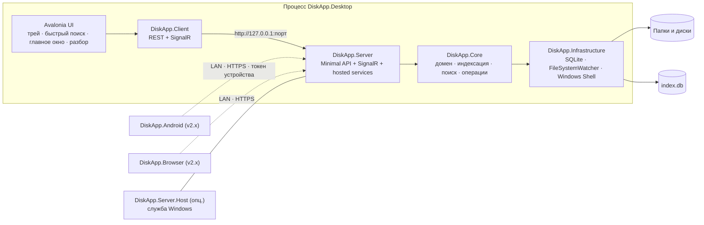
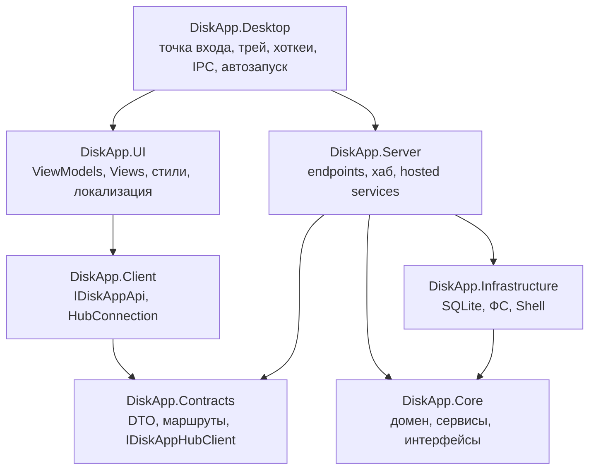
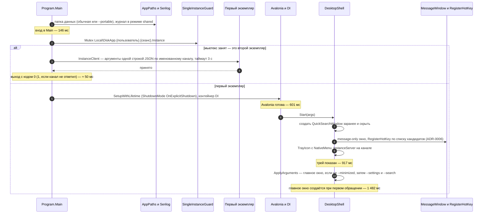
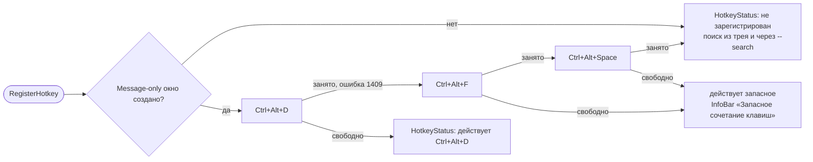
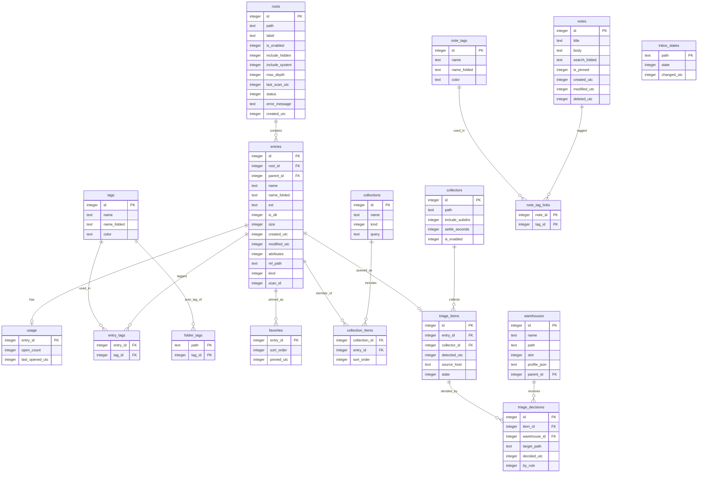
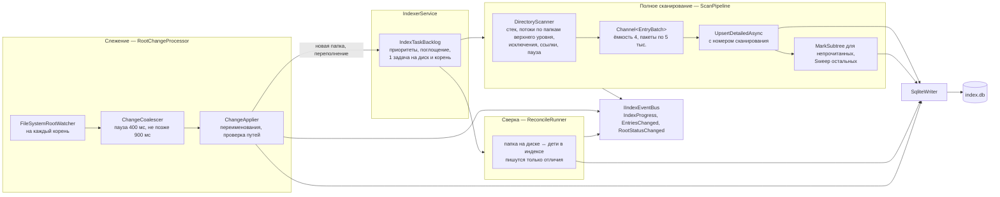
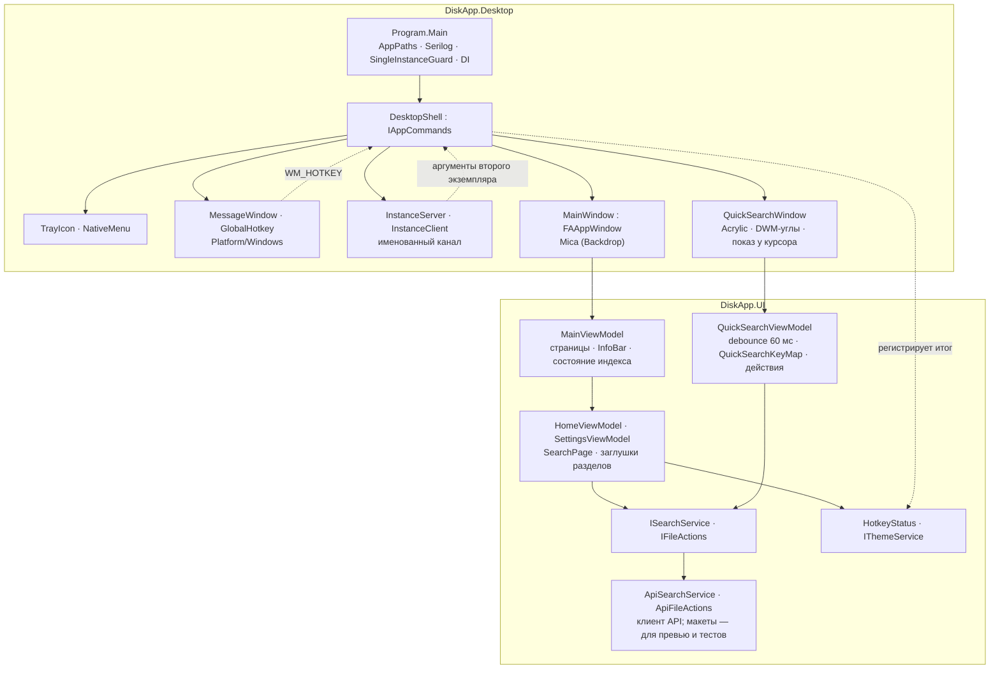

# Архитектура DiskApp

Документ описывает, как устроено приложение: процессы, проекты, данные, конвейеры индексации и поиска, API, интерфейс и платформенные сервисы. Что делает продукт — в [README.md](../README.md); почему решили именно так — в [ADR](ADR/README.md); порядок работ и критерии — в [PLAN.md](../PLAN.md).

Статус: проектная документация с фактами этапа 0 (2026-10-10). Разделы 3, 9, 10, 14–16 описывают реализованное и замеренное; остальные — замысел, помеченный этапом плана, на котором появится реализация. По мере реализации документ уточняется цифрами и схемами.

## Содержание

1. [Контекст и процессы](#1-контекст-и-процессы)
2. [Проекты и зависимости](#2-проекты-и-зависимости)
3. [Запуск десктопа](#3-запуск-десктопа)
4. [Данные](#4-данные)
5. [Индексация](#5-индексация)
6. [Поиск](#6-поиск)
7. [API и события](#7-api-и-события)
8. [Файловые операции](#8-файловые-операции)
9. [Интерфейс](#9-интерфейс)
10. [Платформенные сервисы](#10-платформенные-сервисы)
11. [Разбор входящих](#11-разбор-входящих)
12. [Резервное копирование](#12-резервное-копирование)
13. [Безопасность](#13-безопасность)
14. [Наблюдаемость и диагностика](#14-наблюдаемость-и-диагностика)
15. [Сборка и поставка](#15-сборка-и-поставка)
16. [Бюджеты и измерения](#16-бюджеты-и-измерения)

## 1. Контекст и процессы

В версии 1.0 всё работает в одном процессе `DiskApp.Desktop`: интерфейс Avalonia, клиентская библиотека и локальный сервер ASP.NET Core с ядром. Сервер слушает только `127.0.0.1` на динамическом порту. Интерфейс не вызывает ядро напрямую — только через `DiskApp.Client` по loopback, тем же путём, что и будущие удалённые клиенты.

Режимы работы сервера:

| Режим | Кто запускает | Привязка | Авторизация | Этап |
|---|---|---|---|---|
| Локальный | `DiskApp.Desktop` внутри процесса | `127.0.0.1:0` (динамический порт) | Нет (опционально токен сессии против других локальных процессов) | 4, 6 |
| Headless | `DiskApp.Server.Host` или `DiskApp.Desktop --headless` | По настройке | Как в удалённом | 4 (опц.), 13 |
| Удалённый | Тот же сервер с включённым доступом по сети | Выбранные интерфейсы LAN, фиксированный порт, HTTPS | Токены сопряжённых устройств, права на устройство | 13 |

Состояние после этапа 4: `DiskApp.Core` содержит домен, интерфейсы инфраструктуры, шину событий, модель настроек, индексацию (сканер, сверка, наблюдатель, оркестратор) поиск (парсер, план, ранжирование, сервис) и файловые операции; `DiskApp.Infrastructure` — SQLite (схема, миграции, писатель, репозитории, исполнение поиска), файловую систему, пути и JSON-хранилище настроек; `DiskApp.Desktop` (оболочка, окна, Win32) и `DiskApp.UI` (страницы на макете `ISearchService`) работают с этапа 0. `Contracts` — DTO, маршруты и JSON-контекст API; `Server` — сервер внутри процесса десктопа (REST, SignalR, файловые операции); `Client` — пустой проект до этапа 5. Спайки S3 и S4 подтвердили, что сервер внутри процесса и FTS5 укладываются в бюджеты (раздел 16), поэтому схема выше остаётся целевой без изменений.

## 2. Проекты и зависимости

Правила, которые проверяет архитектурный тест (этап 0.3):

- `Core` не ссылается ни на один проект решения и не знает об ASP.NET Core, Avalonia и SQLite.
- `UI` не ссылается на `Core` и `Infrastructure`: любой экран должен работать поверх `IDiskAppApi`, чтобы без изменений перейти на Android и в браузер.
- `Contracts` не ссылается ни на что: это общий язык сервера и клиентов.
- Платформенный код (P/Invoke, реестр, Shell) живёт в `Infrastructure` (сервисная сторона) и `Desktop` (сторона интерфейса: хоткеи, трей, IPC); `UI` остаётся кроссплатформенным.

Тест живёт в `tests/DiskApp.Core.Tests/Architecture` (и `tests/DiskApp.UI.Tests/Architecture` для правила интерфейса): он читает `ProjectReference` из всех `src/*.csproj` и сверяет их с таблицей слоёв README, а также проверяет фактические ссылки скомпилированных сборок (`GetReferencedAssemblies`). Новый проект в `src/` или новая ссылка между проектами требуют правки таблицы и теста.

Тесты: по проекту на каждый `src/` плюс `tests/DiskApp.Desktop.Tests` (одиночный экземпляр, протокол канала), общая библиотека фикстур `tests/DiskApp.Testing` (`TemporaryDirectory`, `TestTree`; подключается ко всем тестовым проектам из `tests/Directory.Build.targets`, от `src/` не зависит) и `tests/DiskApp.Benchmarks`. Временная база `TemporaryDatabase` — в `tests/DiskApp.Infrastructure.Tests`: соединения она открывает и пулы сбрасывает через `SqliteConnectionFactory`.

Один DI-контейнер на процесс: `WebApplicationBuilder.Services` получает сервисы ядра и инфраструктуры, десктоп добавляет туда же ViewModels и свои сервисы. Это упрощает время жизни объектов и тестирование. На этапе 0 контейнер строит `Program.BuildServices` из `ServiceCollection` (`AddDiskAppUi` для ViewModel и сервисов интерфейса, `DesktopShell` как `IAppCommands`); с этапа 4 его место займёт `WebApplicationBuilder`, а спайк S3 подтвердил, что интерфейс и хаб могут брать сервисы из одного `app.Services` (ADR-0004).

## 3. Запуск десктопа

Цель — иконка в трее менее чем за секунду при тёплом старте и показ окна поиска по хоткею менее чем за 100 мс. Для этого тяжёлое выполняется параллельно и лениво. Схема соответствует коду этапа 0 (`Program.Main`, `DesktopShell.Start`); в заметках — метки времени из журнала при тёплом старте (ADR-0003). С этапа 4 сразу после захвата мьютекса в фоне собирается общий контейнер сервера и оболочки (`DiskAppServerHost.Create`, ≈ 100 мс), параллельно с Avalonia. После показа трея в фоне запускается сервер: открытие базы, индексатор, Kestrel на `127.0.0.1:0` (замер в Debug: трей через 878 мс, сервер готов через 1 039 мс после старта процесса). Окно поиска подключится к API и SignalR на этапе 7.

Регистрация горячей клавиши идёт по цепочке кандидатов; итог попадает в `HotkeyStatus`, который показывают главная страница, настройки и `InfoBar` главного окна:

Остановка: «Выход» из меню трея или `--exit` от второго экземпляра → `DesktopShell.Exit`: окна закрываются (флаг `AllowClose`, иначе закрытие прячет окно в трей), снимаются хоткей, message-only окно, трей и сервер канала → `lifetime.Shutdown()`. Затем вне потока интерфейса останавливается сервер (до 5 с): файловые операции отменяются, индексатор останавливается раньше, чем закрывается база, контейнер освобождается. Подтверждение выхода при активных операциях — этап 6.

Параметры командной строки: работают `--minimized`, `--show`, `--search "q"`, `--settings`, `--portable`, `--exit` (`StartupArguments`; портативная копия держит свой одиночный экземпляр, привязанный к папке данных); позже `--add <пути>` и URI `diskapp://open?path=…`, `diskapp://search?q=…` (этап 6.4), `--safe-mode` (этап 10), `--headless` (этап 13). Любой из них, полученный вторым экземпляром, пересылается первому; запуск без аргументов при работающем экземпляре выводит главное окно на передний план.

## 4. Данные

### Расположение

| Режим | Папка данных |
|---|---|
| Обычный | `%LocalAppData%\DiskApp\` |
| Портативный (файл `portable` рядом с exe или флаг `--portable`) | `.\data\` рядом с exe |

Внутри: `index.db` (+ `-wal`, `-shm`), `settings.json`, `backups\`, `cache\icons\`, `cache\thumbs\`, `logs\`. Пути считает `AppPaths` (`DiskApp.Infrastructure`, реализация `IAppPaths`): режим выбирается по файлу `portable` рядом с exe или аргументу `--portable`, папки журналов, кэша и резервных копий создаются при разрешении путей.

### Настройки

Этап 1.5. Модель — запись `AppSettings` в `DiskApp.Core.Settings` (горячие клавиши, внешний вид, индексация с правилами исключений, поиск, трей) с константой версии схемы. Хранилище — `JsonSettingsStore<T>` (`ISettingsStore<T>`) поверх System.Text.Json с source generation (`AppSettingsJsonContext`: camelCase, перечисления строками, отступы для правки руками). При чтении файл разбирается в `JsonObject`, по полю `schemaVersion` применяются миграции «с версии N» (словарь правок JSON), после чего версия поднимается до текущей и файл перезаписывается; отсутствующий файл даёт значения по умолчанию без записи; повреждённый откладывается в `settings.corrupt-<дата>.json`, берутся значения по умолчанию, итог возвращается в `SettingsLoadResult`. Запись атомарная: `settings.json.tmp` со сбросом на диск и `File.Replace`, прежняя исправная версия остаётся в `settings.json.bak` (этап 10.3; на файловых системах без замены — копия и переименование). Повреждённый файл после карантина восстанавливается из копии (`SettingsLoadOutcome.RestoredFromBackup`) и перезаписывается; значения по умолчанию берутся, только если повреждена и копия. Подписчики `Subscribe` получают каждое сохранение; трансляция в SignalR (`OnSettingsChanged`) — этап 4.

Свойства настроек объявлены с `set`, а не `init`: генератор System.Text.Json строит объект инициализатором и затирает значения по умолчанию у полей, которых нет в файле. Договорённость: экземпляр из хранилища не меняется на месте, изменение — копия через `with` и `SaveAsync`.

### Локализация

Этап 9.2. Строки интерфейса и сообщений API лежат в ресурсах `Localization/Strings.resx` (русский — нейтральный язык сборок, `NeutralLanguage=ru`) и `Strings.en.resx` (английский, вспомогательная сборка `en`) в трёх сборках: `DiskApp.UI` (интерфейс и десктоп), `DiskApp.Server` (ответы API) и `DiskApp.Core` (ядро и инфраструктура). Доступ — `L.T(key)` и `L.F(key, args)` в каждой из них; в AXAML — `{loc:Str Key}`, привязка к номеру смены языка `Localizer.Revision` с конвертером, поэтому разметка обновляется сразу. `Localizer.SetLanguage` ставит культуру интерфейса и форматов для всего процесса (`DefaultThreadCurrentUICulture`), так что сервер внутри процесса отвечает на том же языке; страницы (`PageViewModel.RelocalizeAsync`), главное окно и меню трея перечитывают тексты по событию `LanguageChanged`. `Formatting` выбирает формы слова (три в русском, две в английском), разделители разрядов, единицы и даты по языку. Настройка — `appearance.language`: `system` (русский для русской Windows, иначе английский), `ru`, `en`. Не переводятся журналы, описания OpenAPI, синтаксис запросов (русские и английские слова фильтров работают на обоих языках) и макетные данные. Строки выносит `scripts/l10n/L10n.cs`.

С этапа 9.1 страница «Настройки» читает и меняет настройки через `ISettingsService` поверх `GET`/`PATCH /api/v1/settings`: каждое изменение — частичный JSON одного поля, сервер проверяет значения (`SettingsEndpoints.Validate`) и сохраняет; основа слияния сериализуется со всеми полями, чтобы принимались и поля со значением `null`. Применение без перезапуска идёт по подписке на хранилище: десктоп (`DesktopShell.ApplySettings`) меняет тему, акцент (`FluentAvaloniaTheme.CustomAccentColor`), фон окон (`Backdrop.Apply`), масштаб (`LayoutTransformControl`), компактные списки (класс `compact`), монитор и поведение окна поиска, подробности строк (`QuickSearchViewModel.Display`), уровень журнала (`Program.LogLevel`) и сочетание Quick Switch; сервер (`SearchCacheInvalidator`) передаёт новые параметры в `SearchService.UpdateOptions`.

### Онбординг

Этап 9.3. `DesktopShell` после старта читает `onboarding` из настроек: пока мастер не пройден и в индексе нет корней, он открывает `OnboardingViewModel` поверх главного окна (`MainViewModel.StartOnboarding`, слой в `MainView`). Если корни уже есть — это обновление с версии без мастера, и он отмечается пройденным. Мастер добавляет отмеченные папки через `IRootsService` при уходе с первого шага, автозапуск — через `IAutoStartService`, тему применяет сразу, язык сохраняет сразу; «Готово» и «Пропустить» сохраняют `onboarding.completed` и `lastSeenVersion` (`AppVersion.Current`). Если `lastSeenVersion` отличается от текущей версии, при следующем показе главного окна открывается «Что нового» (`IDialogService.ShowWhatsNewAsync`, пункты `WhatsNew.N.Title/Text` в ресурсах), и версия запоминается после показа. Обучающие подсказки ведёт `SettingsTipsService` (`ITipsService`): подсказка показывается один раз и только после мастера или «Что нового», показанные хранятся в `onboarding.tipsShown`. На главной это `FATeachingTip` по очереди (горячая клавиша, затем перетаскивание), их открывает представление при активации окна; в окне поиска подсказка о фильтрах встроена в окно, потому что всплывающее окно подсказки забирало фокус и окно поиска пряталось. «О программе» → «Пройти заново» (`IAppCommands.StartOnboarding`) сбрасывает подсказки и открывает мастер.

### Доступность

Этап 9.4. Имя для Экранного диктора у каждого интерактивного элемента задаётся `AutomationProperties.Name` в разметке; у кнопки с текстом оно берётся из текста, а кнопка со значком или составным содержимым без него звучала бы как имя типа (`Avalonia.Controls.StackPanel`), поэтому тест `AxamlAccessibilityTests` требует имя у таких кнопок, полей, списков и переключателей. Части шаблонов FluentAvalonia называются стилями в `AppStyles.axaml` (кнопка меню навигации, заголовки и строки групп настроек), строки списков — через `ToString()` модели (`SearchHit` — имя файла, `ResultSectionHeader` — заголовок), дерево и крошки «Обзора» — стилями представления. `HelpText` даёт всплывающая подсказка. `AppThemeService` при каждом применении темы проверяет `IPlatformSettings.GetColorValues().ContrastPreference` и при высокой контрастности включает `FluentAvaloniaTheme.HighContrastTheme` поверх выбора пользователя, а `DesktopShell` — сплошной фон окон; переменная `DISKAPP_HIGH_CONTRAST=1` включает то же для проверки. Масштаб до 150 % (`LayoutTransformControl`) держат адаптивные места: меню навигации в режиме `Auto`, «Обзор» по ширине прячет сведения и переносит фильтры, кнопки в строках настроек — в `WrapPanel`, путь в строке файла сжимается. Минимальный размер целей нажатия — 32 px в общих стилях.

### Диагностика и устойчивость

Этап 9.5. `CrashHandler` (Desktop) подключается в `Program.Main` сразу после журнала: `AppDomain.UnhandledException` пишет в журнал и в `last-crash.txt` в папке данных, `TaskScheduler.UnobservedTaskException` помечает исключение наблюдённым; после настройки Avalonia подключается `Dispatcher.UIThread.UnhandledException` (исключение помечается обработанным). Ошибки двух последних видов показывает `DesktopShell.ReportError` окном `ErrorWindow` с `ErrorReportViewModel`: одно окно, повторные ошибки увеличивают счётчик; отметку прошлого сбоя оболочка забирает при старте и показывает то же окно. Архив собирает `DiagnosticArchive` (Infrastructure) через `IAppMaintenance.CreateDiagnosticArchiveAsync`: `environment.txt`, `settings.json` с маской на свойствах с «token», «password», «secret», «apikey», «credential», и последние файлы журнала, прочитанные с `FileShare.ReadWrite` (Serilog держит файл открытым), большие — с конца. `--safe-mode` разбирается до создания хоста: сервер стартует с `StartIndexer = false`, оболочка не подключает Quick Switch, не открывает мастер и «Что нового» и показывает полосу со сбросом настроек (`IAppMaintenance.ResetSettingsAsync`: копия `settings.json.bak-…`, затем `new AppSettings()` в хранилище — подписчики применяют её как любое изменение). Раздел «Журнал» в настройках читает хвост текущего файла (`ReadLogTailAsync`, последний мегабайт) и разбирает его `LogTail`: строки без отметки времени — продолжение предыдущей записи, поэтому стек не отрывается от ошибки при фильтре. Источники `Microsoft`, `System.Net.Http.HttpClient` и `Polly` пишутся с уровня предупреждения.

Этап 10.3. Восстановление после повреждения видно пользователю: `ServerState` хранит итог чтения настроек, `GET /api/v1/app/info` отдаёт `CorruptDatabasePath`, `CorruptSettingsPath` и `SettingsRestoredFromBackup`, оболочка после старта сводит их в одну полосу `RecoveryNotice` в главном окне. Пробуждение: `ISystemResumeSource` (Core) реализует `DesktopResumeSource` — выход из сна приходит от `PowerRegisterSuspendResumeNotification` с обратным вызовом (без окна, `WindowsSystemResumeSource`), возврат в сеанс — из служебного окна оболочки (`WTSRegisterSessionNotification`, подключение консоли или удалённого рабочего стола). `ServerStartupService` через 10 с вызывает `IndexerService.OnSystemResumed`: недоступные корни уходят в офлайн, офлайн-корни проверяются на ближайшем такте, съёмные и сетевые получают новый наблюдатель и сверку (их могли изменить на другом компьютере), локальные только проверяются. Нехватка места на диске с базой: писатель переводит `SQLITE_FULL` в `DiskFullException`, индексатор показывает у корня понятную причину. Проверка доступности сетевого корня ждёт не дольше `IndexerOptions.NetworkProbeTimeout` (5 с): недоступный сервер SMB отвечает только по своему таймауту, а планировщик общий для всех корней; зависшая проверка не дублируется. Долгая работа проверяется `scripts/soak.ps1`: портативная копия в трее, непрерывные изменения дерева, поиски и окно поиска, выборки памяти, хендлов и объектов GDI/USER, в конце — сверка индекса с диском.

### SQLite

Этап 1.3. `SqliteConnectionFactory` открывает соединения из пула Microsoft.Data.Sqlite и на каждом применяет PRAGMA: `journal_mode=WAL`, `synchronous=NORMAL`, `temp_store=MEMORY`, `cache_size=-65536` (64 МБ), `mmap_size=256 МБ`, `foreign_keys=ON`, `busy_timeout=5000`. Выдача соединения из пула (`Open`, открытие для проверки целостности) и очистка пулов (`ClearPool`, `SqliteConnectionFactory.ClearAllPools` для тестов и замеров) идут под одной блокировкой на процесс: Microsoft.Data.Sqlite 10.0.12 помечает выданное соединение активным раньше, чем запоминает владельца, и очистка пула или соседнее открытие в этот миг закрывали его под писателем или отдавали второму владельцу (dotnet/efcore#39008); PRAGMA выполняются вне блокировки. Напрямую `SqliteConnection.ClearPool`/`ClearAllPools` не вызываются. Один писатель — `SqliteWriter`: выделенный поток с одним постоянным соединением читает задания из `Channel`; задание — синхронный делегат, его исключение возвращается вызывающему и не останавливает очередь. Чтение — из пула соединений параллельно, в WAL читатель видит снимок и не ждёт писателя (проверено тестом). `SqliteDatabase` при старте делает `PRAGMA quick_check`; повреждённый файл (или не-база) переименовывается в `index.corrupt-<дата>.db`, создаётся новый, итог `DatabaseInitialization.WasRecovered` сообщает оболочке, что индекс надо построить заново; предложение резервной копии — этап 16.1. Обслуживание: `OptimizeAsync` (`PRAGMA optimize` и усечение WAL), `VacuumAsync`; расписание при простое — этап 10.

Даты хранятся целым числом — тиками UTC (`DateTimeOffset.UtcTicks`, 100 нс от 0001-01-01; `SqliteTime`, ADR-0007): полная точность времени файловой системы, 8 байт вместо 28 у текста ISO 8601, порядок чисел совпадает с хронологическим. Прочитать в SQL: `datetime((x - 621355968000000000) / 10000000, 'unixepoch')`. Dapper настроен на `snake_case` → `PascalCase` и этот формат дат (`DapperConfiguration`).

Этап 10.2. Кэш страниц 64 МБ на соединение нужен во время работы: с 8 МБ запросы с фильтрами на 1 млн записей выходят из бюджета поиска (60 мс вместо 27). В простое он не нужен, поэтому `SqliteDatabase` раз в 15 с проверяет простой: если минуту не открывалось соединение и писатель ничего не выполнял, `ReleaseIdleMemoryAsync` закрывает соединения пула вместе с их кэшем и ставит писателю `PRAGMA optimize; PRAGMA wal_checkpoint(TRUNCATE); PRAGMA shrink_memory;`. Повтор — только после новой работы: фабрика считает открытые соединения, писатель — выполненные задания.

Миграции — SQL-скрипты `V001__init.sql`, `V002__…` во встроенных ресурсах `DiskApp.Infrastructure` (`Sqlite/Migrations`), `SqliteMigrator` применяет недостающие по порядку, каждую в своей транзакции вместе с записью в `schema_version`; тест проверяет апгрейд с первой версии до текущей.

Репозитории (этап 1.4, `Sqlite/Repositories`) реализуют интерфейсы `DiskApp.Core.Repositories`: чтение в отдельном соединении на пуле потоков, запись через `SqliteWriter`. `SqliteFileIndexRepository.UpsertAsync` — три подготовленных запроса на строку в одной транзакции: пометить неизменённую строку текущим `scan_id` (совпали размер, время, атрибуты, имя), вставить новую (`ON CONFLICT DO NOTHING`), иначе обновить; родитель определяется подзапросом по `rel_path` родительской папки, поэтому папки в пакете идут раньше детей. Поддеревья удаляются и переименовываются диапазоном `rel_path >= 'путь\' AND rel_path < 'путь]'` по индексу `UNIQUE(root_id, rel_path)`; число удалённых считается отдельным `COUNT` в той же транзакции, потому что каскад по `parent_id` удаляет детей раньше, чем до них доходит `DELETE`.

### Схема (V001 — этап 1.3, V002 — этап 19, V003 — этап 17.1, V004 — этап 23, V005 — этап 17.4, V006 — этап 20; таблицы этапов 16 и 17 отмечены и появятся позже)

Пересмотр 2026-10-11 (ADR-0012, ADR-0013, PLAN.md решение 25): `collectors` и `warehouses` не создаются — накопители и рабочие папки живут в настройках (`AppSettings.Sorting`). Состояния файлов в накопителях (17.1) займут таблицу вместо `triage_items`, журнал решений `triage_decisions` заменит история файлов (этап 20). Авто-теги папок — таблица `folder_tags` (V002, этап 19); появятся напоминания (этап 21.4). Заметки (V004, этап 23, ADR-0014) — `notes` и свои теги `note_tags` с `note_tag_links`, никак не связанные с `tags` файлов. История решений разбора для подсказок (V005, этап 17.4) — `sorting_stats (feature, destination, score, count, updated_utc)`. История файлов (V006, этап 20, ADR-0016) — `file_events (id, time_utc, kind, source, path, old_path, path_key, old_path_key, names_folded, is_dir, size, operation_id, details)` с индексами по времени и ключам путей; полные пути, а не записи индекса — история переживает удаление записи и корня. Диаграмма ниже — исходный замысел с `folder_tags`, `inbox_states` и заметками; она обновится вместе с миграциями этих этапов.

Вне диаграммы: виртуальная таблица `entries_fts` (FTS5 только по `name`, `tokenize='trigram'`, external content на `entries`, синхронизируется триггерами на вставку, удаление и изменение имени), `query_history` (запрос, счётчик, время), `meta`, `scan_log`, `schema_version`, а также таблицы резервных копий `backups` и заданий `backup_jobs` (этап 16).

Индексы на `entries`: `UNIQUE(root_id, rel_path)`, `(root_id, parent_id)`, `name_folded` (имя в нижнем регистре по правилам .NET — `COLLATE NOCASE` не сворачивает кириллицу, ADR-0005), `ext`, `modified_utc`, `size`, `kind`, `(root_id, scan_id)` для mark-and-sweep. Внешние ключи с `ON DELETE CASCADE`: удаление корня убирает его записи, статистику, избранное, привязки тегов и элементы коллекций; `parent_id` каскадирует на поддерево как страховка от сирот.

## 5. Индексация

Этап 2, реализовано 2026-10-11. Логика обхода, сверки, склейки событий и оркестрации живёт в `DiskApp.Core/Indexing` и проверяется без ОС; тонкий слой над ОС — в `DiskApp.Infrastructure/FileSystem`: `FileSystemLister` (одна папка через `FileSystemEnumerable`, сведения о пути, идентичность папки), `FileSystemRootWatcher` (`FileSystemWatcher`), `DriveInfoProvider` (тип носителя и физический диск через IOCTL), `ThreadBackgroundPriority`. Три источника изменений — полное сканирование, сверка и события наблюдателя — сходятся в одном писателе.

**Сканер.** `DirectoryScanner` читает начальную папку сам, её подпапки делит между выделенными потоками с фоновым приоритетом (степень — по типу диска: SSD 4, сеть 2, HDD и съёмные 1). Каждый поток обходит свои папки целиком на собственном стеке и складывает записи в свои пакеты, поэтому родитель всегда попадает в канал раньше детей, и `parent_id` вычисляется подзапросом при вставке. `ExclusionMatcher` решает по glob-шаблонам имени и пути (`GlobPattern`: частые формы без регулярных выражений), скрытым и системным атрибутам, размеру и глубине. Junction и символические ссылки индексируются, но не обходятся; при `FollowReparsePoints` — обходятся с защитой от циклов по идентичности папки (`DescentGuard`: том и номер файла). Ошибка чтения папки записывается в `scan_log`, обход продолжается, а записи этой папки в индексе сохраняются (`MarkSubtreeAsync`).

**Метаданные папок.** NTFS хранит копию времени и атрибутов папки в записи родителя и обновляет её лениво — например, когда папку открывают для перечисления. Поэтому для папок (кроме ссылок) сведения берутся из самой папки отдельным запросом, как у наблюдателя; иначе каждое следующее сканирование «меняло» бы недавно тронутые папки. Для файлов данные перечисления точны.

**Полное сканирование** (`ScanPipeline`) — mark-and-sweep: новый номер сканирования (`NextScanIdAsync`), пакеты записываются с ним через `UpsertDetailedAsync` (неизменённые строки только помечаются), затем непомеченное удаляется. Недоступный корень не трогает индекс (исход `RootMissing`), исчезнувшее или исключённое поддерево удаляется. Прерванное сканирование ничего не удаляет. Используется при первом сканировании, после восстановления индекса, по «Пересканировать» и «Пересобрать».

**Сверка** (`ReconcileRunner`) — по разнице: обход папок, сравнение содержимого каждой с её детьми в индексе (`GetChildrenOfPathAsync`), запись только отличий; смена регистра имени — переименование с сохранением идентификатора. Читает столько же, сколько полное сканирование, но почти не пишет в WAL. Используется при запуске, при возвращении корня, по переполнению буфера наблюдателя, для новых папок от наблюдателя и по расписанию (раз в 6 ч, сетевые корни — вчетверо чаще).

**Слежение.** `RootChangeProcessor` складывает события `FileSystemWatcher` в канал, `ChangeCoalescer` копит их до паузы 400 мс (но не дольше 900 мс от первого события) и сводит повторы к множеству путей, сохраняя порядок переименований. `ChangeApplier` переносит переименованные поддеревья одним запросом (идентификаторы, статистика и избранное сохраняются), остальные пути проверяет на диске: есть — запись или обновление, нет — удаление поддерева. Запись появляется, только если её родитель уже в индексе, поэтому файлы в скрытых и исключённых папках не просачиваются через события. Новая папка ставит сверку своего поддерева (её могли перенести в корень с содержимым). Во время полного сканирования наблюдатель помечает свои записи его номером, а тронутые пути перепроверяются после него (`RootIndexState`). Пока индексация на паузе, события копятся; больше 10 тыс. путей — пакет заменяется сверкой корня.

**Оркестрация** (`IndexerService`). При старте — корни из репозитория, наблюдатели, полное сканирование или сверка каждого. Очередь `IndexTaskBacklog` упорядочивает задачи (сверка поддерева по событию > сверка корня > полное сканирование) и поглощает покрытые; одновременно выполняется не больше одной задачи на физический диск (`disk:N`) и на корень, до двух дисков сразу. Недоступный корень (`Offline`) теряет наблюдателя, но не индекс, и опрашивается раз в 30 с; сбой наблюдателя при живом корне — перезапуск со сверкой. Управление: `PauseAll`, `ResumeAll`, `RescanRoot`, `ReconcileRoot`, `RebuildAllAsync`, `RefreshRootsAsync`; состояние — `GetStatuses` и `GetAggregateState` для трея. Журнал — `LoggerMessage` через Microsoft.Extensions.Logging. Запуск в процессе десктопа — вместе с сервером на этапе 4.

Состояния корня: `Online → Scanning → Online`, `* → Paused → *` (пауза), `Online → Offline → Online` (с последующей сверкой), `* → Error` с сообщением (повтор — следующей задачей или вручную).

**Вложенные корни** (ADR-0015). Путь принадлежит самому глубокому корню, который его содержит (`RootNesting.OwnerOf`): папка внутреннего корня для `ExclusionMatcher` внешнего исключена, как папка по glob-шаблону, — её не обходит сканер, не сверяет сверка, события наблюдателя внутри неё отбрасываются; выключенный корень владеет поддеревом так же, как включённый. `RefreshRootsAsync` пересобирает правила оставшихся корней по текущему набору и ставит на сверку поддеревья, перешедшие к новому внутреннему корню или вернувшиеся от удалённого. Сервер при добавлении корня внутри другого забирает у внешнего его поддерево, при удалении — возвращает, одной транзакцией с сохранением идентификаторов (`MoveSubtreeAsync`): статистика, избранное и теги остаются; папка-приёмник без записи создаётся заглушкой до ближайшей сверки. Область поиска внешнего корня или его папки включает корни внутри (раздел 6).

**Облачные заглушки** (`FILE_ATTRIBUTE_RECALL_ON_DATA_ACCESS`, `RECALL_ON_OPEN`, `OFFLINE`) — атрибуты сохраняются в записи (`FileEntry.IsCloudPlaceholder`); индексация содержимое не читает вовсе, предпросмотр и миниатюры (этапы 7 и 12) обязаны проверять признак.

## 6. Поиск

Этап 3: модель и логика — `DiskApp.Core/Search`, исполнение в SQLite — `DiskApp.Infrastructure/Sqlite/Search`. Конвейер запроса:

1. **Парсер** `QueryParser` превращает строку в `SearchQuery`: термы, фразы, фильтры (`ext`, `type`, `in`, `root`, `size`, `modified`, `created`, `is`, `tag`, `fav`), отрицания, диапазоны, регулярное выражение `/…/`, токены с позициями для подсветки синтаксиса и подсказок. Значения фильтров понимаются на русском и английском (`FilterValues`: `type:картинки`, `modified:неделя`, `size:>10мб`). Ошибки терпимы: незакрытая кавычка или неизвестный фильтр становятся текстом, замечания уходят в `Warnings`. `ToString()` даёт каноническую строку, разбор и обратная сборка покрыты тестами.
2. **Планировщик** `SearchPlanner` строит `SearchPlan`. Термы сворачиваются `SearchText.Fold`: нижний регистр по правилам .NET и ё → е без изменения длины, поэтому диапазоны подсветки ложатся на исходное имя. Имена в разложенной форме Unicode (NFD — с macOS, из архивов) сначала собираются в готовые символы, запрос приводится к NFC (`SearchText.Compose`), и обе формы находят друг друга (этап 10.3); такая свёртка короче имени, поэтому ранжировщик берёт `SearchText.FoldMapped` с картой позиций и переводит подсветку в позиции исходного имени. Версия правил свёртки хранится в `meta` (`search_fold_version`): при её росте `name_folded` пересчитывается при открытии базы для имён с комбинирующими знаками. Источник кандидатов выбирается по термам: от трёх символов — FTS5 trigram; только термы из одного-двух символов — префикс первого терма по индексу `name_folded` (ADR-0005); только фильтры — выборка по условиям; пустой запрос — подборка. Фильтры переводятся в списки и диапазоны: виды, расширения, размеры, даты (границы в часовом поясе пользователя, переведённые в UTC), корни, папки, атрибуты, теги, избранное.
3. **Исполнение** `SqliteSearchIndex` — один SQL на параметрах. Каждый терм уходит в `MATCH` фразой в кавычках (кавычки внутри удваиваются), короткие и отрицательные термы проверяются `instr` по `name_folded`; `LIKE` и встроенный `rank` не используются (ADR-0005). Лимит кандидатов — 2 000. Если совпадений больше, к выборке добавляются записи с именем на первый терм, недавно открытые и избранные: ранжирование поднимет их выше остальных. Регулярное выражение проверяется функцией SQLite с таймаутом 50 мс на имя.
4. **Фильтр по папкам** `in:`. Полный путь превращается в диапазон `rel_path` внутри корня. Путь относится к корню-владельцу — самому глубокому из содержащих его, а область внешнего корня или его папки включает корни, лежащие внутри (ADR-0015). Имя папки ищется по `name_folded`, найденные папки сливаются в непересекающиеся диапазоны и пишутся во временную таблицу соединения. Запрос только по папке соединяет диапазоны с `entries` через `CROSS JOIN` по индексу `UNIQUE(root_id, rel_path)`. В остальных запросах условие проверяет функция с двоичным поиском по тем же диапазонам в памяти.
5. **Фильтр по тегу** `tag:` (этапы 19 и 19.5) — свой тег (`entry_tags`) или авто-тег папки выше (`folder_tags`). Папки с авто-тегом переводятся в корень и относительный путь: сама папка — точным совпадением (диапазон «417…» захватил бы соседнюю «417 ТЗ»), потомки — диапазоном `rel_path`, авто-тег корня и корни внутри папки с авто-тегом (ADR-0015) — весь корень; строку проверяет функция с двоичным поиском, как у `in:`. Запрос только из фильтров берёт кандидатов `UNION ALL` непересекающихся частей — свои теги вне папок, целые корни, сами папки и диапазоны потомков по индексу путей; сумма счётчиков частей по индексам — точное число записей тега, и для `tag:x` без других условий подсчёт больше не нужен. До 200 тыс. записей тег проверяется не по пути, а по идентификатору: `SqliteSearchIndex.TagMembers` — битовая карта идентификаторов (или хеш-множество, если записи немногочисленны и далеко разнесены), загруженная одной строкой `group_concat`, и функция SQLite, зарегистрированная напрямую через `SQLitePCL.raw` (обёртка Microsoft.Data.Sqlite втрое дороже). Проверка идентификатора не читает строку, поэтому её можно вычислять на любом индексе. Выдача «новые сверху»: `tag:x` обходит индекс `modified_utc` с этой проверкой или, если записей тега мало относительно базы (`members² ≤ limit · всего · 0,25`), сортирует их; `tag:x` с условием по индексу (`ext:`, `type:`, `size:`, `modified:`) отдаёт выбор индекса планировщику SQLite — он обходит индекс условия и сортирует немногие совпадения; с условиями без индекса до 150 тыс. записей тега сортирует их. Сортировщик держит только время и идентификатор, строки читаются потом для одной страницы. Множество строится, только если запрос его проверяет (чтение из источника тега — без него), параллельные подсчёт и выборка одного тега строят его один раз (`MemberLoads`), функция снимается с соединения в конце запроса. Запрос, читающий источник (`tag:` или `in:`), не проверяет условие источника повторно. `-tag:x` — ни своего тега, ни авто-тега; запросы с термами проверяют тег по пути.
6. **Порядок для фильтров.** Запрос без текста с большим числом совпадений идёт по индексу `modified_utc` от новых к старым и останавливается на лимите.
7. **Подсчёт** идёт параллельно выборке на отдельном читателе WAL; сервис ждёт его, только если выборка усечена. Только FTS и только префикс считаются точно по индексу. Фильтры поверх сотен тысяч совпадений считаются до потолка 20 000 и с пределом времени: тогда `IsTotalApproximate` истинно и интерфейс пишет «20 000+».
8. **Отмена и таймаут** прерывают SQLite через `sqlite3_interrupt`. По таймауту (500 мс) возвращается частичный результат с флагом `IsPartial`.
9. **Нечёткие совпадения** включаются, когда точных меньше пяти. Кандидаты — записи с любой триграммой терма, до 2 000. `FuzzyMatcher` оценивает подпоследовательность с выравниванием в духе fzf v2: бонусы за границы слов, camelCase и разделители, штраф за разрывы. Для опечаток и перестановок он ищет приблизительную подстроку по расстоянию Дамерау — Левенштейна. Порог похожести — 0,8.
10. **Ранжирование** `SearchRanker` в памяти. Тип совпадения: точное имя 1,0, начало имени 0,85, начало слова 0,65, подстрока 0,3, нечёткое до 0,25. Дальше покрытие имени, frecency `log(1 + opens) · 0,5^(дни / 30)`, избранное, свежесть изменения и штраф за глубину. История умножается на `0,4 + 0,6 · совпадение`, чтобы частый файл со слабым совпадением не обгонял точное имя. Веса задают пресеты `RankingPreset`: «По имени», «Недавнее», «Сбалансированно»; выбор — в настройках или в запросе. При равенстве порядок решают имя и путь.
11. **Подсветка** — диапазоны совпадений в имени и в папке полного пути.
12. **Страница** `SearchPage`: курсор `SearchCursor` (оценка и id последней записи), общее число с флагом приблизительности, время выполнения, признаки частичного результата и нечётких совпадений, разобранный запрос и замечания.

Поиск по мере ввода: клиент отменяет предыдущий запрос, сервис прерывает SQLite. Кэш уточнения срабатывает, когда новый запрос сужает предыдущий (каждый прежний терм входит в новый, фильтры те же), а прежняя выборка была полной: кандидаты фильтруются в памяти без SQL. `SuggestAsync` предлагает запросы из истории, ключи фильтров и значения: `ext:` — частые расширения из индекса, `tag:` — теги, `in:` — имена папок. История хранит до 100 запросов, запись можно удалить, историю — очистить.

Одинаковые запросы, идущие одновременно (два окна, быстрый набор, клиенты удалённого режима), выполняются один раз (этап 10.2): `InFlightRequests<T>` объединяет их на уровне всего поиска (ключ — запись `SearchRequest`), выборки кандидатов и подсчёта (ключ — `SearchPlan.Signature`). Готовый результат не кэшируется, работа отменяется, только когда отказались все ожидающие, — устаревший запрос при наборе по-прежнему прерывается. Нагрузка из 100 одновременных поисков на 1 млн записей: p95 1 398 → 354 мс.

## 7. API и события

Этап 4 (`DiskApp.Server`). `DiskAppServerHost` собирает `WebApplication` через `CreateSlimBuilder`: Kestrel только на loopback (`http://127.0.0.1:0`, фактический адрес — из `IServerAddressesFeature`), общий DI-контейнер с десктопом (`AddDiskAppServer` регистрирует сервисы Core и Infrastructure, оболочка добавляет свои через `configureServices`). `ServerStartupService` до приёма запросов открывает базу (проверка целостности, миграции) и запускает индексатор; при остановке сначала отменяются файловые операции, потом останавливается индексатор, потом закрывается база.

Конвейер: краткий журнал запросов (Debug, ошибки сервера — Warning) → обработчик исключений и коды ошибок в формате `ProblemDetails` (код доменной ошибки — в расширении `code`, без стека) → проверки локального режима (раздел 13) → маршруты. `GET /health` — версия, время работы, версия схемы, состояние индексации.

Маршруты `/api/v1` (константы `ApiRoutes.V1`, полный перечень с описаниями — в OpenAPI):

| Группа | Маршруты | Особенности |
|---|---|---|
| Roots, Index | `roots`, `roots/{id}`, `rescan`, `pause`, `resume`, `index/status`, `index/rebuild` | Путь проверяется `RootValidator` и наличием папки; удаление сначала отключает корень, файлы не трогает; пауза — отдельного корня |
| Search | `search` (GET и POST), `suggest`, `history`, `history/entry?query=` | Курсор — непрозрачная строка Base64Url (оценка и id); лимит 1…500 |
| Entries | `entries/{id}`, `children`, `browse?path=`, `entries/resolve`, `content`, `icon`, `thumbnail`, `open`, `open-with`, `reveal`, `properties`, `run-as-admin`, `tags` | `browse` только внутри корней; `content` с Range, без облачных заглушек; иконки с ETag; действия через `IPlatformShell`, без реализации — 501, ошибка оболочки — 422; `open?query=` пишет запрос в историю |
| Operations | `operations`, `operations/{id}`, `cancel`, `decision`, `undo`, `upload` | Раздел 8; загрузка до 2 ГБ |
| Sorting | `sorting/move`, `sorting/drop`, `sorting/inbox`, `sorting/inbox/state`, `sorting/rules/preview` | Раздел 11: перенос и бросок — операции очереди; очередь накопителей с состояниями (этап 17.1), подсказками шаблонов (этап 17.5) и истории решений (этап 17.4), сухой прогон шаблонов (этап 17.5) |
| Library | `favorites`, `favorites/order`, `pinned`, `recent`, `tags`, `auto-tags`, `collections`, `collections/{id}/items` | Порядок избранного, ручные коллекции и сохранённые запросы; `auto-tags` (этап 19) — `GET` всех папок с авто-тегами, `PUT` заменяет набор папки (до 20 тегов, папка внутри корней — иначе 400 или 403, нет папки — 404; пустой список снимает и у пропавшей), недостающие теги создаются |
| Notes | `notes`, `notes/{id}`, `notes/{id}/restore`, `note-tags`, `note-tags/{id}` | Этап 23: список — закреплённые сверху, затем новые; `q` — все слова в заголовке или тексте (`instr` по свёрнутому тексту), `tagId`, `deleted=true` — корзина; чтение списка чистит корзину старше 30 дней. `DELETE` — в корзину, `permanent=true` — навсегда и только из корзины (иначе 404). Теги в запросе — по именам, недостающие создаются; до 20 тегов, текст до 1 млн символов — иначе 400; одноимённый тег заметок — 409 |
| FileHistory | `files/history`, `files/history/path?path=`, `files/history/{id}/revert` | Этап 20: лента, новые сверху — `folder`, `q` (имя или прежнее имя), `kinds`, `sources` через запятую, `from`, `to`, `before` (номер события, следующая страница — `nextBefore`), `limit` до 500; неизвестный вид или источник — 400. История пути — через переносы и переименования. `revert` — «Вернуть на место» (операция переименования или переноса) или «Восстановить» из корзины; пути только внутри корней (403), нет события — 404, нельзя вернуть (место занято, файла нет, корзину очистили) — 409 |
| Settings, App | `settings` (GET и PATCH), `app/info` | PATCH — JSON Merge Patch: `null` возвращает значение по умолчанию, неизвестное поле и значение вне диапазона — 400 |

Контракты — `DiskApp.Contracts`: DTO по областям (`App`, `Roots`, `Entries`, `Search`, `Operations`, `Library`, `Notes`, `History`, `Hub`), `DiskAppJsonContext` с source generation (web-умолчания: camelCase, без учёта регистра при чтении; перечисления строками, как в коде; `null` не пишется). Перечисления контрактов повторяют доменные по именам и порядку — это проверяет тест, перевод — `DtoMapper` приведением. Свойства запросов объявлены с `set`: генератор System.Text.Json иначе затирает значения по умолчанию у полей, которых нет в JSON. Форму ответов стерегут снимки JSON в тестах. OpenAPI (`/openapi/v1.json`) и Scalar UI (`/scalar`) — только в Development.

SignalR: хаб `DiskAppHub : Hub<IDiskAppHubClient>` на `/hubs/diskapp`, JSON-протокол на том же контексте, keep-alive 10 с, таймаут клиента 30 с. Методы клиента: `SubscribeRoot`, `UnsubscribeRoot`, `GetStatus`. Сразу после подключения сервер присылает `OnStatus` (состояние индексации и активные операции), поэтому переподключение ничего не теряет. `HubBroadcaster` подписан на шину событий: обработчики только складывают события в буферы, раз в 250 мс уходят смены состояния корней (`OnRootStatusChanged`), последний ход индексации каждого корня (`OnIndexProgress`, не чаще четырёх раз в секунду), ход, конфликты и завершение операций, изменения папок (`OnEntriesChanged`), настройки (`OnSettingsChanged`) и новые записи истории файлов (`OnFileHistoryChanged`, этап 20 — число записей за интервал). Изменения папок получают только подписчики корня, пакетами до 500; при лавине больше 10 000 за интервал приходит один сигнал «перечитайте корень». Индексатор сообщает об изменениях на уровне папок, клиент перечитывает открытые папки.

Клиент (`DiskApp.Client`, этап 5) зависит только от контрактов, платформенного кода в нём нет. `IDiskAppApi` и `HttpDiskAppApi` — типизированный `HttpClient` (`AddDiskAppClient`): обработчик подставляет адрес сервера и токен в каждую попытку, конвейер устойчивости повторяет только идемпотентные GET (три раза, экспоненциально со случайным разбросом) и ограничивает попытку 30 с. Ошибка сервера — `DiskAppApiException` с кодом ответа, кодом доменной ошибки и ошибками полей. Поиск идёт GET, очень длинный запрос — POST; загрузка и скачивание сообщают прогресс. Адрес даёт `IServerEndpointProvider`: внутри процесса запросы ждут, пока десктоп задаст адрес запущенного сервера, удалённый адрес задаётся заранее (этап 13). `DiskAppHubConnection` переподключается без предела попыток (и при первом подключении), выдаёт события хаба как C#-события, восстанавливает подписки на корни после переподключения и копит события, на которые ещё никто не подписан (до 256 каждого вида).

## 8. Файловые операции

Этап 4.5. `FileOperationService` (`DiskApp.Core/Operations`, файловая система через `System.IO.Abstractions`) — очередь операций copy, move, rename, delete, create-folder, create-file; они выполняются по одной в порядке постановки, история хранит последние 100. Состояния: `Queued → Running → Completed | Failed | Cancelled` и пауза `WaitingDecision`. Ход — элементы, байты, текущий файл, средняя скорость, оценка оставшегося времени — уходит событиями шины и хаба не чаще раза в 100 мс.

- **Копирование** — потоки с буфером 1 МБ и `SequentialScan`, затем времена создания и изменения и атрибуты. Ссылки на папки (junction, symlink) не разворачиваются: это защищает от циклов. Копия в ту же папку получает имя `имя (2)` без вопроса.
- **Перемещение** в пределах тома — переименование (`File.Move`, `Directory.Move`), слияние с существующей папкой — по элементам. Между томами — копирование, сверка размера копии и только потом удаление источника. Том определяется корнем пути; тесты подменяют правило (`FileOperationOptions.SameVolume`).
- **Конфликты**: Ask (операция ждёт `decision`, есть «применить ко всем»), Skip, Overwrite, KeepBoth (`имя (2).ext`). При замене существующий файл уходит в корзину, папки сливаются — данные пользователя не удаляются безвозвратно.
- **Удаление** — в корзину через `IPlatformShell`; безвозвратно — только с явным флагом `Permanent`. Без реализации оболочки (до этапа 7) удаление и замена завершаются ошибкой и ничего не трогают.
- **Отмена** — в очереди сразу, во время копирования — на границе блока; недописанный файл, созданный операцией, удаляется. Ошибка одного элемента не останавливает остальные: операция завершается `Failed` со сводкой.
- **Возврат результата** — для переименования, перемещения, создания и копирования (с этапа 18.2), пока работает сервер: обратная операция ставится в очередь; созданное — новая папка, файл, копии верхнего уровня — уходит в корзину, слитое с существующей папкой при копировании не трогается. Для переноса между томами запоминается верхний уровень (новая папка целиком), при слиянии — каждый элемент.
- **Индекс** обновляется сразу: сервис сообщает затронутые папки в `IPathChangeSink`, индексатор ставит их сверку, не дожидаясь наблюдателя.
- **Занятый файл** (ошибка совместного доступа, `ERROR_SHARING_VIOLATION` и `ERROR_LOCK_VIOLATION`) объясняется по-человечески: `IFileLockInspector` (в Windows — `WindowsFileLockInspector` на диспетчере перезапуска, `rstrtmgr.dll`) называет программу, которая держит файл, — ««Пароли.csv» открыт в программе Microsoft Excel — закройте его там и повторите». Без реализации — «открыт в другой программе».

Endpoints проверяют, что все пути лежат в добавленных корнях (`RootGuard`, раздел 13). Загрузка (`POST /upload`, multipart) пишет файлы в папку внутри корней с политикой KeepBoth, Skip или Overwrite.

### История файлов

Этап 20, ADR-0016. `FileHistoryService` (Core, служба сервера `FileHistoryHostedService`) пишет в `file_events` только структурные события: создан, переименован, перенесён, удалён в корзину, удалён, восстановлен, изменены свои теги, сводка индекса. Источник — DiskApp, «Разбор» (`OperationOrigin.Sorting`), авторазбор, Проводник (наблюдатель), сверка.

- **Операции DiskApp** — из итога операции (`OperationCompletedEvent` → `FileOperationInfo`: `Moved`, `Deleted` с размером и признаком «навсегда», `Created`, `IsUndo`). Отмена операции записывается источником DiskApp.
- **Изменения извне** — из журнала индекса (`IndexJournalEvent`): `ChangeApplier` и `ReconcileRunner` публикуют только верхние структурные изменения (переименование, исчезновение, появление — папка, а не её содержимое) с размером и временами файла; сверки, которые служба ставит сама (после операции, для новой папки), журнал не публикуют (`ScanRequest.Journal`). Полное сканирование корня — одна сводка (путь корня, число записей, причина), удаление корня — тоже.
- **Разбор**: обработчики шины только складывают в буфер; раз в 500 мс изменения старше окна 3 с разбираются. Изменения на путях идущих операций и завершившихся не более 30 с назад отбрасываются (покрытие — из очереди операций, порядок событий не важен), как и появление только что восстановленного из корзины. «Исчез + появился» — перенос или переименование: оба файла или обе папки; папки с одним именем; файлы одного размера с временем изменения ±2 с и тем же именем или временем создания ±2 с — в том числе между корнями. «Появился и исчез» в окне — временный файл; переименование из `.crdownload`, `.part`, `.partial`, `.download`, `.tmp` — появление. Исчезнувшее без пары ищется в корзине (`IRecycleBin`, в Windows — `WindowsRecycleBin`: записи `$I` в `X:\$Recycle.Bin\<SID>`, версии 1 и 2) — «в корзине» с путём `$R…`, иначе «удалён».
- **Хранение**: `history.retentionDays` (90, 1–3650) и `history.maxSizeMegabytes` (50, 1–1024); раз в час — сначала старше срока, затем самые старые пачками по 1 000, пока оценка объёма строк больше предела.
- **История файла** — события по пути и по прежним путям через переносы (до 20 шагов). **«Вернуть на место»** — переименование или перенос с именем операцией DiskApp, если файл на месте, прежнее место свободно и папка есть; **«Восстановить»** — перенос из корзины, как в Проводнике, с записью «восстановлен». Работает после перезапуска.
- **Теги**: `POST entries/{id}/tags` записывает разницу «+тег, −тег».

## 9. Интерфейс

Этапы 6–9. `DiskApp.UI` — общий Avalonia-проект: `ViewModels/` (CommunityToolkit.Mvvm), `Views/`, `Controls/`, `Services/` (навигация, диалоги, InfoBar, диспетчер), `Styles/` (дизайн-токены), `Localization/` (`.resx` RU и EN). `DiskApp.Desktop` добавляет окна и платформенное: трей, хоткеи, IPC, автозапуск. Класс приложения `App` (тема `FluentAvaloniaTheme`, ресурсы) тоже лежит в `DiskApp.UI`, чтобы его переиспользовали Android и Browser; десктоп создаёт `ClassicDesktopStyleApplicationLifetime` явно в `Program` и сам назначает окна, поэтому `App` не знает о `MainWindow`.

Рендеринг (этап 10.2, ADR-0009): по умолчанию окна рисуются программно (`Win32PlatformOptions.RenderingMode = [Software]`) — GPU-драйвер через ANGLE добавлял около 90 МБ частной памяти и полсотни потоков и не укладывался в бюджет памяти в простое. Настройка `appearance.hardwareAcceleration` включает GPU и Acrylic в окне поиска; `RenderingChoice` читает её из `settings.json` до запуска Avalonia, поэтому она применяется после перезапуска, а страница настроек показывает, что перезапуск нужен (`RenderingInfo.HardwareAccelerated`). `DISKAPP_RENDERING=gpu|software` переопределяет её для проверки. Окно поиска прогревается через 3 с после старта: один невидимый показ за пределами экрана без активации готовит шаблоны и первый кадр. `FileIcon` грузит миниатюру, только когда иконка подошла к видимой области прокрутки (`EffectiveViewportChanged`, запас 300 px): плитка «Обзора» стоит на `WrapPanel` без виртуализации.

Окна:

| Окно | Назначение | Особенности |
|---|---|---|
| `QuickSearchWindow` | Быстрый поиск | Без рамки, поверх всех, Acrylic, скруглённые углы через DWM, создаётся заранее, скрывается по `Esc` и потере фокуса |
| `DropWindow` | Окно Drag&Drop у значка в трее (этап 18, ADR-0011; каркас — 18.1) | Тот же стиль и общий `PopupChrome` (Acrylic со сплошной подложкой, появление 150 мс); место — `DropWindowPlacement` у панели задач монитора с курсором (напротив курсора при щелчке по значку, в углу у области уведомлений при хоткее); не прячется при потере фокуса, прячется по `Esc`, кнопке, щелчку и хоткею; создаётся заранее и прогревается. Содержимое — `DropView` и `DropWindowViewModel` в `DiskApp.UI`: область «Бросить в накопитель» (приём файлов — 18.2), разовая подсказка о новом поведении значка. Заменяет задуманное `TriageWindow` |
| `MainWindow` | Главное окно | `NavigationView`, собственный заголовок, Mica, запоминает размер и монитор |

Стиль Windows 11: FluentAvaloniaUI (`PreferSystemTheme`, `PreferUserAccentColor`), `TransparencyLevelHint` Mica → Acrylic → сплошной цвет, радиусы 8 px у окон и 4 px у контролов, Segoe UI Variable с fallback, Segoe Fluent Icons / FluentIcons, анимации 150–250 мс с учётом системного «уменьшить движение». Виртуализация во всех списках, LRU-кэш растровых иконок и миниатюр.

Прототип интерфейса (2026-10-10) собран до ядра на макетных данных: `ISearchService` с реализацией `SampleSearchService` в `DiskApp.UI` заменяется обёрткой над `IDiskAppApi` в этапе 5, интерфейс при этом не меняется. Команды оболочки (`IAppCommands`: показать поиск, главное окно, страницу по ключу) реализует `DesktopShell` в `DiskApp.Desktop`, который владеет треем, хоткеем и окнами и разбирает аргументы запуска (`StartupArguments`). `MainWindow` наследует `FAAppWindow` FluentAvalonia (заголовок и системные кнопки в стиле Windows 11), Mica включает `Backdrop.ApplyMica` с fallback на сплошной цвет темы; `QuickSearchWindow` — окно без рамки с `ExperimentalAcrylicBorder` и скруглением через `DwmSetWindowAttribute`. Страницы подбираются по `DataTemplate` из `App.axaml`, без рефлексии; подсветка совпадений — контрол `HighlightTextBlock`.

С этапа 7 (2026-10-11) окна работают с настоящим индексом: `ApiSearchService` переводит ответы `IDiskAppApi` в модели интерфейса (подсветка диапазонами сервера, подписи и доступность корней, ход индексации), пустой запрос показывает секции «Недавно открытые», «Закреплённые», «Недавно изменённые» строками-заголовками, которые не выбираются. Действия над файлом — `IFileActions` (`ApiFileActions`): действия оболочки идут запросами к серверу, корзина и переименование — операциями его очереди с ожиданием итога, буфер обмена — `IClipboardService`, который десктоп реализует через оболочку Windows (`ShellClipboardService`). Клавиши быстрого поиска связаны с командами в одном месте — `QuickSearchKeyMap` (клавиши редактирования остаются полю запроса); `F2` и `Del` открывают панель под списком (новое имя, подтверждение корзины), итог действия показывает `InfoBar` в окне поиска, контекстное меню строки открывается правой кнопкой, `Tab` или `Shift+F10`.

Иконки строк показывает `FileIcon`: растр берётся из `IIconCache` (`ApiIconCache` — PNG с `/icon` и `/thumbnail`, LRU на 768 растров, одна загрузка на ключ), до загрузки и при отсутствии — заглушка FluentIcons по виду файла; у изображений и видео — миниатюра. Над результатами — чипы фильтров, которые переписывают текст запроса (`type:`, `modified:`, `root:`), под полем — подсказки сервера (`/suggest`) или история запросов; запрос `?` показывает справку (`SearchHelp`). Перетаскивание из списка — `DragDrop.DoDragDropAsync` с файлом (копия по умолчанию), файлы извне принимаются на строку-папку и копируются загрузкой через API.

Страницы главного окна этапа 8 (2026-10-11) — отдельные ViewModel в `DiskApp.UI`, каждая поверх своего сервиса с реализацией через API и макетом для превью и тестов:

| Страница или окно | ViewModel | Сервис | Что умеет |
|---|---|---|---|
| Главная | `HomeViewModel`, `RootCardViewModel` | `IRootsService`, `ISearchService` | Карточки корней со сводкой `roots/{id}/stats`, добавление папок, закреплённые и изменённые за сутки |
| Обзор | `BrowseViewModel` | `IBrowseService`, `IFileActions`, `IOperationsCoordinator` | Дерево, список и плитка, история, фильтры, выбор, буфер обмена, создание, перетаскивание, `Ctrl+D` и `Ctrl+T` |
| История (бывшие «Операции», этап 20.4) | `OperationsViewModel` (он же `IOperationsCoordinator`), лента `FileHistoryFeedViewModel`, строки `FileHistoryItemViewModel` | `IOperationsService`, `IFileHistoryService` (`ApiFileHistoryService`, макет `SampleFileHistoryService`) | Сверху — очередь сервера по событиям хаба, конфликты через `IDialogService`, `Ctrl+Z`, отметки «Разбор» и «Авторазбор»; ниже — лента истории файлов по дням, отбор по корню, виду, источнику и имени (пауза 300 мс), страницы по 100, «Вернуть на место» и «Восстановить»; по `OnFileHistoryChanged` открытая лента перечитывается, закрытая — при входе |
| «Добавить» | `AddFilesViewModel` | `IAddFilesService`, `IAddPreferences` | Выбор папки для файлов извне, буфер обмена в файл |
| Коллекции | `CollectionsViewModel` | `ILibraryService` | Избранное, ручные коллекции, сохранённые запросы; добавление перетаскиванием и из списка путей через `entries/resolve`, порядок, выгрузка путей |
| Теги | `TagsViewModel`, диалог `TagPickerViewModel` через `ITagEditor` | `ILibraryService` | Теги с цветами палитры `TagPalette`, файлы тега поиском `tag:`, отметки нескольким файлам с третьим состоянием |
| Заметки (этап 23) | `NotesViewModel`, `NoteItem`; поле тегов — `AutoTagsEditorViewModel` со своей подсказкой | `INotesService` (`ApiNotesService`, макет `SampleNotesService`) | Список с поиском (пауза 250 мс) и фильтром по тегу, правка и просмотр Markdown, автосохранение через 0,8 с и при смене заметки — снимком текста той заметки, в которой печатали; сохранения идут по одному; черновик попадает на сервер с первым словом; удаление с «Отменить», корзина |

«История» в карточке файла «Поиска» и «Обзора» — `FileHistoryPanelViewModel` (`FileHistoryPanel`, строки — общий `FileHistoryRow`): свёрнута, читается `files/history/path` при раскрытии и при смене выбора. Под результатами поиска (окно и страница) — секция «Было» (этап 20.5, `QuickSearchViewModel.Former`, `FormerFileViewModel`): слова запроса без фильтров и исключений (от 3 символов) ищутся в истории (`q` — каждое слово в имени или прежнем имени) среди переносов, переименований и удалений; файл, который поиск и так нашёл под нынешним именем, не повторяется; до 5 строк «акт.pdf · переименован в «сверка.pdf» · вчера» с «Найти» (запрос — нынешнее имя в кавычках) и «Вернуть на место» или «Восстановить».

Страница, которой важна видимость, реализует `IPageLifecycle`: `MainViewModel` вызывает `OnNavigatedTo` и `OnNavigatedFrom` при смене страницы. «Коллекции» так перечитывают данные при входе и обновляют сохранённый запрос раз в 15 секунд, пока страница открыта; «Заметки» при уходе сохраняют недописанное. Чипы тегов в строках берут цвет из `FileEntry.TagColors` (конвертер `TagConverters.Brush`).

Просмотр заметок — контрол `MarkdownView` (ADR-0014): Markdig (`UseTaskLists`, `UseAutoLinks`, `UseEmphasisExtras`, `UsePreciseSourceLocation`) разбирает текст, блоки становятся `TextBlock`, `StackPanel` и `Border` со стилями темы. Флажок пункта — `CheckBox`; щелчок сообщает `TaskToggled` с позицией `[` в тексте, и страница меняет `[ ]` на `[x]` (`MarkdownView.ToggleTask`). Ссылки и пути Windows в тексте — `MarkdownLink` (подчёркнутый `Run` цвета акцента): абзац ловит щелчок попаданием в прямоугольники текста ссылки (`LinkAt`), поэтому ссылка переносится вместе со строкой. Путь открывается через `ILauncher` — папка или файл, если они есть; веб-адрес — только `http`, `https` и `mailto` (`WebAddress`). Перенос строки в тексте — перенос и в просмотре. Над полем правки — панель форматирования: правки считает `MarkdownEditing` (`Apply` для кнопок, `ContinueList` для `Enter`), вид заменяет выделенный участок через `TextBox.SelectedText`, поэтому `Ctrl+Z` отменяет их как обычный ввод; кнопки `Focusable=False` и не сбрасывают выделение.

Состав оболочки и интерфейса после этапа 7:

### Уведомления

Этап 21.1, ADR-0013. Всё, о чём приложение сообщает само, идёт через `INotificationService` (`NotificationService` в `DiskApp.UI`, на потоке интерфейса): `Notification` — вид (`AutoSort`, `Operation`, `Index`, позже `Backup`, `Sorting`, `Reminder`), заголовок, текст, цвет (`FAInfoBarSeverity`), до двух кнопок, настойчивость и ключ события. Нарастание:

1. Главное окно открыто и не свёрнуто (`INotificationHost.IsMainWindowVisible`) — полоса уведомлений окна с первой кнопкой.
2. Окно скрыто — тихая карточка у области уведомлений (`NotificationCardViewModel`, `NotificationCardView`; в десктопе — `NotificationCardWindow` через `NotificationCardPresenter`): поверх всех, без рамки, без кнопки на панели задач и без фокуса, в углу рабочей области основного монитора у панели задач; закрывается кнопкой, действием или сама через 8 с (срочная — 15 с), пока над ней нет указателя. Новая карточка заменяет прежнюю.
3. Карточку не пустили — только подсказка значка в трее: к ней дописывается заголовок последнего непрочитанного; открытие главного окна отмечает всё прочитанным.

Настойчивость: `Quiet` — только полоса окна или трей (папка снова доступна, короткая операция), `Normal` — карточка с лимитами, `Urgent` — карточка без лимита частоты (ошибка индекса, неудачная операция). Лимиты общие: одно событие (`Key`) карточкой не чаще 10 минут, не больше 4 карточек в час; «не беспокоить» (`DoNotDisturbUntil`) и часы тишины (`QuietHours`, через полночь) оставляют только трей, срочным тоже. Последние 50 уведомлений — в `Recent`. Источники: сводка авторазбора (`SortingViewModel`, «Отменить»), итог операции, начатой в интерфейсе (`OperationsViewModel`: дольше 10 с — `Normal`, короче — `Quiet`, ошибка — `Urgent`), состояние корней (`IndexNotifications` по хабу: недоступна, ошибка, снова доступна — только перемены за сеанс, состояние при подключении — точка отсчёта; кнопка «Открыть» — «Главная»). Без оболочки (`NullNotificationHost`: превью, тесты) всё уходит в полосу окна. Настройки «Уведомлений» — этап 21.5.

«Умный момент» (этап 21.2): напоминания — заявки `ReminderRequest` (ключ, вид, срок, «точно» или «в удобный момент», число отсрочек) в `ReminderScheduler` (`DiskApp.UI`); источник вида (`Register`) собирает уведомление в момент показа, `null` — напоминать не о чем, заявка снимается. Очередь переживает перезапуск (`IReminderStore`; в десктопе — `reminders.json` рядом с настройками). Раз в минуту (`Tick`, без диска) — одно напоминание, если пора: пользователь не занят (`IUserActivityMonitor`: в десктопе `WindowsUserActivityMonitor` — простой ввода `GetLastInputInfo`, полный экран, презентация и «тихие часы» `SHQueryUserNotificationState`, блокировка сеанса от служебного окна; плюс тишина DiskApp). Точная заявка больше ничего не ждёт. Удобная ждёт хорошего момента — возвращения после простоя от 10 минут, разблокировки или запуска приложения и 2 минут работы после него (момент держится 15 минут); не дождалась за 2 часа после срока — показывается, пока пользователь работает; не чаще раза в час и не больше трёх в день. Показанное сразу откладывается — закрыть без ответа значит «отложить»: 45 минут → 1,5 часа → 3 часа → следующее утро (9:00); «Готово» снимает заявку и сбрасывает отсрочки, «Сегодня не напоминать» — до утра, «вечером» — 18:00.

## 10. Платформенные сервисы

| Интерфейс (Core) | Windows-реализация | Где живёт | Этап |
|---|---|---|---|
| `IPlatformShell` | `WindowsPlatformShell` на отдельном STA-потоке: `ShellExecuteEx` (через `Process.Start`), `SHOpenWithDialog`, `SHOpenFolderAndSelectItems`, `SHObjectProperties`, verb `runas`, корзина `SHFileOperation` с `FOF_ALLOWUNDO` (только локальные жёсткие диски — на сетевых и съёмных корзины нет, действие отклоняется), буфер Windows `CF_UNICODETEXT` и `CF_HDROP`. Регистрирует только десктоп; живые тесты — при `DISKAPP_SHELL_TESTS=1` | Infrastructure | есть (7.3) |
| `IIconProvider` | `WindowsIconProvider`: иконка типа — `SHGetFileInfo` + `SHGetImageList` (16/32/48/256, у «jumbo» без своего кадра — обрезка), своя иконка и миниатюра — `IShellItemImageFactory`; PNG собственным кодировщиком (`Imaging/PngEncoder`), кэш в памяти (LRU) и PNG на диске в `cache\icons\v1` на неделю; иконки и миниатюры на разных STA-потоках | Infrastructure | есть (7.4) |
| Горячая клавиша | `GlobalHotkey` + `MessageWindow`: `RegisterHotKey` с `MOD_NOREPEAT`, приём `WM_HOTKEY` собственным message-only окном (`CreateWindowEx` с `HWND_MESSAGE`); `Win32Properties` в Avalonia 12 нет. `ShellHotkey` — сочетание функции оболочки с запасными: быстрый поиск (`Ctrl+Alt+D` → `F` → `Space`, ADR-0006, id 1), главное окно (`Ctrl+Alt+O` → `W` → `M`, id 3), окно Drag&Drop (`Ctrl+Alt+B` → `J` → `X`, id 4; ADR-0011); запасные, назначенные другим функциям, пропускаются; итог — в `HotkeyStatus`. Quick Switch — id 2 в том же окне (`QuickSwitchController`) | Desktop | есть (0.6, 18.1) |
| Трей | Avalonia `TrayIcon` + `NativeMenu` (Открыть DiskApp, Окно Drag&Drop, Быстрый поиск, Пауза, Настройки, Выход; у пунктов — действующие сочетания). Щелчки (этап 18.1, ADR-0011): `TrayClickRecognizer` — Avalonia поднимает `Clicked` на каждое отпускание кнопки, поэтому одиночный щелчок ждёт интервал двойного (`GetDoubleClickTime`, 200–900 мс) и открывает или прячет окно Drag&Drop, второй щелчок в интервале открывает главное окно; правый — меню | Desktop | есть (0.6, 18.1) |
| Одиночный экземпляр, IPC | `SingleInstanceGuard` (`Mutex` на пользователя и сеанс) + `InstanceServer`/`InstanceClient` (`NamedPipeServerStream`, `CurrentUserOnly`, строка JSON через source generator) | Desktop | есть (0.6) |
| Окна в стиле Windows 11 | `Backdrop.ApplyMica` (Mica с fallback), `WindowEffects` (`DwmSetWindowAttribute` для углов, `GetCursorPos` для показа у курсора) | Desktop | есть (0.6) |
| Автозапуск | `HKCU\…\CurrentVersion\Run` | Desktop | 6 |
| Интеграции оболочки | `shell:sendto`, `HKCU\Software\Classes\*\shell\DiskApp`, протокол `diskapp://` | Desktop | 8 |
| Quick Switch диалогов | `FileDialogBridge`: диалог `#32770` со списком Проводника, поле имени файла (`cmb13`, `edt1`), путь через `WM_SETTEXT`, синхронный `WM_COMMAND(IDOK)` через `SendMessageTimeoutW`, возврат имени файла. `QuickSwitchController` держит флаг `experimental.quickSwitch` и второе сочетание (`Ctrl+Alt+G`, id 2 в том же `MessageWindow`), выбор папки — режим быстрого поиска `BeginFolderPick` (ADR-0008) | Desktop | есть (8.6) |
| Источник файла | Поток `Zone.Identifier` (`HostUrl`, `ReferrerUrl`) | Infrastructure | 17 |
| `IUserActivityMonitor` | `GetLastInputInfo`, `SHQueryUserNotificationState`, `WTSRegisterSessionNotification` (блокировка сеанса); опц. — `GetForegroundWindow` + класс процесса, `CapabilityAccessManager\ConsentStore` (микрофон, камера), `GetSystemPowerStatus` (ADR-0013) | Desktop | 21 |

Для Linux и macOS (этап 12.7) предусмотрены реализации на `xdg-open` / `open`, SharpHook для хоткеев и корзина по спецификации freedesktop / Finder; интерфейс и клиент не меняются.

## 11. Разбор входящих

Сделано (минимальный срез этапа 17, 2026-10-11):

- **Папки-накопители и рабочие папки** («склад» из исходного замысла — только аналогия, в интерфейсе слова нет) — два списка в настройках (`AppSettings.Sorting`: `Inboxes`, `WorkFolders`; путь и подпись, порядок задаёт клавиши 1–9). Это обычные папки внутри корней индекса, поэтому поиск находит и накопители, и рабочие папки; папка вне корней при добавлении становится корнем (интерфейс вызывает `IRootsService.AddAsync`). От «лёгкого корня без индексации» из исходного замысла отказались: пользователю нужен поиск и по «Загрузкам».
- **`SortingService`** (Core): проверка запроса (до 1 000 элементов, имя новой подпапки по правилам `FileOperationService.NameProblem`, до 20 тегов, не в саму себя), создание подпапки, перенос одной операцией очереди с правилом «оставить оба». Теги живут в записи индекса, а перенос между корнями создаёт новую запись, поэтому прежние теги источников запоминаются до переноса. Когда операция завершилась (`OperationCompletedEvent`), по `FileOperationInfo.Moved` (пары «откуда → куда») сервис ждёт появления записей на новом месте и назначает им прежние и новые теги. Отмена — обычный возврат результата операции.
- **API**: `POST /api/v1/sorting/move` (`SortFilesRequest`: `sources`, `destination`, `newFolder`, `tags`) → 202 с операцией; пути через `RootGuard` (403 вне корней). Бросок из окна Drag&Drop (этап 18.2) — `POST /api/v1/sorting/drop` (`DropFilesRequest`: `sources`, `destination`, `copy`) → 202: назначение — только накопитель из настроек внутри корней (иначе 403), источники — существующие абсолютные пути, в том числе вне корней; запрос только с loopback-адреса (`SortingEndpoints.IsThisComputer`); `SortingService.DropAsync` — перенос как разбор (прежние теги сохраняются) или копия, «оставить оба». Списки накопителей, рабочих папок и основной накопитель (`mainInbox`) — в `GET/PATCH /api/v1/settings` (раздел `sorting`).
- **Интерфейс**: страница «Разбор» (`SortingViewModel`, `SortingView`) вместо заглушки «Входящие». Слева — накопители чипами с числом файлов и список их содержимого из индекса (`IBrowseService`, новые сверху, множественный выбор). Справа — рабочие папки (1–9; номер на чипе — плашкой `WorkFolderItem.NumberText`), поиск любой папки (`is:dir`), ленивое дерево подпапок с «Новой папкой» (создаётся при переносе). Между панелями — `GridSplitter`, ширина правой — `DestinationColumnWidth`, её помнит `ILayoutStore` (в десктопе `DesktopLayoutStore` пишет раздел `panels` файла `window-state.json` через 0,5 с после последнего изменения, рядом с положением окна; так же — ширина списка «Заметок»). Внизу одна полоса: «Куда», кнопки «Имя» и «Теги» со всплывающими редакторами (шаблон с подстановками и готовыми вариантами; теги с подсказками из библиотеки) — на кнопке видно, что задано, — и «Перенести N» (`Ctrl+Enter`, `Enter` в списке). Двойной щелчок по файлу и «Открыть» в меню строки открывают его (`ISearchService.OpenAsync`), «Показать в папке» — `IFileActions.RevealAsync`, «Удалить в корзину» (`Delete`) и «Удалить всё» под списком — `IFileActions.MoveToRecycleBinAsync` после вопроса (из корзины Windows операция не возвращает). Имена по шаблону считает `FileNameTemplate`: `{дата}` — `ddMMyyyy`, `{время}` — `HHmmss`, без разделителей. Перенос идёт через `IOperationsService.SortAsync` и виден на странице «Операции»; уведомление с «Отменить» — только когда операция завершилась (событие очереди `Updated` и опрос `GetAllAsync` на случай пропущенного события; долгий перенос — «Переношу…»). Не удалась — список перечитывается, файлы снова в нём, уведомление с причиной и «Повторить» (тот же `SortOperation`). Бейдж навигации — число файлов на складах. Рабочая папка помечается «не найдена», если её пути нет в индексе (`entries/resolve`) и он не совпадает с доступным корнем: папку вне индекса «Разбор» добавляет корнем, а у корня своей записи нет.

Дальше — по видению пользователя (пересмотр 2026-10-11, [VISION.md](VISION.md), ADR-0011…0013):

- **Рабочая папка** — путь, подпись, номер 1–9, **наследуемые авто-теги** (этап 19), **шаблоны имён** для авторазбора (17.5). Карточка (17.2) — `WorkFolderCardViewModel` в диалоге из меню чипа «Настроить…»: подпись, номер, папка. **Слежение за переименованием** (17.2): `ChangeApplier` публикует `EntryRenamedEvent` (полные пути до и после), `SortingFolderTracker` — служба сервера (`SortingFolderTrackerService`) — по нему и по парам `Moved` завершённой операции DiskApp пересчитывает пути накопителей, рабочих и вложенных папок и основной папки-накопителя (`Remap`) и сохраняет настройки; обновления идут по одному. Папку, перенесённую в Проводнике в другое место (наблюдатель видит удаление и появление), интерфейс помечает «не найдена» по ответу `entries/resolve`.
- **Авто-теги** (этап 19) хранятся один раз у папки: `folder_tags (path, tag_id)` — полный путь, а не запись индекса, поэтому переживают пересборку (она удаляет записи вместе с `entry_tags`) и удаление и возврат корня. Путь следует за переименованием тем же `SortingFolderTracker` (`IFolderTagRepository.MovePathsAsync`) со сбросом кэша поиска. Принадлежность считается по пути на лету: новый файл получает авто-тег сразу, вынесенный теряет. `tag:x` — раздел 6, п. 5. `EntryLookup` добавляет к записям API `inheritedTags` (ближайшая папка первой, без повторов своих тегов), интерфейс рисует их контуром (`TagLabel.Folder`, общий `TagChipTemplate`). Редактор — `AutoTagsEditorViewModel`/`AutoTagsEditorView`: в карточке рабочей папки и в диалоге «Авто-теги папки…» «Обзора» (`ITagEditor.EditAutoTagsAsync`); новые имена сначала становятся тегами с цветом палитры. Диалог `Ctrl+T` показывает авто-теги папок с «Перейти к папке» (`IAppCommands.BrowseFolder`), «Разбор» — строку «Получат авто-теги» для папки назначения (`FolderTagsInfo.InheritedAt`), страница «Теги» — папки, где тег авто-тег.
- **Очередь накопителей** (17.1): `InboxService` (Core) читает файлы накопителей из индекса — прямые дети или, с `includeSubfolders`, все файлы поддерева (`IFileIndexRepository.GetSubtreeFilesAsync`), без скрытых, системных и подходящих под `sorting.ignorePatterns`; у файла — момент «пришёл»: время изменения плюс `sorting.settleSeconds`. Состояния «отложен» и «оставить здесь» — `inbox_states (path, state, changed_utc)` (V003) по полному пути; записи файлов, которых нет на диске, убираются при чтении (только у доступных накопителей). API: `GET /api/v1/sorting/inbox` → `InboxDto` (накопители с `rootId` и проблемой, файлы с `isReady`, `newCount`, `nextReadyUtc`), `PUT /api/v1/sorting/inbox/state`. Интерфейс — `IInboxService` (`ApiInboxService`: подписка хаба на корни накопителей, событие `Changed`; без сервера — `BrowseInboxService` по листингу). `SortingViewModel` перечитывает очередь по событию через 0,4 с и когда приходит дописываемый файл, чтения идут по одному, а строки тех же файлов сохраняются — выделение не пропадает. Бейдж и подсказка у значка трея (`DesktopShell`) — только пришедшие новые.
- **Авторазбор** (17.5, ADR-0012): шаблоны — `SortingFolder.Rules` (`SortingRule`: маска glob по имени — без `*` и `?` ищется в любом месте имени, режим `Auto`/`Suggest`, флажок `Enabled`, необязательные `Inbox`, `Extensions`, `Subfolder`) в настройках, путь условия «накопитель» следует за переименованием (`SortingFolderTracker.Remap`). `SortingRuleSet` (Core) разбирает шаблоны один раз и даёт `SortingVerdict`: `Auto` — одна папка с «переносить самим» (только для файлов), `Suggest` — одна папка только предложить (и любая папка из накопителя), `Choice` — разные места, `None`; файл, уже лежащий в месте назначения, не подходит. `AutoSortService` (сервер, служба хоста) делает проход после событий индекса внутри накопителей, смены настроек, к моменту «пришёл» дописываемого файла и через 2 мин после неудачи: переносит пришедшие новые файлы с вердиктом `Auto` через `SortingService.MoveAsync` с `OperationOrigin.AutoSort` — по операции на пару «накопитель → место», имена по `sorting.nameTemplate` (`FileNameTemplate`, перенесён в `DiskApp.Contracts.Text`, чтобы сервер называл файлы как интерфейс), «оставить оба», прежние теги сохраняет `SortingService`, авто-теги даёт папка. Перенесённый файл запоминается по пути, времени изменения и размеру: вернувшийся (отмена, вручную) получает состояние `InboxItemState.Manual` (3, «вручную»; для клиента — обычный новый) и сам больше не уходит, отменённая пользователем операция — тоже. API: у файла очереди `decision` и `matches` (шаблон, рабочая папка, место); `POST /api/v1/sorting/rules/preview` — сухой прогон по шаблонам из настроек или присланным (карточка до сохранения), с `willMove` и именем после переноса; у операции — `origin`. Интерфейс: `SortItem.HintText` в строке («→ 417 · шаблон 417_*», «уйдёт сам», «подходит к … — выберите»); единственное предложенное место становится назначением (`SelectDestinationAsync`, с подпапкой по дереву), если назначение не выбрано пользователем. Шаблоны в карточке — `SortingRuleEditorViewModel`/`SortingRuleEditorView` (условия во всплывающей панели), сухой прогон через `IInboxService.PreviewRulesAsync` после паузы в вводе, «Сохранить» недоступна при ошибке в шаблоне. «Всегда класть такие в …» — `SortingRuleDialogViewModel`: маска по именам выбранных (`SortingMask`), шаблон добавляется рабочей папке назначения (в подпапку — с `Subfolder`) или назначение становится рабочей папкой. Переносы авторазбора (`OperationInfo.IsAutoSort`) собираются за 1,5 с в одно уведомление с «Отменить» для всех; на странице «Операции» — «Авторазбор: …».
- **Подсказки по истории решений** (17.4, решение 18): `SortingHistory` (Core, служба сервера) — счётчики «признак → папка» без ML в таблице `sorting_stats` (V005), в памяти после первого чтения. Признаки (`SortingFeatures`): до 8 слов имени — буквы или цифры подряд, нижний регистр, «ё» как «е», без предлогов и «копия»; из чисел остаются 3–4 цифры без ведущего нуля и не год («417»), даты и порядковые номера отбрасываются; расширение; накопитель. Вес решения затухает вдвое за 90 дней; почти забытые строки удаляются при загрузке. Учат: перенос пользователя через `SortingService.MoveAsync` — после завершения операции по парам `Moved` (бросок в накопитель и авторазбор не учат); «оставить здесь» (`PUT sorting/inbox/state`) — решение «никуда» (`destination` пустой). Подсказка: папка с наибольшей суммой долей по словам (доля — вес папки к сумме весов признака плюс 1) и половинным весом по расширению; если первое место у «никуда» — подсказки нет вовсе; объяснение обязательно — слово с ≥ 2 файлами и долей ≥ 0,5 или расширение с ≥ 3 файлами и долей ≥ 0,6, иначе — папка, куда переносили из этого накопителя за последние 3 дня. Пропавшая папка, папка, где файл уже лежит, и папка внутри него не предлагаются. Пути папок и накопителей следуют за переименованием (`SortingFolderTracker` → `SortingHistory.MovePathsAsync`). API: у файла очереди `suggestion` (`destination`, `reason`: `Word`/`Extension`/`Recent`, `count`, `feature`) — только если шаблоны молчат. Интерфейс: строка «→ 417 › Акты · раньше туда: 5 файлов со словом «акт»» (у «недавно» строки нет — она была бы почти у каждого файла), назначение выбирается само, как по шаблону (`SortItem.Suggested`), и под «Куда» — «Подсказка: …» с причиной (`DestinationReasonText`); выбранное пользователем не объясняется и подсказкой не меняется.
- **Окно Drag&Drop** (этап 18): `DropWindowViewModel` берёт основную папку-накопитель (`SortingFolders.Main`: выбранная или первая); `Decide` выбирает действие как Проводник — тот же том перенос, другой копия, `Shift`/`Ctrl`, плюс действия, разрешённые источником перетаскивания; итог — по событию завершения операции, с отменой; окно прячется само через 4 с после броска.
- **История файлов** (этап 20, ADR-0016) — постоянный журнал структурных событий всех источников, раздел 8.
- **Уведомления и напоминания** (этап 21) — общий модуль: `INotificationService`, `ReminderScheduler` с простым «умным моментом», карточка у трея.

Исходный замысел модели «общий склад → профильные склады» (2026-10-10; профили, каскад, `TriageWindow` и общий механизм правил отменены ADR-0012, напоминания переработаны ADR-0013):

- **`Collector`** (общий склад) — папка под присмотром; новые файлы после «времени успокоения» попадают в очередь `triage_items` с источником и признаками.
- **`Warehouse`** (профильный склад) — именованное назначение с профилем (виды, расширения, ключевые слова, домены), закреплённым номером 1–9, шаблоном подпапки и, при каскаде, своим набором складов.
- **`TriageService`** считает подсказки (правила → профиль → история решений → недавние склады → остальные по номерам), исполняет решения через `FileOperationService`, пишет журнал решений с отменой и обучает счётчики признаков.
- **Правила** (`triage_rules`) — условия → действие → режим (автоматически или только предлагать); создаются из решений.
- **Напоминания** — планировщик «умного момента» (`TriageReminderScheduler`) на стороне интерфейса: поводы (новые файлы, порог, расписание, давность) ставят заявку; детектор занятости `IUserActivityMonitor` (простой ввода, `SHQueryUserNotificationState`, звонок по микрофону или камере, категория активного окна, блокировка сеанса) решает, хороший ли момент; умная отсрочка с нарастанием, лимиты частоты, эскалация бейдж → тихое уведомление → `InfoBar`, обучение по реакциям. Без модальных окон и звука.

Интерфейс: `TriageWindow` для сессии и страница «Входящие» как центр управления. Подсказки объяснимы: рядом с каждой — причина.

## 12. Резервное копирование

Этап 16. `BackupService` делает консистентный снимок `index.db` через SQLite Online Backup API (`SqliteConnection.BackupDatabase`) без остановки индексации, упаковывает его с `settings.json` и `manifest.json` (версии, контрольные суммы) в zip, при необходимости шифрует AES-256 с ключом из пароля пользователя. Расписание, несколько назначений, ретенция (N последних или GFS), страховочные копии перед миграцией, пересборкой и восстановлением, проверка целостности перед восстановлением, выборочное восстановление, JSON-экспорт метаданных.

Задания резервного копирования файлов (16.2) — модель «источник → назначение → режим (зеркало, версии, снимок) → расписание → хранение», инкрементальность по индексу, исполнение через `FileOperationService`, журнал запусков и восстановление байт-в-байт.

## 13. Безопасность

Локальный режим (1.0, этап 4.6): хост отказывается создаваться с нелокальным адресом; `LocalSecurityMiddleware` принимает только заголовок `Host` с loopback-адресом (защита от DNS rebinding) и отклоняет чужой `Origin` — браузерная страница не может отправить даже «простой» запрос без предварительной проверки; CORS выключен. За флагом (`DiskAppServerOptions.SessionToken`) — токен сессии в заголовке `X-DiskApp-Token`, известный только десктопу (для хаба — ещё и параметр `access_token`); `/health` открыт. `RootGuard` проверяет, что путь лежит в одном из корней, а если по дороге от корня встречается ссылка, её настоящая цель тоже должна быть внутри корней. Тело запроса — до 10 МБ, загрузка — до 2 ГБ, заголовки — 15 с. В логах нет содержимого файлов и секретов.

Повторная проверка 2026-10-11 (этап 10.4):

| Область | Что проверено | Итог |
|---|---|---|
| Только loopback | хост не создаётся с `0.0.0.0`, `*`, адресом сети; `Host` и `Origin` проверяются | без изменений, тесты `LocalSecurityTests` |
| Обход путей | `..` и `\\?\` нормализуются до проверки корня; ссылка внутри корня, ведущая наружу | **дефект**: проверялась только первая ссылка на пути — цепочка «junction в другую папку корня, оттуда junction наружу» проходила; теперь цепочка проверяется до конца (до 8 ссылок). **Дефект**: `\\.\PhysicalDrive0` принимался как сетевой ресурс с сервером «.» — пространство имён устройств (`\\.\`, `\\?\`) теперь отклоняется |
| Имена файлов | загрузка берёт только имя без папок, запрещённые символы, имена устройств, точка и пробел в конце | без изменений |
| Лимиты | тело, загрузка, страница поиска до 500, разбор путей до 1 000, сообщение хаба до 64 КБ, регулярное выражение — 50 мс на имя | **добавлено**: строка запроса поиска и подсказок — до 1 000 символов (`SearchRequest.MaxQueryLength`), иначе ответ 400; интерфейс обрезает вставленный огромный текст |
| Секреты в логах | журнал запросов пишет путь без строки запроса; токен сравнивается за постоянное время; записи ASP.NET Core — от предупреждений | без изменений, тест на сервере с токеном: токен из заголовка и параметра хаба и текст запроса не попадают ни в одну запись; `ToString` у `ServerEndpoint` и `DiskAppServerOptions` скрывает токен |
| Зависимости | `dotnet list package --vulnerable --include-transitive` — шаг CI, падает на находке | уязвимых нет; устаревший один — FluentIcons.Avalonia 2.1.344 вышел 2026-10-11, моложе двух недель, не обновляется |

Содержимое по ссылке внутри корня (файловый symlink на файл снаружи) отдаётся, только если запись есть в индексе, а индексатор по умолчанию не заходит в ссылки; включённый обход ссылок (`followReparsePoints`) — осознанный выбор пользователя.

Удалённый режим (этап 13): HTTPS с самоподписанным сертификатом и пиннингом отпечатка в клиентах; сопряжение по QR с одноразовым кодом; подписанные отзываемые токены устройств; права на устройство (только чтение, разрешённые корни, загрузка, удаление); rate limiting; журнал доступа; блокировка после неудачных попыток; модель угроз в `docs/SECURITY.md`.

## 14. Наблюдаемость и диагностика

Serilog пишет структурные логи в `logs\diskapp-<дата>.log`: ротация по дням, хранятся 14 файлов, режим `shared` (второй экземпляр пишет в тот же файл), уровень Debug (`Microsoft` — Information), `Log.Logger` отдаётся через DI. Метки `StartupTimer` (время от старта процесса) пишутся на входе в `Main`, после готовности Avalonia, при показе трея, открытии главного окна и первом кадре окна поиска — по ним снимаются замеры раздела 16. `Log.Fatal` ловит необработанное исключение в `Main`.

Позже (этап 10): настраиваемый уровень и ограничение размера; глобальные обработчики исключений (AppDomain, TaskScheduler, Avalonia) логируют и показывают окно «Что-то пошло не так» с кнопкой «Собрать диагностический архив» (логи, настройки без секретов, версия, окружение); endpoint `/health` уже есть (этап 4.1); режим `--safe-mode` отключает автоиндексацию и интеграции для разбора проблем. Телеметрии нет.

## 15. Сборка и поставка

Этапы 0 и 11. `.slnx`, `Directory.Build.props` (net10.0, nullable, warnings as errors, анализаторы `latest-recommended`, стиль из `.editorconfig` при сборке, `GenerateDocumentationFile` ради правила IDE0005, `VersionPrefix`), `Directory.Packages.props` (центральные версии). Тесты — xunit v3 на Microsoft.Testing.Platform (`global.json` → `test.runner`): отчёты TRX и покрытие дают расширения `Microsoft.Testing.Extensions.TrxReport` и `CodeCoverage`, а не VSTest-коллекторы.

CI — GitHub Actions на `windows-latest` (`.github/workflows/ci.yml`): SDK по `global.json`, кэш NuGet, `restore` → `build -c Release` → `test` с TRX и Cobertura (сводка покрытия ReportGenerator в job summary, артефакт `test-results`) → `dotnet format --verify-no-changes`; запускается на push в `main`, pull request и вручную. Ветка `main` защищена от принудительной отправки и удаления (`scripts/protect-main.ps1`); готовые ветки сливаются в неё локально fast-forward (CONTRIBUTING.md).

Публикация сейчас — `scripts/publish.ps1`: `dotnet publish` self-contained, single-file, ReadyToRun для `win-x64` (или `win-arm64`), результат `releases\diskapp_v{версия}_{стадия}[_singlefile].exe`; стадия (`alpha`, `beta`, `rc`, `release`) становится суффиксом SemVer к `VersionPrefix`. Такая сборка весит около 200 МБ из-за self-contained ASP.NET Core и Avalonia; бюджет установщика 80 МБ — задача этапа 11 (тримминг, версия из git через MinVer, установщик и дельта-обновления Velopack с GitHub Releases как источником, портативная сборка zip с файлом `portable`).

## 16. Бюджеты и измерения

Бюджеты производительности и способы измерения — в PLAN.md, раздел 8. Результаты фактических замеров (дата, конфигурация машины, цифры) записываются сюда по итогам этапов 0.6 (спайки), 3.6, 4.7 и 10.1.

Итоги спайков этапа 0.6 (код S3 и S4 — в `spikes/`, S1 и S2 проверены прототипом и тестами):

| Спайк | Что проверяли | Итог | ADR |
|---|---|---|---|
| S1 | Стиль Windows 11 в Avalonia 12 + FluentAvalonia 3 | `FAAppWindow`, Mica с fallback, Acrylic и DWM-углы у окна поиска, тема и акцент системы; показ окна поиска 82 мс в первый раз, 1 мс далее | [0002](ADR/0002-windows11-shell-in-avalonia.md) |
| S2 | Трей, горячая клавиша, один экземпляр | `TrayIcon` + `NativeMenu`, `RegisterHotKey` с message-only окном (в Avalonia 12 нет `Win32Properties`), `Mutex` + именованный канал; трей через 917 мс, второй экземпляр ≈ 50 мс | [0003](ADR/0003-tray-hotkey-single-instance.md) |
| S3 | Kestrel + Minimal API + SignalR внутри процесса | `CreateSlimBuilder`, порт из `app.Urls`, общий DI подтверждён; старт 138 мс и +17 МБ, loopback 0,1–0,2 мс | [0004](ADR/0004-kestrel-in-process.md) |
| S4 | SQLite FTS5 trigram на 1 млн записей | FTS только по имени, подстрока с 3 символов через `MATCH`, 1–2 символа — префикс по `name_folded`, без `LIKE` (регистр кириллицы) и без `bm25`; бюджет БД ужесточён до 250 МБ | [0005](ADR/0005-fts5-trigram-index-layout.md) |
| S5 (опц.) | `FileSystemWatcher` под нагрузкой | Отложен до этапа 2.3; риск переполнения буфера закрыт пересканированием | — |

Замеры:

| Дата | Конфигурация | Метрика | Бюджет | Результат |
|---|---|---|---|---|
| 2026-10-10 | Ноутбук разработчика: Windows 11, 22 CPU, SSD, .NET 10.0.12, Release framework-dependent, тёплый старт | Старт до иконки в трее | < 1 с | 917 мс (вход в `Main` 146 мс, Avalonia готова 601 мс) |
| 2026-10-10 | то же | Главное окно открыто | — (не на критическом пути) | 1 482 мс |
| 2026-10-10 | то же | Показ окна поиска до первого кадра | < 100 мс | 82 мс первый показ, 1 мс последующие |
| 2026-10-10 | то же | Второй экземпляр: `Main` → аргументы переданы → выход | — | ≈ 50 мс |
| 2026-10-10 | то же, спайк S3 | Старт Kestrel + SignalR (`CreateSlimBuilder`, холодный) | не задерживать трей; память < 150 МБ | 138 мс, рабочий набор +17 МБ |
| 2026-10-10 | то же, спайк S3 | Loopback: HTTP GET / SignalR Invoke / push сервер→клиент, медиана | доли мс | 0,12 / 0,16 / 0,17 мс |
| 2026-10-10 | то же, спайк S4, SQLite 3.53.3 | Вставка 1 млн записей, FTS по имени | ≥ 2 000 файлов/с (ограничивает сканер) | 7,7 с (129 тыс. строк/с), файл 161 МБ |
| 2026-10-10 | то же, спайк S4 | Вставка 1 млн записей, FTS по имени и пути | — (отклонено) | 16,5 с (60 тыс. строк/с), файл 334 МБ |
| 2026-10-10 | то же, спайк S4 | Размер БД на 1 млн записей, FTS по имени | ≤ 250 МБ | 161 МБ |
| 2026-10-10 | то же, спайк S4 | Поиск от 3 символов, trigram `MATCH` (`COUNT`) | < 50 мс | 0,6–5 мс при 9–35 тыс. совпадений; с `ORDER BY rank` 22–34 мс, на очень частой триграмме 532 мс — поэтому ранг свой |
| 2026-10-10 | то же, спайк S4 | Поиск по 2 символам (полный скан `LIKE`) | < 50 мс | 140–390 мс — вне бюджета, заменён префиксом по `name_folded` (ADR-0005) |
| 2026-10-10 | то же, Intel Core Ultra 7 155H, BenchmarkDotNet 0.15.8, Release, `tests/DiskApp.Benchmarks` | `SqliteFileIndexRepository.UpsertAsync`: 100 тыс. записей пакетами по 5 тыс. (этап 1.4) | ≤ 5 с | 4,07 с (24,6 тыс. строк/с; три запроса на строку плюс подзапрос родителя), 358 МБ выделений |
| 2026-10-10 | то же | `RenameSubtreeAsync`: поддерево на 50 тыс. записей (этап 1.4) | ≤ 200 мс | 184 мс — в бюджете с небольшим запасом; основная стоимость — перестроение индекса `rel_path` |
| 2026-10-11 | то же, SSD (`disk:0`), 4 потока обхода, `scan-budget` в `tests/DiskApp.Benchmarks`, тёплый кэш ФС | Первое полное сканирование 100 тыс. файлов в 3 100 папках с записью в индекс (этап 2.6) | ≤ 60 с | 4,5 с (≈ 23 тыс. записей/с; упирается в запись с FTS) |
| 2026-10-11 | то же | Пик рабочего набора во время первого сканирования | ≤ 100 МБ | +79 МБ |
| 2026-10-11 | то же | Сверка без изменений / повторное полное сканирование | — | 0,9 с / 0,85 с |
| 2026-10-11 | то же | Шесть повторных прогонов «сканирование + сверка»: дескрипторы и рабочий набор процесса | не расти | 335 дескрипторов и ~155 МБ на плато (кэш страниц SQLite 64 МБ на соединение и mmap файла индекса); бюджет памяти в простое (150 МБ) — проверить на этапе 10, при необходимости уменьшить `cache_size` и `mmap_size` |
| 2026-10-11 | то же, тест `RootChangeProcessorTests` | Отражение создания файла в индексе (пауза склейки 150 мс в тесте, 400 мс в приложении) | ≤ 1 с | меньше 1 с |
| 2026-10-11 | то же, `search-budget` в `tests/DiskApp.Benchmarks`: 1 млн синтетических записей (seed 42), 40 прогонов на запрос, кэши сервиса сброшены | Поиск p95, полный `SearchService.SearchAsync`: пустой запрос / 2 символа / 3 символа / 5 символов | < 50 мс | 1,9 / 9,7–11,4 / 10,7–13,8 / 8,8–9,2 мс |
| 2026-10-11 | то же | Поиск p95: несколько слов / текст с фильтрами / только фильтры / с опечаткой | < 50 мс | 12,8–21,5 / 16,2–44,5 / 14,4–38,3 / 14,3 мс; худший — `in:2025 report` (3 008 совпадений в 500 папках с именем `2025`) |
| 2026-10-11 | то же | Набор «report» по буквам с кэшем уточнения | ≤ 100 мс на обновление | 5,4–8,6 мс на шаг |
| 2026-10-11 | то же | Размер БД на 1 млн записей реальной схемы (имя 27 байт, путь 51 байт в среднем) | ≤ 250 МБ | 389 МБ после `VACUUM`, 407 МБ сразу после генерации; с датами текстом было 449 МБ. Бюджет не выполнен, разбор по объектам — ADR-0007, решение — вопрос 15 PLAN.md |
| 2026-10-11 | то же, Debug, портативный режим, второй экземпляр рядом с установленным | Старт десктопа с сервером внутри процесса: трей / сервер готов (база, индексатор, Kestrel) | трей < 1 с | 878 мс / 1 039 мс; контейнер собирается в фоне за ≈ 100 мс параллельно с Avalonia |
| 2026-10-11 | то же, Release, `api-budget` в `tests/DiskApp.Benchmarks`: сервер на базе 1 млн записей, `HttpClient` по loopback с разбором JSON, 40 прогонов на запрос | Поиск p95 через API: 20 видов запросов из `search-budget` | < 60 мс | 4,1–45,6 мс; худший — `in:2025 report` |
| 2026-10-11 | то же | Нагрузочный smoke: 5 волн по 100 одновременных поисков | p95 < 60 мс (PLAN.md, 4.7) | Не выполнено: p95 460 мс, 202 запроса/с, ошибок нет; цель перенесена в 10.2 |
| 2026-10-11 | то же | Масштабирование `SearchService` без HTTP: 1 / 4 / 16 потоков | — | 70 / 178 / 246 поисков/с; до выключения учёта памяти SQLite — 71 / 177 / 188, с серверным GC — до 263 |
| 2026-10-11 | Этап 10.1, `scripts/measure.ps1`: Intel Core Ultra 7 155H, 22 потока, 32 ГБ, Windows 11 Pro 26200, NVMe SSD, .NET SDK 10.0.401, от сети, схема «Сбалансированная»; текущий код self-contained с ReadyToRun, портативная копия, корень на 20 тыс. файлов | Старт до трея: первый запуск копии / тёплый, медиана 5 запусков | < 2 с / < 1 с | 905 мс / 735 мс (692–791); сервер готов через 1 016 мс |
| 2026-10-11 | то же | Показ окна поиска до первого кадра (окно прячется перед каждым показом) | < 100 мс | Не выполнено для первого показа: 182 мс; следующие — 12 мс (медиана 9 показов) |
| 2026-10-11 | то же | Первичная индексация корня в приложении, 20 тыс. файлов, с добавлением корня | ≥ 2 000 файлов/с | 4 809 файлов/с (4,2 с) |
| 2026-10-11 | то же | Память: только трей и окно поиска / через 10 минут простоя после показа и скрытия главного окна | < 150 МБ | Не выполнено: рабочий набор 343 / 384 МБ, выделено 192 / 220 МБ |
| 2026-10-11 | то же, `scripts/profile.ps1`, `dotnet-gcdump` и `dotnet-counters` после поиска и главного окна | Состав памяти | — | Живая управляемая куча 26 МБ, память сборщика 50 МБ; остальные ~220 МБ выделенной памяти — нативные: кэш страниц SQLite (до 64 МБ на соединение в пуле), ресурсы Skia и GPU окон, библиотеки |
| 2026-10-11 | то же | CPU в простое, 10 минут | ≈ 0 % | 0,04 %, 998 дескрипторов |
| 2026-10-11 | то же, `scan-budget 100000` | Сканирование 100 тыс. файлов | ≥ 2 000 файлов/с; ≤ 60 с | 4,5 с, 22 899 записей/с |
| 2026-10-11 | то же, `search-budget` и `api-budget` на базе 1 млн записей | Поиск p95, худший из 20 запросов: сервис / через API | < 50 / < 60 мс | 46,0 / 46,5 мс; набор по буквам с задержкой ввода 60 мс — до 73 мс на шаг |
| 2026-10-11 | то же | Нагрузка: 5 волн по 100 одновременных поисков через API | p95 < 60 мс | Не выполнено: p95 1 398 мс, 76 запросов/с (утром — 460 мс, 202/с; разброс между прогонами большой, вероятно, P- и E-ядра при схеме «Сбалансированная») |
| 2026-10-11 | то же | Размер БД на 1 млн записей | ≤ 250 МБ | Не выполнено: 408 МБ (вопрос 15) |
| 2026-10-11 | то же, трассы `dotnet-trace` (профиль `dotnet-sampled-thread-time`) | Горячие пути: старт, индексация, поиск через API, прокрутка результатов | — | Явных горячих мест по CPU нет: почти все выборки — ожидания потоков; в поиске чтение из SQLite ≈ 3 % выборок, в старте после трея — фоновая сверка корня, прокрутка списка почти не нагружает процесс |
| 2026-10-11 | Этап 10.2, `scripts/measure.ps1`, та же машина и сборка, программный рендеринг (ADR-0009) | Старт до трея: первый запуск копии / тёплый | < 2 с / < 1 с | 792 мс / 662 мс (623–671) |
| 2026-10-11 | то же | Показ окна поиска: первый (после прогрева) / следующие | < 100 мс | 53 мс / 14 мс |
| 2026-10-11 | то же | Память, частный рабочий набор (столбец «Память» Диспетчера задач): трей и окно поиска / через 10 минут простоя после главного окна | < 150 МБ | 69 / 93 МБ (полный рабочий набор 225 / 251 МБ, выделено 83 / 104 МБ) |
| 2026-10-11 | то же, опыт на Release-сборке после поисков | Частный рабочий набор по режимам рендеринга: ANGLE / ANGLE с DirectComposition / ANGLE с поверхностью перенаправления / WGL / программный | < 150 МБ | 206 / 219 / 227 / 171 / 117 МБ; потоков 73 / 72 / 74 / 29 / 26 |
| 2026-10-11 | то же | CPU в простое / сканирование 100 тыс. файлов / индексация в приложении | ≈ 0 % / ≥ 2 000 в секунду | 0,04 % / 24 957 записей/с / 5 437 файлов/с |
| 2026-10-11 | то же | Поиск p95 на 1 млн записей: сервис / через API | < 50 / < 60 мс | 47,8 / 54,5 мс |
| 2026-10-11 | то же | Нагрузка: 5 волн по 100 одновременных поисков | p95 < 60 мс (перенесено в этап 13.1) | p95 394 мс, 338 запросов/с (до объединения одинаковых запросов — 1 398 мс, 76/с) |
| 2026-10-11 | Этап 10.3, `scripts/soak.ps1 -Minutes 60`: та же машина, портативная копия текущего кода (self-contained, ReadyToRun), дерево 20 тыс. файлов, 6 779 изменений файлов за час, поиск через API и окно поиска раз в 10 минут | Рост за час: частный рабочий набор / хендлы / GDI / USER (первая четверть после прогрева → последняя) | ≤ 15 МБ / ≤ 100 / ≤ 50 / ≤ 50 | 120,7 → 127,3 МБ (наклон 1,0 МБ/ч) / 1 019 → 1 050 / 95 → 95 / 50 → 56; индекс совпал с диском (25 653 записи) — пройден |
| 2026-10-12 | Этап 19.2, `search-budget` (Release) на базе 1 млн записей с 40 рабочими папками с авто-тегом и областью с авто-тегом на 5 % записей | Поиск p95 с `tag:`: `tag:тз` / `tag:проект ext:pdf` / `tag:тз report` / `-tag:проект report` | < 50 мс | 64 / 124 / 45 / 27 мс — запросы только из `tag:` вне бюджета, подэтап 19.5; остальные 20 запросов в бюджете |
| 2026-10-14 | Этап 19.5, `search-budget` (Release) на той же базе плюс «смета» у трёх папок (0,6 % записей); Linux-контейнер, 4 ядра Xeon — прежние замеры здесь давали 58,6 / 122 мс против 64 / 124 мс у пользователя | Поиск p95 с `tag:`: `tag:тз` / `tag:проект ext:pdf` / `tag:смета` / `tag:тз report` / `-tag:проект report` | < 50 мс | 27,5 / 39–44 / 12,3 / 37–42 / 21 мс; число у `tag:тз` и `tag:проект ext:pdf` точное (60 021 и 5 897 вместо «15 305+» и «2 000+»); все 25 запросов в бюджете |
