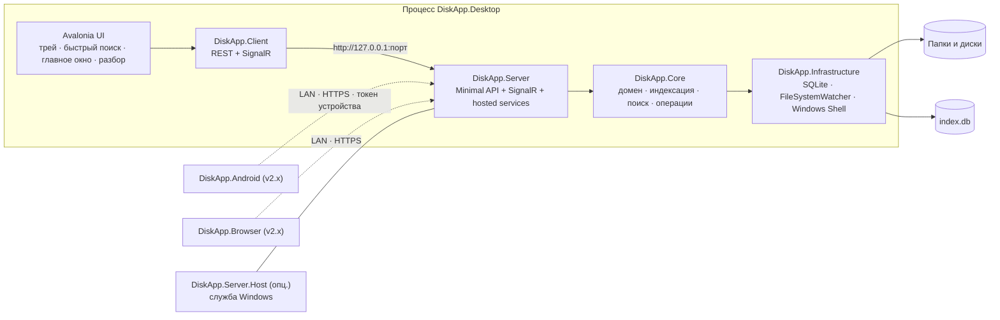
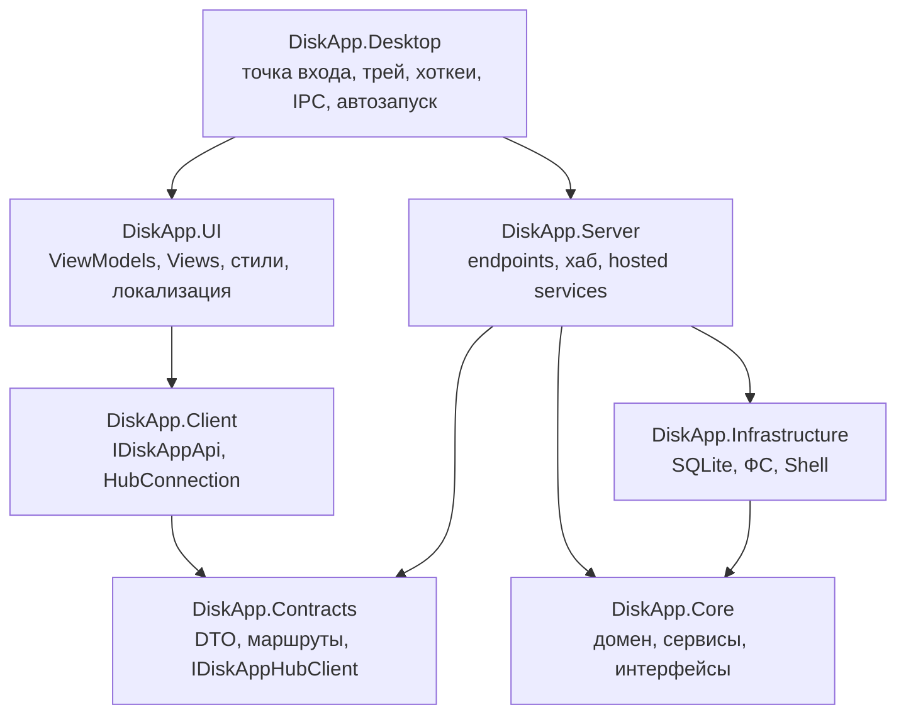
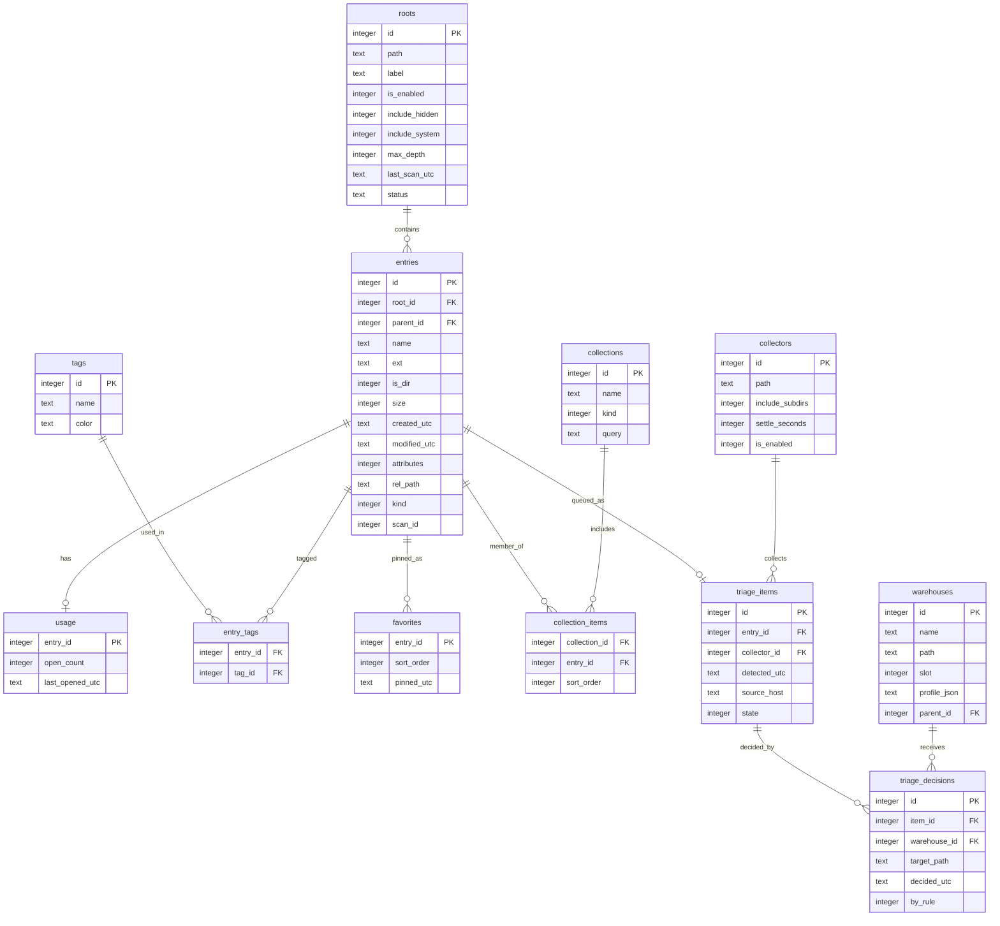
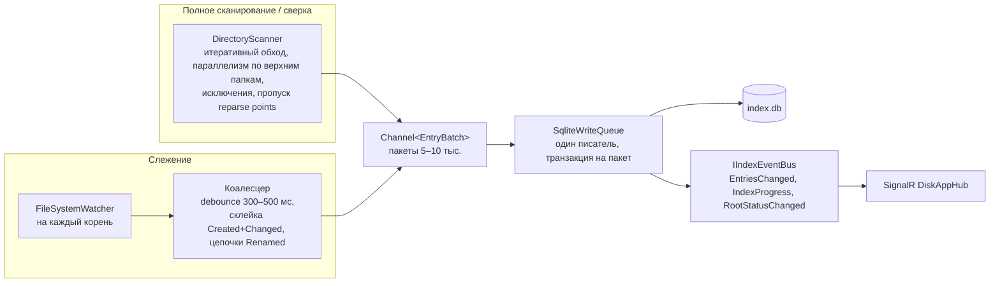

# Архитектура DiskApp

Документ описывает, как устроено приложение: процессы, проекты, данные, конвейеры индексации и поиска, API, интерфейс и платформенные сервисы. Что делает продукт — в [README.md](../README.md); почему решили именно так — в [ADR](ADR/README.md); порядок работ и критерии — в [PLAN.md](../PLAN.md).

Статус: проектная документация. Разделы помечены этапом плана, на котором появляется реализация; по мере реализации документ уточняется фактическими цифрами и схемами.

## Содержание

1. [Контекст и процессы](#1-контекст-и-процессы)
2. [Проекты и зависимости](#2-проекты-и-зависимости)
3. [Запуск десктопа](#3-запуск-десктопа)
4. [Данные](#4-данные)
5. [Индексация](#5-индексация)
6. [Поиск](#6-поиск)
7. [API и события](#7-api-и-события)
8. [Файловые операции](#8-файловые-операции)
9. [Интерфейс](#9-интерфейс)
10. [Платформенные сервисы](#10-платформенные-сервисы)
11. [Разбор входящих](#11-разбор-входящих)
12. [Резервное копирование](#12-резервное-копирование)
13. [Безопасность](#13-безопасность)
14. [Наблюдаемость и диагностика](#14-наблюдаемость-и-диагностика)
15. [Сборка и поставка](#15-сборка-и-поставка)
16. [Бюджеты и измерения](#16-бюджеты-и-измерения)

## 1. Контекст и процессы

В версии 1.0 всё работает в одном процессе `DiskApp.Desktop`: интерфейс Avalonia, клиентская библиотека и локальный сервер ASP.NET Core с ядром. Сервер слушает только `127.0.0.1` на динамическом порту. Интерфейс не вызывает ядро напрямую — только через `DiskApp.Client` по loopback, тем же путём, что и будущие удалённые клиенты.



Режимы работы сервера:

| Режим | Кто запускает | Привязка | Авторизация | Этап |
|---|---|---|---|---|
| Локальный | `DiskApp.Desktop` внутри процесса | `127.0.0.1:0` (динамический порт) | Нет (опционально токен сессии против других локальных процессов) | 4, 6 |
| Headless | `DiskApp.Server.Host` или `DiskApp.Desktop --headless` | По настройке | Как в удалённом | 4 (опц.), 13 |
| Удалённый | Тот же сервер с включённым доступом по сети | Выбранные интерфейсы LAN, фиксированный порт, HTTPS | Токены сопряжённых устройств, права на устройство | 13 |

## 2. Проекты и зависимости



Правила, которые проверяет архитектурный тест (этап 0.3):

- `Core` не ссылается ни на один проект решения и не знает об ASP.NET Core, Avalonia и SQLite.
- `UI` не ссылается на `Core` и `Infrastructure`: любой экран должен работать поверх `IDiskAppApi`, чтобы без изменений перейти на Android и в браузер.
- `Contracts` не ссылается ни на что: это общий язык сервера и клиентов.
- Платформенный код (P/Invoke, реестр, Shell) живёт в `Infrastructure` (сервисная сторона) и `Desktop` (сторона интерфейса: хоткеи, трей, IPC); `UI` остаётся кроссплатформенным.

Тест живёт в `tests/DiskApp.Core.Tests/Architecture` (и `tests/DiskApp.UI.Tests/Architecture` для правила интерфейса): он читает `ProjectReference` из всех `src/*.csproj` и сверяет их с таблицей слоёв README, а также проверяет фактические ссылки скомпилированных сборок (`GetReferencedAssemblies`). Новый проект в `src/` или новая ссылка между проектами требуют правки таблицы и теста.

Один DI-контейнер на процесс: `WebApplicationBuilder.Services` получает сервисы ядра и инфраструктуры, десктоп добавляет туда же ViewModels и свои сервисы. Это упрощает время жизни объектов и тестирование.

## 3. Запуск десктопа

Цель — иконка в трее менее чем за секунду при тёплом старте и показ окна поиска по хоткею менее чем за 100 мс. Для этого тяжёлое выполняется параллельно и лениво.

```mermaid
sequenceDiagram
    participant Main as Program.Main
    participant Paths as AppPaths / Serilog
    participant Single as Одиночный экземпляр
    participant Host as Kestrel + DI
    participant App as Avalonia App
    participant Tray as TrayIcon / хоткеи
    participant QS as QuickSearchWindow
    Main->>Paths: определить папку данных (обычная или portable), поднять логи
    Main->>Single: захватить Mutex; если занят — передать аргументы по named pipe и выйти
    Main->>Host: собрать контейнер, запустить Kestrel на 127.0.0.1:0 (в фоне)
    Main->>App: старт Avalonia (параллельно с Kestrel)
    App->>Tray: показать иконку, зарегистрировать RegisterHotKey, запустить pipe-сервер
    Host-->>App: адрес сервера готов (TaskCompletionSource)
    App->>QS: создать окно заранее и скрыть; подключить SignalR
    Note over App,QS: главное окно создаётся только при первом обращении
```

Остановка: `Exit` из трея → подтверждение при активных операциях → остановка подписок SignalR → `IHostApplicationLifetime.StopApplication()` → ожидание завершения писателя SQLite → выход.

Параметры командной строки: `--minimized`, `--show`, `--search "q"`, `--add <пути>`, `--settings`, `--portable`, `--safe-mode`, `--headless` (этап 13), а также URI `diskapp://open?path=…` и `diskapp://search?q=…`. Любой из них, полученный вторым экземпляром, пересылается первому.

## 4. Данные

### Расположение

| Режим | Папка данных |
|---|---|
| Обычный | `%LocalAppData%\DiskApp\` |
| Портативный (файл `portable` рядом с exe или флаг `--portable`) | `.\data\` рядом с exe |

Внутри: `index.db` (+ `-wal`, `-shm`), `settings.json`, `backups\`, `cache\icons\`, `cache\thumbs\`, `logs\`.

### Настройки

`settings.json` сериализуется через System.Text.Json с source generation. Файл содержит версию схемы настроек; при повышении версии выполняется миграция, при повреждении файл откладывается в `settings.corrupt-<дата>.json` и берутся значения по умолчанию. Запись атомарная: временный файл и переименование. Изменения публикуются подписчикам (аналог `IOptionsMonitor`) и в SignalR (`OnSettingsChanged`).

### SQLite

Параметры подключения: `journal_mode=WAL`, `synchronous=NORMAL`, `temp_store=MEMORY`, `cache_size=-65536` (64 МБ), `mmap_size=256 МБ`, `foreign_keys=ON`, `busy_timeout=5000`. Один писатель — `SqliteWriteQueue` поверх `Channel`, все изменения идут через него пакетами в транзакциях; чтение — из пула соединений параллельно. При старте `PRAGMA quick_check`; при сбое файл переименовывается, создаётся новый, корни помечаются на пересканирование, пользователю предлагается последняя проверенная резервная копия (этап 16.1).

Миграции — SQL-скрипты `V001__init.sql`, `V002__…` во встроенных ресурсах `DiskApp.Infrastructure`, применяются по порядку в транзакции, версия хранится в `schema_version`.

### Схема (этапы 1, 3, 8; таблицы этапов 16 и 17 отмечены)



Вне диаграммы: виртуальная таблица `entries_fts` (FTS5, `tokenize='trigram'`, external content на `entries`, синхронизируется триггерами), `query_history`, `meta`, `scan_log`, `schema_version`, а также таблицы правил разбора `triage_rules` (этап 17.5), резервных копий `backups` и заданий `backup_jobs` (этап 16).

Индексы на `entries`: `UNIQUE(root_id, rel_path)`, `(root_id, parent_id)`, `name_folded` (имя в нижнем регистре по правилам .NET — `COLLATE NOCASE` не сворачивает кириллицу, ADR-0005), `ext`, `modified_utc`, `size`, `kind`.

## 5. Индексация

Этап 2. Два источника изменений — полный обход и события файловой системы — сходятся в одном писателе.



Ключевые механизмы:

- **Mark-and-sweep.** Полное сканирование ставит на записи текущий `scan_id`; в конце записи без него удаляются. Так находятся файлы, удалённые пока приложение не работало.
- **Пропуск неизменённого.** Строка не перезаписывается, если размер и `modified_utc` совпали; меньше записи в WAL.
- **Переименование папки** — один `UPDATE` префикса `rel_path` для поддерева.
- **Переполнение буфера watcher'а** — пересканирование корня или известного поддерева с низким приоритетом.
- **Недоступный корень** (извлечён диск, пропала сеть) — состояние Offline, периодическая проверка, при возврате — сверка.
- **Облачные заглушки** (`FILE_ATTRIBUTE_RECALL_ON_DATA_ACCESS`, `OFFLINE`) — метаданные берутся, содержимое и миниатюры не читаются.
- **Приоритеты.** Изменения от watcher'а выше сверки, сверка выше полного сканирования; одна тяжёлая задача на физический диск; фоновый приоритет потока и ввода-вывода.

Состояния корня: `Online → Scanning → Online`, `Online → Paused → Online`, `Online → Offline → Scanning`, `* → Error` с сообщением и повтором по кнопке.

## 6. Поиск

Этап 3. Конвейер запроса:

1. **Парсер** превращает строку в `SearchQuery`: термы, фразы, фильтры (`ext`, `type`, `in`, `root`, `size`, `modified`, `created`, `is`, `tag`, `fav`), отрицания, опционально регулярное выражение. Ошибки терпимы: незакрытая кавычка или неизвестный фильтр становятся текстом.
2. **Планировщик** выбирает стратегию по длине терма: от трёх символов — FTS5 `MATCH` по trigram; один-два символа — префикс по индексу колонки `name_folded` (имя в нижнем регистре по правилам .NET: `COLLATE NOCASE` в SQLite не сворачивает кириллицу, ADR-0005); пустой запрос — подборка недавних и избранных.
3. **SQL** с параметрами и `WHERE` по фильтрам отдаёт ограниченный набор кандидатов (порядка 5 000) без встроенного `rank`: bm25 стоит до сотен миллисекунд на частых триграммах и не отражает полезность для имён файлов (ADR-0005).
4. **Ранжирование** в памяти: тип совпадения (точное имя > начало имени > начало слова > подстрока > нечёткое), покрытие имени, frecency `Σ log(1 + opens) · decay(дни)`, избранное, штраф за глубину, свежесть изменения; веса из настроек с пресетами; детерминированный tie-break.
5. **Подсветка** — диапазоны совпадений в имени и пути.
6. **Страница** — keyset-пагинация по `(score, id)`, приблизительное общее количество, время выполнения.

Поиск по мере ввода: клиент отменяет предыдущий запрос через `CancellationToken`; сервер прерывает SQLite по отмене; при уточнении запроса (добавлен символ) кандидаты предыдущего ответа фильтруются в памяти, пока гарантирована полнота.

## 7. API и события

Этап 4. Minimal API, префикс `/api/v1`, группы endpoints: `roots`, `index`, `search`, `entries` (включая `icon`, `thumbnail`, `content`, действия `open`/`reveal`/…), `operations`, `upload`, `favorites`, `tags`, `collections`, `settings`, `app`; позже `collectors`, `warehouses`, `triage` (этап 17), `backups`, `backup-jobs` (этап 16), `devices` (этап 13). Полный перечень маршрутов — в PLAN.md, подэтапы 4.3, 16.1, 16.2, 17.8.

Контракты в `DiskApp.Contracts`: DTO с JSON source generation, перечисления строками, camelCase, маршруты константами. Ошибки — `ProblemDetails` с кодом домена. OpenAPI документ генерируется встроенными средствами, Scalar UI включён только в Development.

SignalR: один хаб `DiskAppHub : Hub<IDiskAppHubClient>`. События: `OnIndexProgress`, `OnRootStatusChanged`, `OnEntriesChanged` (пакетами, батчинг 250 мс), `OnOperationProgress`, `OnOperationCompleted`, `OnOperationNeedsDecision`, `OnSettingsChanged`; позже `OnTriageQueueChanged`, `OnTriageDecisionApplied`, `OnWarehousesChanged`, `OnBackupProgress`, `OnBackupCompleted`. При переподключении клиент получает текущий статус индекса и активные операции.

Клиент (`DiskApp.Client`): `IDiskAppApi` над `HttpClient` с устойчивостью (повторы только для идемпотентных GET), `DiskAppHubConnection` с автоматическим переподключением и ресинхронизацией. Платформенного кода в клиенте нет.

## 8. Файловые операции

Этап 4.5. `FileOperationService` владеет очередью операций (copy, move, rename, delete, create-folder, create-file, upload) с состояниями `Queued → Running → Completed | Failed | Cancelled` и паузой `WaitingDecision` для конфликтов в режиме Ask. Прогресс — файлы, байты, текущий файл, скорость, оценка времени — публикуется через шину и SignalR.

Правила: перемещение в пределах тома — `File.Move`, между томами — копирование с проверкой и удаление; удаление — только в корзину через `IFileOperation` с `FOF_ALLOWUNDO`, безвозвратное — отдельный явный флаг; конфликты — Ask / Skip / Overwrite / KeepBoth; undo для rename, move и create в рамках сессии; индекс обновляется сразу после операции, не дожидаясь watcher'а. Операции разбора входящих (этап 17) и заданий резервного копирования (этап 16.2) используют тот же сервис.

## 9. Интерфейс

Этапы 6–9. `DiskApp.UI` — общий Avalonia-проект: `ViewModels/` (CommunityToolkit.Mvvm), `Views/`, `Controls/`, `Services/` (навигация, диалоги, InfoBar, диспетчер), `Styles/` (дизайн-токены), `Localization/` (`.resx` RU и EN). `DiskApp.Desktop` добавляет окна и платформенное: трей, хоткеи, IPC, автозапуск. Класс приложения `App` (тема `FluentAvaloniaTheme`, ресурсы) тоже лежит в `DiskApp.UI`, чтобы его переиспользовали Android и Browser; десктоп создаёт `ClassicDesktopStyleApplicationLifetime` явно в `Program` и сам назначает окна, поэтому `App` не знает о `MainWindow`.

Окна:

| Окно | Назначение | Особенности |
|---|---|---|
| `QuickSearchWindow` | Быстрый поиск | Без рамки, поверх всех, Acrylic, скруглённые углы через DWM, создаётся заранее, скрывается по `Esc` и потере фокуса |
| `TriageWindow` | Сессия разбора входящих (этап 17) | Тот же стиль; склады кнопками с закреплёнными номерами |
| `MainWindow` | Главное окно | `NavigationView`, собственный заголовок, Mica, запоминает размер и монитор |

Стиль Windows 11: FluentAvaloniaUI (`PreferSystemTheme`, `PreferUserAccentColor`), `TransparencyLevelHint` Mica → Acrylic → сплошной цвет, радиусы 8 px у окон и 4 px у контролов, Segoe UI Variable с fallback, Segoe Fluent Icons / FluentIcons, анимации 150–250 мс с учётом системного «уменьшить движение». Виртуализация во всех списках, LRU-кэш растровых иконок и миниатюр.

Прототип интерфейса (2026-10-10) собран до ядра на макетных данных: `ISearchService` с реализацией `SampleSearchService` в `DiskApp.UI` заменяется обёрткой над `IDiskAppApi` в этапе 5, интерфейс при этом не меняется. Команды оболочки (`IAppCommands`: показать поиск, главное окно, страницу по ключу) реализует `DesktopShell` в `DiskApp.Desktop`, который владеет треем, хоткеем и окнами и разбирает аргументы запуска (`StartupArguments`). `MainWindow` наследует `FAAppWindow` FluentAvalonia (заголовок и системные кнопки в стиле Windows 11), Mica включает `Backdrop.ApplyMica` с fallback на сплошной цвет темы; `QuickSearchWindow` — окно без рамки с `ExperimentalAcrylicBorder` и скруглением через `DwmSetWindowAttribute`. Страницы подбираются по `DataTemplate` из `App.axaml`, без рефлексии; подсветка совпадений — контрол `HighlightTextBlock`.

## 10. Платформенные сервисы

| Интерфейс (Core) | Windows-реализация | Где живёт | Этап |
|---|---|---|---|
| `IPlatformShell` | `ShellExecuteEx`, `SHOpenWithDialog`, `SHOpenFolderAndSelectItems`, `IFileOperation`, буфер обмена с `DataFormats.Files` | Infrastructure | 7 |
| `IIconProvider` | `SHGetFileInfo`, `IShellItemImageFactory`, кэш PNG на диске | Infrastructure | 7 |
| `IGlobalHotkeyService` | `RegisterHotKey`, приём `WM_HOTKEY` собственным message-only окном (`MessageWindow`, `CreateWindowEx` с `HWND_MESSAGE`); `Win32Properties` в Avalonia 12 нет | Desktop | 6 |
| Трей | Avalonia `TrayIcon` + `NativeMenu` | Desktop | 6 |
| Одиночный экземпляр, IPC | `Mutex` + `NamedPipeServerStream` | Desktop | 6 |
| Автозапуск | `HKCU\…\CurrentVersion\Run` | Desktop | 6 |
| Интеграции оболочки | `shell:sendto`, `HKCU\Software\Classes\*\shell\DiskApp`, протокол `diskapp://` | Desktop | 8 |
| Quick Switch диалогов | Win32 (`#32770`, `WM_SETTEXT`) или UI Automation, за флагом | Desktop | 8 |
| Источник файла | Поток `Zone.Identifier` (`HostUrl`, `ReferrerUrl`) | Infrastructure | 17 |
| `IUserActivityMonitor` | `GetLastInputInfo`, `SHQueryUserNotificationState`, `GetForegroundWindow` + класс процесса, `CapabilityAccessManager\ConsentStore` (микрофон, камера), `WTSRegisterSessionNotification` (блокировка сеанса), `GetSystemPowerStatus` | Desktop | 17 |

Для Linux и macOS (этап 12.7) предусмотрены реализации на `xdg-open` / `open`, SharpHook для хоткеев и корзина по спецификации freedesktop / Finder; интерфейс и клиент не меняются.

## 11. Разбор входящих

Этап 17. Модель «общий склад → профильные склады»:

- **`Collector`** (общий склад) — папка под присмотром; новые файлы после «времени успокоения» попадают в очередь `triage_items` с источником и признаками.
- **`Warehouse`** (профильный склад) — именованное назначение с профилем (виды, расширения, ключевые слова, домены), закреплённым номером 1–9, шаблоном подпапки и, при каскаде, своим набором складов.
- **`TriageService`** считает подсказки (правила → профиль → история решений → недавние склады → остальные по номерам), исполняет решения через `FileOperationService`, пишет журнал решений с отменой и обучает счётчики признаков.
- **Правила** (`triage_rules`) — условия → действие → режим (автоматически или только предлагать); создаются из решений.
- **Напоминания** — планировщик «умного момента» (`TriageReminderScheduler`) на стороне интерфейса: поводы (новые файлы, порог, расписание, давность) ставят заявку; детектор занятости `IUserActivityMonitor` (простой ввода, `SHQueryUserNotificationState`, звонок по микрофону или камере, категория активного окна, блокировка сеанса) решает, хороший ли момент; умная отсрочка с нарастанием, лимиты частоты, эскалация бейдж → тихое уведомление → `InfoBar`, обучение по реакциям. Без модальных окон и звука.

Интерфейс: `TriageWindow` для сессии и страница «Входящие» как центр управления. Подсказки объяснимы: рядом с каждой — причина.

## 12. Резервное копирование

Этап 16. `BackupService` делает консистентный снимок `index.db` через SQLite Online Backup API (`SqliteConnection.BackupDatabase`) без остановки индексации, упаковывает его с `settings.json` и `manifest.json` (версии, контрольные суммы) в zip, при необходимости шифрует AES-256 с ключом из пароля пользователя. Расписание, несколько назначений, ретенция (N последних или GFS), страховочные копии перед миграцией, пересборкой и восстановлением, проверка целостности перед восстановлением, выборочное восстановление, JSON-экспорт метаданных.

Задания резервного копирования файлов (16.2) — модель «источник → назначение → режим (зеркало, версии, снимок) → расписание → хранение», инкрементальность по индексу, исполнение через `FileOperationService`, журнал запусков и восстановление байт-в-байт.

## 13. Безопасность

Локальный режим (1.0): сервер слушает только loopback; CORS выключен; за флагом — токен сессии в заголовке `X-DiskApp-Token`, известный только десктопу. Все пути из запросов нормализуются и проверяются на принадлежность разрешённым корням (запрет `..`, проверка выхода через символические ссылки). Лимиты размеров запросов и загрузок. В логах нет содержимого файлов и секретов.

Удалённый режим (этап 13): HTTPS с самоподписанным сертификатом и пиннингом отпечатка в клиентах; сопряжение по QR с одноразовым кодом; подписанные отзываемые токены устройств; права на устройство (только чтение, разрешённые корни, загрузка, удаление); rate limiting; журнал доступа; блокировка после неудачных попыток; модель угроз в `docs/SECURITY.md`.

## 14. Наблюдаемость и диагностика

Serilog пишет структурные логи в `logs\diskapp-<дата>.log` с ротацией по дням и ограничением размера; уровень настраивается. Глобальные обработчики исключений (AppDomain, TaskScheduler, Avalonia) логируют и показывают окно «Что-то пошло не так» с кнопкой «Собрать диагностический архив» (логи, настройки без секретов, версия, окружение). Endpoint `/health`. Телеметрии нет. Режим `--safe-mode` отключает автоиндексацию и интеграции для разбора проблем.

## 15. Сборка и поставка

Этапы 0 и 11. `.slnx`, `Directory.Build.props` (net10.0, nullable, warnings as errors, анализаторы `latest-recommended`, стиль из `.editorconfig` при сборке), `Directory.Packages.props` (центральные версии). Тесты — xunit v3 на Microsoft.Testing.Platform (`global.json` → `test.runner`): отчёты TRX и покрытие дают расширения `Microsoft.Testing.Extensions.TrxReport` и `CodeCoverage`, а не VSTest-коллекторы. CI — GitHub Actions на `windows-latest`: restore, build Release, test, `dotnet format --verify-no-changes`, результаты тестов и покрытие. Публикация — self-contained, single-file, ReadyToRun для `win-x64` и `win-arm64`; версия из git (MinVer). Установщик и дельта-обновления — Velopack с GitHub Releases как источником; портативная сборка — zip с файлом `portable`.

## 16. Бюджеты и измерения

Бюджеты производительности и способы измерения — в PLAN.md, раздел 8. Результаты фактических замеров (дата, конфигурация машины, цифры) записываются сюда по итогам этапов 0.6 (спайки), 3.6, 4.7 и 10.1.

| Дата | Конфигурация | Метрика | Результат |
|---|---|---|---|
| 2026-10-10 | Ноутбук разработчика: Windows 11, 22 CPU, SSD, .NET 10.0.12, Release framework-dependent, тёплый старт | Старт до иконки в трее | 917 мс (вход в `Main` 146 мс, Avalonia готова 601 мс) |
| 2026-10-10 | то же | Главное окно открыто | 1 482 мс |
| 2026-10-10 | то же | Показ окна поиска до первого кадра | 82 мс первый показ, 1 мс последующие |
| 2026-10-10 | то же | Второй экземпляр: `Main` → аргументы переданы → выход | ≈ 50 мс |
| 2026-10-10 | то же, спайк S3 | Старт Kestrel + SignalR (`CreateSlimBuilder`, холодный) | 138 мс, рабочий набор +17 МБ |
| 2026-10-10 | то же, спайк S3 | Loopback: HTTP GET / SignalR Invoke / push сервер→клиент, медиана | 0,12 / 0,16 / 0,17 мс |
| 2026-10-10 | то же, спайк S4, SQLite 3.53.3 | Вставка 1 млн записей, FTS по имени | 7,7 с (129 тыс. строк/с), файл 161 МБ |
| 2026-10-10 | то же, спайк S4 | Вставка 1 млн записей, FTS по имени и пути | 16,5 с (60 тыс. строк/с), файл 334 МБ |
| 2026-10-10 | то же, спайк S4 | Поиск от 3 символов, trigram `MATCH` (`COUNT`) | 0,6–5 мс при 9–35 тыс. совпадений |
| 2026-10-10 | то же, спайк S4 | Поиск по 2 символам (полный скан `LIKE`) | 140–390 мс — вне бюджета, см. ADR-0005 |
